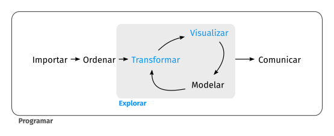

```{r}
#| label: setup
#| include: false
#| eval: true

# Elimino todo del Entorno
rm(list = ls())

# Cargo bibliotecas necesarias
library(tidyverse)
library(kableExtra)
```

```{r}
#| label: generar-datos
#| echo: false
#| eval: true

source("Tema04datos.R")
```


# El AED: de los datos en bruto a la decisión

## ¿Qué es el AED y para qué sirve?

:::: {.columns}
::: {.column width=40%}

{fig-align="center"}

:::
::: {.column width=60%}

::: {style="font-size: 92%;"}

Del fichero recibido a la decisión informada, con dos objetivos:

1. **Conocer los datos y su calidad**: qué mide cada variable, qué falta, qué está mal, qué no es comparable

2. **Describir con propósito**: los patrones que responden a una pregunta económica concreta

**No hay receta**: depende de los datos y del objetivo, y es iterativo.

:::
:::
::::

- **Es un problema económico, más que informático**: una decisión se toma sobre un **número** (un margen, una tasa de paro, un ticket medio), y ese número hereda los defectos de los datos

  - Si el 30% de los clientes insatisfechos no contesta la encuesta, la satisfacción media mide la de quienes contestan

- **Cada decisión de limpieza es un supuesto** sobre cómo se generaron los datos: se escribe, se justifica y se puede deshacer

::::{.notes}
- Recordad el Tema 03: 80% del tiempo es trabajo "sucio". El AED es donde ese 80% se convierte en decisiones documentadas.
- Otro ejemplo: si un vendedor declara su facturación en miles y otro en euros, la "empresa más grande" del ranking puede ser la más pequeña.
- "Garbage in, garbage out" es real, pero el mensaje útil es el otro: la limpieza es modelización implícita.
- Ejemplo típico de consultoría: dos informes con cifras distintas porque uno deduplicó y el otro no.
::::

## Caso del curso: el marketplace *MercadoLocal*

:::: {.columns}
::: {.column width=49%}
::: {.callout-note appearance="simple" icon=false}
::: {style="font-size: 130%;"}

**El negocio**

- Plataforma que conecta pequeños comercios con compradores en el Levante y Madrid

- Dirección quiere responder a tres preguntas:

  1. ¿Cuánto gasta un cliente típico y en qué canal?

  2. ¿Qué vendedores son más productivos?

  3. ¿Crecemos o solo es la campaña de Navidad?

:::
:::
:::
::: {.column width=2%}
:::
::: {.column width=49%}
::: {.callout-note appearance="simple" icon=false}
::: {style="font-size: 130%;"}

**Tablas disponibles**

- `pedidos_bruto`: una fila por pedido, tal y como sale del sistema

- `vendedores`: una fila por comercio, con datos de un formulario que rellenan ellos mismos

- `serie_ventas`: ventas mensuales agregadas, 2023-2025

- `ventas_prov` y `devoluciones`: resúmenes ya agregados (ventas por provincia; devoluciones por canal y categoría)

:::
:::
:::
::::

- Datos: `marketplace.RData`, en la página [Datos](../Datos.html). Al final del tema, un caso con datos del INE

::: {.callout-important}
El **ejercicio del tema** se hace **durante estas clases**: [Tema 04 - Ejercicios del tema](Tema04ej1.html).
Sus cuatro entregas corresponden a las tres PRÁCTICAS más una con datos del INE.
:::

## Los datos tal y como llegan

```{r}
pedidos_bruto |> glimpse()
```

::: {style="font-size: 88%;"}

| variable      | qué debería ser        | qué llega                             |
|---------------|------------------------|---------------------------------------|
| `fecha`       | fecha                  | texto en DOS formatos distintos       |
| `importe`     | número (euros)         | texto con coma decimal y punto de miles |
| `canal`       | factor de 3 niveles    | texto con mayúsculas y espacios       |
| `cp_envio`    | texto de 5 dígitos     | número (ha perdido el cero inicial)   |
| `valoracion`  | 1 a 10, o ausente      | incluye el valor centinela `-99`      |
| `descuento`   | 0 a 1, o "sin promoción" | `NA` con DOS significados distintos |

:::

- Ninguno de estos problemas da un error al importar: el fichero se lee "bien" y todo parece correcto

::::{.notes}
- Insistir: R no protesta. El error aparece tres semanas después en una cifra del informe.
::::


# Parte I. Detectar los problemas de calidad

## Un protocolo de reconocimiento

- Antes de tocar nada, cuatro preguntas siempre iguales:

  1. **Tamaño y unidad de observación**: ¿cuántas filas y qué es una fila? ¿coincide con lo que esperábamos?

  2. **Tipos**: ¿cada variable tiene el tipo que corresponde a lo que mide?

  3. **Rango y categorías**: ¿los valores son posibles? ¿las categorías son las del diccionario?

  4. **Ausencias**: ¿dónde falta información y por qué?

```{r}
dim(pedidos_bruto)             # ¿1200 pedidos? ¿o más?
n_distinct(pedidos_bruto$id_pedido)   # ¿la clave identifica las filas?

pedidos_bruto |> count(canal)  # categorías realmente presentes
summary(pedidos_bruto)         # rangos y NAs de las numéricas
modelsummary::datasummary_skim(pedidos_bruto)   # todo de un vistazo
```

- El **diccionario de variables** (qué mide, en qué unidades, qué valores admite) es parte de los datos: si no viene, hay que pedirlo o reconstruirlo

- Hay informes completos automáticos (`DataExplorer::create_report()`): mucho ruido, no conocen el contexto y no distinguen un error de un dato extremo legítimo. La decisión sigue siendo vuestra. Más herramientas, en el [anexo](Tema04anexo.html)


::::{.notes}
- `dim()` frente a lo esperado detecta duplicados y filtros silenciosos del sistema de origen.
- `n_distinct` de la clave frente a `nrow`: primera comprobación siempre.
- `datasummary_skim(pedidos_bruto)` avisa de que omite `id_pedido`, `fecha`, `id_cliente`, `id_vendedor` e `importe` por tener más de 50 niveles: `importe` aparece como texto, que es el Problema 1 (comprobado el 19-oct-2026).
- Estos recuentos ya son análisis de variación (Parte II): muchos problemas solo aparecen al ver la distribución; en los datos en bruto no se ven.
::::

## Problema 1: cada variable, con el tipo de lo que mide

- El tipo lo decide **lo que mide** la variable, no cómo se ha leído:

  - **Cantidades** → número. `importe` llega como texto con formato español (`"1.234,56"`): no da error, pero no se puede sumar

  - **Códigos e identificadores** → texto. `cp_envio` llega como número y pierde el cero (3003 por "03003"); su media no tiene sentido

  - **Categorías** → factor, vengan como texto (`canal`, `sector`) o como números (en la EPA, `SEXO1` vale 1 o 6). Se convierten después de corregir sus erratas (Problema 3)

  - **Fechas** → fecha (Problema 2)

```{r}
pedidos <- pedidos_bruto |>
  mutate(importe  = parse_number(importe, locale = locale(decimal_mark = ",")),
         cp_envio = str_pad(cp_envio, 5, pad = "0"))     # 3003 -> "03003"
```

::::{.notes}
- `mean(pedidos_bruto$importe)` da NA con aviso: es texto.
- `parse_number()` frente a `as.numeric()`: el segundo devuelve NA silenciosamente con "1.234,56".
- Con `decimal_mark = ","`, `locale()` ya supone que el separador de miles es el punto.
- Al importar se puede fijar el tipo por columna (`col_types` en `read_csv`): mejor que corregir después.
- Un código numérico de categorías (1 = hombre, 6 = mujer) tratado como número da medias sin sentido y regresiones absurdas.
::::

## Problema 2: fechas

- Una fecha en texto se ordena alfabéticamente: `"04/03/2025"` va antes que `"12/01/2024"`

- El riesgo real es la **ambigüedad**: `03/04/2025` es 3 de abril en España y 4 de marzo en EE.UU.

```{r}
pedidos_bruto |> count(str_detect(fecha, "/"))   # ¿cuántos de cada formato?
```

- Con dos formatos mezclados, `parse_date_time()` (del paquete `lubridate`, que viene con el `tidyverse`) prueba los órdenes que le digamos: día-mes-año y año-mes-día

```{r}
pedidos <- pedidos |>
  mutate(fecha = as_date(parse_date_time(fecha, orders = c("dmy", "ymd"))))

sum(is.na(pedidos$fecha))     # comprobación: ninguna fecha sin convertir
```

- Comprobar siempre el **rango**: fechas anteriores al inicio del negocio o posteriores a hoy son errores

```{r}
range(pedidos$fecha)
```

::::{.notes}
- Con un solo formato basta `dmy()` o `ymd()`. Sin `lubridate`: `if_else(str_detect(fecha, "/"), as.Date(fecha, format = "%d/%m/%Y"), as.Date(fecha, format = "%Y-%m-%d"))`, mismo resultado (comprobado el 19-oct-2026).
- `parse_date_time()` devuelve fecha y hora; `as_date()` se queda con la fecha.
- Un `NA` tras convertir es información: dice qué filas no encajaban en el formato supuesto.
::::

## Problema 3: categorías con erratas

- Las mismas categorías escritas de formas distintas se cuentan como distintas: el `group_by()` del Tema 03 obedece al texto, no a la intención

```{r}
pedidos |> count(canal)              # "web", "WEB", " web ", ...
vendedores |> count(provincia)       # "Valencia" y "València"
```

- Homogeneizar es una **decisión**: estamos afirmando que dos etiquetas son la misma cosa

```{r}
pedidos <- pedidos |>
  mutate(canal = str_trim(str_to_lower(canal)),
         canal = parse_factor(canal, levels = c("web", "app", "tienda")))

vendedores <- vendedores |>
  mutate(provincia = str_trim(str_to_title(provincia)),
         provincia = fct_recode(provincia, "Valencia" = "València"))
```

- Después, **volver a contar**: si aparece un nivel `NA`, es que había una categoría que no estaba en nuestra lista. Ya limpias, las demás categorías pasan a factor, varias a la vez con `across()` (Tema 03)

```{r}
pedidos |> count(canal)
vendedores <- vendedores |> mutate(across(c(provincia, sector), as.factor))
```

::::{.notes}
- `str_trim()` quita los espacios de los extremos (`" web "`, 252 pedidos); `str_squish()` además deja un solo espacio entre palabras. Aquí basta el primero.
- Cuidado con acentos y con "Otros"/"otro"/"OTROS" al agrupar categorías raras.
::::

## Problema 4: unidades mezcladas

- Los vendedores rellenan su facturación anual en un formulario libre: unos ponen euros y otros miles de euros. Cada fila está medida en una escala distinta

::: {.panel-tabset}

### Detectar

```{r}
summary(vendedores$facturacion_anual)

ggplot(vendedores, aes(x = facturacion_anual)) +
  geom_histogram(bins = 30) + scale_x_log10()

vendedores |> mutate(fact_por_empleado = facturacion_anual / empleados) |>
  arrange(fact_por_empleado) |> head(5)
```

- Por **órdenes de magnitud** y, mejor, contrastando con una variable relacionada: 200 euros por empleado y año es económicamente imposible. Es otra unidad

### Decidir

- La corrección necesita una **regla** escrita, no un ojo clínico

```{r}
vendedores <- vendedores |>
  mutate(
    # regla: una facturación por empleado por debajo de 5.000 euros al año
    # es imposible en este sector; esa fila estaba declarada en miles
    fact_empleado = facturacion_anual / empleados,
    facturacion_eur = if_else(fact_empleado < 5000,       # if_else(condición,
                              facturacion_anual * 1000,   #   si se cumple,
                              facturacion_anual)          #   si no)
  )

vendedores |> summarize(min = min(facturacion_eur / empleados),
                        max = max(facturacion_eur / empleados))
```

- El umbral es un supuesto: hay que escribirlo, y comprobar que ningún caso queda cerca del corte

:::

::::{.notes}
- El histograma en logaritmos muestra DOS montañas separadas por tres órdenes de magnitud.
- Comprobar sensibilidad: ¿cambia el resultado si movemos el umbral a 3.000 o a 8.000? Si cambia mucho, el umbral es un supuesto fuerte que hay que discutir.
::::

## Problema 5: duplicados

- Hay dos tipos y no significan lo mismo

  1. **Filas idénticas**: casi siempre un fallo de exportación o de carga

  2. **Clave repetida con contenido distinto**: dos versiones del mismo hecho

```{r}
sum(duplicated(pedidos))                       # filas completas repetidas

pedidos |> count(id_pedido) |> filter(n > 1)   # clave repetida
```

- Antes de borrar, hay que **mirar** las filas en conflicto: en nuestro caso, el mismo pedido aparece con y sin IVA

```{r}
pedidos |> group_by(id_pedido) |> filter(n() > 1) |>
  arrange(id_pedido) |> select(id_pedido, fecha, importe)
```

- Los 23 registros repetidos son menos del 2% de las filas: inflan los ingresos sin que nada falle

::::{.notes}
- Para la puesta en común de la Práctica 2: con los duplicados de clave la regla depende de la pregunta. Si el conflicto es "con IVA" frente a "sin IVA", quedarse con el menor es elegir la definición del ingreso.
- `duplicated()` sobre todas las columnas; `distinct(id, .keep_all = TRUE)` se queda con la PRIMERA, que no tiene por qué ser la buena.
- Preguntar al origen del dato es parte del trabajo.
::::

## Problema 6: dónde falta información

- `summary()` dice cuántos ausentes hay en cada variable numérica (`NA's`)

```{r}
summary(pedidos)
# todas las columnas, también las de texto
pedidos |> summarize(across(everything(), ~ sum(is.na(.x))))
```

- Y deja ver los ausentes **disfrazados**: códigos centinela que R lee como números válidos. El mínimo de `valoracion` es `-99`, en una escala de 1 a 10

- Un `-99` no declarado contamina toda la descriptiva: entra en la media, en la desviación típica y en el gráfico

```{r}
pedidos <- pedidos |> mutate(valoracion = na_if(valoracion, -99))
```

::::{.notes}
- Con el `-99` dentro, la valoración media sale -14,37; con `na_if()`, 7,87 (comprobado el 19-oct-2026).
- `count(valoracion)` también lo enseña.
- Centinelas habituales en microdatos: -9, -99, 999, 9999, "NS/NC", 88 y 99 en escalas de 1 a 10.
- El diccionario de la encuesta los declara: por eso hay que leerlo.
::::

## PRÁCTICA en clase (1): auditoría de calidad

Trabajad con `pedidos_bruto` y `vendedores`. En 25 minutos, y **sin corregir nada todavía**, elaborad un informe de una página con:

1. Número de filas y comprobación de si `id_pedido` identifica de forma única cada pedido

2. Lista de variables cuyo tipo NO corresponde a lo que miden, con el problema concreto de cada una

3. Recuento de las categorías realmente presentes en `canal` y en `provincia`, señalando cuáles son la misma cosa

4. Número de ausentes por variable, distinguiendo los `NA` de los códigos centinela

5. Para CADA problema detectado, una frase: qué cifra del informe final quedaría mal si no lo corregimos

<!-- INTERNO (solución y guion del profesor):
1) nrow(pedidos_bruto) = 1223 frente a los 1200 esperados: 15 duplicados exactos + 8 de clave.
   pedidos_bruto |> count(id_pedido) |> filter(n > 1)  -> 23 filas afectadas.
2) fecha (texto, dos formatos), importe (texto con coma decimal), canal (texto sin homogeneizar),
   cp_envio (numérico, debería ser texto de 5 dígitos), valoracion (contiene -99),
   devuelto es lógico y está bien.
3) pedidos_bruto |> count(canal) da 9 etiquetas para 3 categorías;
   vendedores |> count(provincia) da 10 etiquetas y mezcla mayúsculas, espacios sobrantes y
   "València"/"Valencia".
4) summary(pedidos_bruto) da 865 NA en descuento y 209 en valoracion, y el minimo -99 de
   valoracion; count(valoracion) dice que son 211 filas con -99, que NO aparecen como NA.
   Ojo: los NA de descuento son ESTRUCTURALES (sin promoción); los de valoracion, no.
5) Respuestas esperadas: ingresos totales inflados por duplicados; ticket medio imposible de
   calcular (texto); ventas por canal repartidas entre nueve categorías; valoración media
   hundida por los -99; mapa por CP con provincias mal asignadas.
Errores típicos que quiero provocar: usar as.numeric() sobre importe (todo NA) y creer que
count(is.na(valoracion)) basta para las ausencias.
-->


::: {.callout-note}
**Ahora el ejercicio 1**, los cinco apartados: es esta misma auditoría, apartado por apartado.
:::

# Parte I (b). Decidir qué hacer

## Ausentes: por qué faltan

- Contarlos es el primer paso. Lo que decide qué hacer con ellos es **por qué** faltan. Tres mecanismos:

  1. **Por azar**: un fallo del servidor un martes. Quedarse con los casos completos solo reduce la muestra

  2. **Según algo que observamos**: los clientes de más edad contestan menos las encuestas por la app. Se corrige condicionando en esa variable (comparando dentro de cada grupo de edad)

  3. **Según el propio valor que falta**: el cliente enfadado no contesta la encuesta. La valoración media observada mide la satisfacción **de los que contestan**

::::{.notes}
- El tercero es el habitual en economía: en una encuesta de presupuestos familiares, las rentas altas responden menos y la renta media observada queda por debajo de la real. Ninguna limpieza corrige ese sesgo.
- Nombres técnicos, por si los ven en un manual: MCAR, MAR y MNAR (*missing completely at random*, *at random*, *not at random*).
- En nuestros datos la valoración media de la población es 7,5 y la de quienes responden sale 7,87. Esa diferencia no la corrige ninguna limpieza.
- Si preguntan cómo sabemos la media de la población: estos datos son simulados.
- Esto es sesgo de selección, el mismo problema conceptual que veremos con la muestra en el Tema 05.
- En la práctica el sesgo no se puede medir, solo acotar con supuestos. Por eso la no respuesta es informativa y conviene guardarla (indicador de la transparencia siguiente).
::::

## Ausentes: ¿y qué hacemos?

::: {style="font-size: 95%;"}

- Primero, el **ausente estructural**: `descuento = NA` significa "sin promoción". El valor correcto es 0

```{r}
pedidos <- pedidos |> mutate(descuento = replace_na(descuento, 0))
```

- Para los ausentes de verdad (`valoracion`), tres opciones:

::: {.panel-tabset}

### 1. Eliminar

- `drop_na()`: válido si la ausencia es por azar. Si depende del valor, se elimina justo al cliente que interesa (el enfadado)

### 2. Imputar

- Sustituir el `NA` por un valor estimado. Mantiene el tamaño muestral, pero inventa variación: la dispersión sale menor que la real

- Con la **media (o mediana) de todos**: a quien calla se le asigna la nota de los que hablan. Si los que callan son distintos en todo lo demás, es la peor opción

- Con la **media condicional**: la de los clientes parecidos (mismo canal, misma categoría). Es la idea de la regresión (Tema 05)

### 3. Indicador de ausencia

- Guardar quién no contesta y analizarlo. El sesgo sigue ahí, pero a la vista: ¿gastan distinto?, ¿devuelven más?

```{r}
pedidos <- pedidos |> mutate(sin_valoracion = is.na(valoracion))

pedidos |> group_by(sin_valoracion) |>
  summarize(n = n(), importe_medio = mean(importe),
            tasa_devol = mean(devuelto))
```

:::

:::

::::{.notes}
- Antes de imputar, volver a la transparencia anterior: imputar un ausente estructural (`descuento`) convierte un 0 en la media de las promociones.
- Imputar la media de todos deja la media igual, baja la desviación típica y atenúa cualquier correlación de `valoracion` con el resto.
- La media condicional es $E[Y \mid X]$, comparar *ceteris paribus*: una imputación por regresión; con dos variables es lo que da `lm()` en el Tema 05. Existe también la imputación múltiple (`mice`), fuera del curso.
- Con el indicador: si los pedidos sin valoración tienen importe o tasa de devolución distintos, la no respuesta es informativa (mecanismo 3) y hay que decirlo en el informe.
- El flujo de limpieza de después de la Práctica 2 usa `replace_na(descuento, 0)`; `sin_valoracion` se deja como opción, el ejercicio solo pide razonarlo (Entrega 1, d.4).
::::

## Atípicos: detectar

- Un valor atípico es el que queda lejos del resto. Atípico **no** significa malo ni erróneo

- **No hay una regla aceptada** para detectarlos. El diagrama de caja aplica una **convención**: más de 1,5 veces el rango intercuartílico por debajo de Q~1~ o por encima de Q~3~

```{r}
ggplot(pedidos, aes(y = importe)) + geom_boxplot()
```

- Otras convenciones son igual de defendibles: el 5% (o el 1%) de cada cola, o más de tres desviaciones típicas de la media

- Aquí la del diagrama de caja marca 77 pedidos, más del 6% de la muestra. Con asimetría (renta, ventas, tamaño de empresa) esa convención señala como atípica una cola derecha normal

::::{.notes}
- El 1,5 x IQR es la regla de Tukey, pensada para distribuciones aproximadamente simétricas.
- Los límites, por si los piden (77 pedidos por encima de `sup`):

```r
lim <- pedidos |>
  summarize(q1 = quantile(importe, 0.25), q3 = quantile(importe, 0.75)) |>
  mutate(iqr = q3 - q1, inf = q1 - 1.5 * iqr, sup = q3 + 1.5 * iqr)
pedidos |> filter(importe > lim$sup) |> count()
```

- En logaritmos (`ggplot(pedidos, aes(x = importe)) + geom_histogram(bins = 40) + scale_x_log10()`) la mayoría de esos "atípicos" desaparecen: era la asimetría, no un error.
::::

## Atípicos: decidir

- Dos tipos:

  1. **Errores en los datos** (una coma mal puesta): detectarlos, entender por qué, y corregirlos o eliminarlos documentándolo

  2. **Valores legítimos**: de la misma población (un mayorista), eliminarlos destruye información; de otra población (un cliente B2B entre minoristas), se analizan aparte

- ¿Cuándo es uno y cuándo otro? **No hay regla mecánica**: hay que entender los datos y saber de qué van. La IA tampoco lo resuelve, porque no sabe cómo se generaron

```{r}
pedidos |> arrange(desc(importe)) |>
  select(id_pedido, canal, unidades, importe) |> head(6)
```

- 4.729 euros con 3 unidades: coma mal puesta. 4.974 euros con 90 unidades: mayorista

- Si se conservan: analizar en logaritmos, usar la mediana, o **winsorizar** (sustituir los valores que pasan el umbral usado para detectarlos por el propio umbral), declarándolo

::::{.notes}
- El contraste con otra variable (unidades frente a importe) es lo que distingue el error del caso real. Es lo que pide el punto 5 de la Práctica 2 y el apartado e) de la Entrega 2.
- En economía las colas son el fenómeno: pocas empresas concentran la mayor parte de las exportaciones o del empleo. Recortar la cola por comodidad estadística elimina el objeto de estudio.
- El umbral de winsorizar es el de la convención de detección: con la del diagrama de caja, Q~3~ + 1,5 x IQR por arriba y Q~1~ - 1,5 x IQR por abajo; con la de las colas, los percentiles 99 y 1 (o 95 y 5). Recortar es eliminar esos valores. Las dos cosas se declaran en el informe.
::::

## PRÁCTICA en clase (2): limpiar y justificar

Sobre la auditoría de la práctica anterior, en 30 minutos:

1. Escribid un único bloque de limpieza que corrija tipos, categorías y ausentes centinela, y elimine los duplicados exactos

2. Comprobad el resultado: filas antes y después, tipos, recuento de `canal` y rango de `fecha`

3. Calculad los **ingresos totales** y el **ticket medio** antes y después de eliminar los duplicados exactos. ¿En cuántos euros y en qué porcentaje cambia la cifra que iría al informe?

4. Decidid qué hacer con los 8 pedidos de clave repetida y **justificad la decisión en dos frases**

5. Elegid un pedido atípico y argumentad si es error, cliente mayorista u otra población, usando `unidades` como apoyo

<!-- INTERNO (solución y guion del profesor):
1) Es el flujo de la slide "Un flujo de limpieza reproducible", que va DESPUÉS de esta práctica como puesta en común. Insistir en que el orden importa:
   parse_number ANTES de cualquier cálculo; na_if(-99) ANTES de cualquier media.
3) Con los 1223 registros: ingresos 80.919 euros y ticket medio 66,16. Tras distinct(): 1208
   registros, 80.310 euros y ticket medio 66,48. La diferencia es 609 euros (0,76%): parece poco,
   pero es justo lo que descuadra un informe frente a contabilidad. Se evalúa que reporten AMBAS
   cifras. Quedan además los 8 duplicados de clave, que distinct() NO elimina: va al punto 4.
4) No hay respuesta única. Aceptable: quedarse con la versión sin IVA si el KPI es "ingresos
   netos" (y decirlo), o pedir al origen la definición. NO aceptable: distinct(id, .keep_all)
   sin mirar cuál se queda.
5) Los 6 pedidos B2B tienen importe alto CON unidades altas; los 2 errores de tecleo tienen
   importe absurdo con 1 o 2 unidades. Ese contraste es la respuesta.
Tiempo: 5 min de puesta en común al final, comparando la cifra de ticket medio de cada grupo.
-->


::: {.callout-note}
**Ahora el ejercicio 2.** Los apartados a) a e) son esta práctica; f) y g) van un paso más allá, con la columna que viene dada y con la identidad que tiene que cumplirse.
:::

## Un flujo de limpieza reproducible (puesta en común)

::: {style="font-size: 95%;"}

- Los datos en bruto **no se tocan nunca**: la limpieza es un script que va del fichero original al fichero de trabajo

```{r}
pedidos_limpio <- pedidos_bruto |>
  # 1. tipos
  mutate(importe  = parse_number(importe, locale = locale(decimal_mark = ",")),
         cp_envio = str_pad(cp_envio, 5, pad = "0"),
         fecha    = as_date(parse_date_time(fecha, c("dmy", "ymd")))) |>
  # 2. categorías
  mutate(canal = parse_factor(str_trim(str_to_lower(canal)),
                              levels = c("web", "app", "tienda"))) |>
  # 3. ausentes: centinela y estructural
  mutate(valoracion = na_if(valoracion, -99),
         descuento  = replace_na(descuento, 0)) |>
  # 4. duplicados exactos
  distinct()
```

- Cada bloque lleva un comentario con la **decisión** y su motivo; el número de filas se comprueba antes y después

```{r}
nrow(pedidos_bruto); nrow(pedidos_limpio)
```

:::

# Parte II. Descriptiva con propósito

## No describir por describir

- El orden es siempre el mismo:

  **pregunta económica** → **magnitud que la responde** → **estadístico o gráfico** → **lectura**

- Ejemplos con nuestro caso:

::: {style="font-size: 92%;"}

| Pregunta de dirección                          | Magnitud que la responde                 |
|------------------------------------------------|------------------------------------------|
| ¿Cuánto gasta un cliente típico?               | centro de una distribución asimétrica    |
| ¿La app canibaliza la web o amplía el mercado? | gasto por cliente y solapamiento         |
| ¿Qué vendedores son más productivos?           | ventas por empleado                      |
| ¿Crecemos?                                     | variación interanual                     |

:::

- El estadístico o el gráfico dependen del tipo de variables: es lo que viene ahora. Y si no sabéis qué decisión cambia con el resultado, sobra

::::{.notes}
- Un informe con veinte gráficos y ninguna conclusión es un informe fallido.
- Herramientas para la tabla: mediana y cuartiles; tabla por canal y por cliente; ratio y su dispersión por sector; serie mensual y tasas interanuales (Trampa 4).
- Este es el criterio para podar un informe: cada gráfico debe poder acompañarse de "y por tanto...".
::::

## Análisis de variación: qué mirar

- La **variación** de una variable es su **distribución**. Lo que aparezca aquí puede obligar a volver a limpiar. Qué buscar:

  - **Inconsistencias**: categorías imposibles ("desconocido", "otros" que lo son todo), valores fuera de rango

  - **Valores frecuentes**: ceros, números redondos, repeticiones. ¿Por qué? Muchas empresas con 49 empleados: el umbral de pequeña empresa es 50

  - **Categorías**: ¿tienen sentido? ¿Conviene agrupar las que tienen pocas observaciones o se comportan igual?

  - **Variables continuas**: asimetría (logaritmos) y si conviene **discretizarlas** en tramos (grupos de edad, tramos de renta)

```{r}
pedidos |> mutate(tramo = cut(importe, breaks = c(0, 20, 50, 100, Inf))) |>
  count(tramo)
```

::::{.notes}
- Los redondeos son información: una encuesta con muchas rentas de 1.000, 1.500 o 2.000 euros dice cómo contesta la gente, y eso afecta a la precisión.
- En el histograma, probar varios anchos de intervalo (`bins`) es otra forma de discretizar: cada ancho puede enseñar o esconder una acumulación.
- Con pocas observaciones en una categoría, los estadísticos de esa categoría son poco fiables y los gráficos quedan desequilibrados.
::::

## Análisis de variación: según el tipo de variable

- El **tipo de variable** decide la tabla, el gráfico y el resumen

::: {style="font-size: 85%;"}

| Variable                   | Tabla                                     | Gráfico                       | Resumen                                   |
|----------------------------|-------------------------------------------|-------------------------------|-------------------------------------------|
| Cualitativa (`canal`)      | frecuencias y proporciones (`count()`)    | barras (`geom_bar()`)         | moda, proporciones                        |
| Cuantitativa (`importe`)   | estadísticos de centro, dispersión y posición | histograma, densidad, caja | media, mediana, desviación típica, cuartiles |

:::

```{r}
pedidos |> count(canal) |> mutate(prop = n / sum(n))
# agrupar categorías pequeñas
vendedores |>
  mutate(provincia = fct_lump_min(provincia, min = 10,
                                  other_level = "Otras")) |>
  count(provincia)

pedidos |> summarize(media = mean(importe), mediana = median(importe),
                     de = sd(importe), p25 = quantile(importe, 0.25),
                     p75 = quantile(importe, 0.75))
```

- Con distribuciones asimétricas, media y mediana responden a preguntas distintas: la **media**, cuánto se factura por pedido (media × n = total); la **mediana**, cuánto gasta un cliente típico

::::{.notes}
- Con renta, salarios, ventas o tamaño de empresa la media queda por encima de la mediana; el INE publica las dos.
- "El salario medio es X" frente a "la mitad cobra menos de Y": las dos son ciertas y sugieren políticas distintas.
- Un solo número no describe una distribución asimétrica: acompañarlo de cuartiles o de un gráfico.
::::

## Análisis de covariación: ¿están relacionadas?

- Ahora la pregunta es si hay **evidencia en los datos** de que dos variables están relacionadas: si saber el valor de una cambia lo que esperamos de la otra

- La herramienta es la **distribución condicional** de $Y$ dado $X$, $\Pr(Y \mid X = x)$:

  - si es la misma para cualquier valor $x$, no hay relación

  - si cambia con $x$, la hay

- ¿Se devuelve igual en todos los canales?

::: {style="font-size: 90%;"}

| canal  | pedidos | devueltos | % devueltos |
|--------|--------:|----------:|------------:|
| web    |     557 |        41 |        7,4% |
| app    |     468 |        57 |       12,2% |
| tienda |     183 |         5 |        2,7% |

:::

- La proporción de devoluciones cambia con el canal: es evidencia de relación

  - Se comparan proporciones dentro de cada canal: cada canal tiene un número distinto de pedidos

  - Si la distribución de $Y$ cambia con $X$, conocer $X$ ayuda a **predecir** $Y$: su media condicional $E[Y \mid X]$

::::{.notes}
- Cifras con `pedidos` limpio (1.208 pedidos), comprobadas el 19-oct-2026.
- Ejemplo clásico para la pizarra: 50 hombres y 50 mujeres con salario alto, pero sobre 100 y 300: el 50% frente al 17%.
- Preguntas que siguen: ¿qué explica la relación? ¿Cómo de fuerte es? ¿Cambia por subgrupos? ¿Es causal?
- Es la misma idea que la imputación con la media condicional de la Parte I (b).
::::

## Análisis de covariación: según el tipo de variables

- Lo que se compara es siempre la distribución de $Y$ en cada valor de $X$. La herramienta depende de los tipos:

::: {style="font-size: 85%;"}

| Variables                                          | Qué se compara                              | Estadísticos                                 | Gráfico                                  |
|----------------------------------------------------|---------------------------------------------|----------------------------------------------|------------------------------------------|
| Dos cualitativas<br>(`devuelto`, `canal`)          | las proporciones de $Y$ en cada categoría de $X$ | tabla de contingencia, proporciones por fila | barras al 100%                       |
| Cuantitativa y cualitativa<br>(`importe`, `canal`) | la distribución de $Y$ en cada grupo        | media, mediana y dispersión por grupo        | cajas por grupo, densidades superpuestas |
| Dos cuantitativas<br>(`importe`, `unidades`)       | cómo cambia $Y$ al cambiar $X$              | correlación                                  | dispersión con su curva                  |

:::

- La **regresión** sirve en los tres casos: estima la media condicional $E[Y \mid X]$, sea $X$ cualitativa o cuantitativa (Tema 05). La **correlación** solo existe entre dos cuantitativas

- Antes de comparar grupos: **cuántas observaciones hay en cada uno**. Una media sobre 7 pedidos no se compara con una sobre 700

## Dos cuantitativas: la correlación

:::: {.columns}
::: {.column width=50%}

- La **correlación** mide la asociación **lineal** entre dos variables cuantitativas, entre -1 y 1

- Con varias variables se mira la **matriz de correlaciones**, mejor en un gráfico

- `unidades` e `importe`: 0,58. En logaritmos baja a 0,15: la arrastran unos pocos pedidos enormes. Es sensible a los atípicos

- La curva de `geom_smooth()` es la media condicional $E[Y \mid X]$; con `method = "lm"`, la recta de la regresión

:::
::: {.column width=50%}

```{r}
#| eval: true
#| output: true
#| echo: false
#| fig-width: 4.5
#| fig-height: 4
ped_cor <- pedidos_bruto |>
  mutate(importe = parse_number(importe, locale = locale(decimal_mark = ",")),
         descuento = replace_na(descuento, 0)) |>
  distinct()
ped_cor |> select(unidades, importe, precio_unit, descuento) |>
  cor() |> corrplot::corrplot(method = "number")
```

```{r}
m <- pedidos |>
  select(unidades, importe,
         precio_unit, descuento) |>
  cor()
corrplot::corrplot(m, "number")
```

:::
::::

::::{.notes}
- Cifras con `pedidos` limpio, comprobadas el 19-oct-2026: `unidades`-`importe` 0,585 (0,146 entre los logaritmos; 0,455 sin los pedidos de más de 1.000 euros); `importe`-`precio_unit` 0,18; `descuento` casi incorrelado con todo. Recta `lm(importe ~ unidades)`: ordenada 8,49, pendiente 18,96. En logaritmos la pendiente es 0,22: una elasticidad.
- Correlación cero solo descarta relación lineal; puede haber otra.
- Si alguna variable tiene `NA` (por ejemplo `valoracion`), `cor()` devuelve `NA`: `cor(use = "complete.obs")` usa solo las filas completas.
- Otra vista de la matriz, con las dispersiones de cada pareja: `GGally::ggpairs(pedidos, columns = c("unidades", "importe", "precio_unit"))`. `corrplot` y `GGally` están en el entorno del curso (`renv.lock`).
::::

## Covariación: el código

::: {.panel-tabset}

### Dos cualitativas

```{r}
pedidos |> count(canal, devuelto) |>
  group_by(canal) |> mutate(prop = n / sum(n))

pedidos |> count(canal, devuelto) |>
  ggplot(aes(x = canal, y = n, fill = devuelto)) +
  geom_col(position = "fill")

lm(devuelto ~ canal, data = pedidos)   # las mismas proporciones
```

::: {.callout-important}
Hasta ahora `geom_bar()` contaba él solo las observaciones de cada categoría. Aquí la altura ya la
hemos calculado con `count()`, así que hay que decirle que **no vuelva a contar**:
`geom_bar(stat = "identity")`, y `geom_col()` es su atajo.
:::

### Cuantitativa y cualitativa

```{r}
pedidos |> group_by(canal) |>
  summarize(n = n(), media = mean(importe), mediana = median(importe))

ggplot(pedidos, aes(x = canal, y = importe)) +
  geom_boxplot() + scale_y_log10()
ggplot(pedidos, aes(x = importe, colour = canal)) +
  geom_density() + scale_x_log10()

lm(importe ~ canal, data = pedidos)    # las mismas medias por canal
```

### Dos cuantitativas

```{r}
pedidos |> select(unidades, importe, descuento) |> cor()

ggplot(pedidos, aes(x = unidades, y = importe)) +
  geom_point(alpha = 0.3) + geom_smooth()

lm(importe ~ unidades, data = pedidos)  # la recta
```

:::

::::{.notes}
- Tabla de contingencia en formato ancho (una fila por canal): añadir `|> select(-n) |> pivot_wider(names_from = devuelto, values_from = prop)`.
- `lm(devuelto ~ canal)`: ordenada 0,0736 (la web), +0,0482 la app y -0,0463 la tienda; son el 7,4%, el 12,2% y el 2,7% de la tabla.
- `lm(importe ~ canal)`: 79,97 la web, -26,42 la app y -21,49 la tienda (medias 80,0, 53,5 y 58,5). `lm(importe ~ unidades)`: 8,49 y 18,96. Comprobado el 19-oct-2026.
::::

# Parte II (b). KPIs y sus trampas

## Qué es un buen indicador (KPI)

- Un KPI es un número que resume el estado del negocio y sobre el que **alguien decide**

- Para que sirva necesita cuatro cosas, y las cuatro se olvidan a menudo:

  1. **Definición escrita**: ¿"cliente activo" es quien compró alguna vez, en el último año o en el último mes?

  2. **Denominador explícito**: por pedido, por cliente, por empleado, por euro invertido

  3. **Frecuencia y periodo de comparación**: mensual frente al mes anterior no es lo mismo que frente al mismo mes del año pasado

  4. **Responsable**: quién puede actuar sobre él

```{r}
kpis <- pedidos |>
  summarize(pedidos          = n(),
            ingresos         = sum(importe),
            ticket_mediano   = median(importe),
            clientes_activos = n_distinct(id_cliente),
            tasa_devolucion  = mean(devuelto))
```

::::{.notes}
- Un KPI mal definido es un incentivo mal puesto: si se premia el número de pedidos, aparecerán pedidos partidos en dos.
- Ley de Goodhart: cuando una medida se convierte en objetivo, deja de ser buena medida.
- Ejemplo de clase: comisiones por pedido frente a comisiones por cliente retenido.
::::

## Trampa 1: niveles y tasas

- El nivel y la tasa responden a preguntas distintas y con frecuencia se contradicen

```{r}
ventas_prov |>
  mutate(variacion_abs = ventas_2025 - ventas_2024,
         variacion_pct = (ventas_2025 / ventas_2024 - 1) * 100) |>
  arrange(desc(variacion_pct))
```

::: {style="font-size: 90%;"}

| provincia | ventas 2024 | ventas 2025 | variación absoluta | variación % |
|-----------|-------------|-------------|--------------------|-------------|
| Teruel    |       4.000 |      10.000 |             +6.000 |     +150,0% |
| Alicante  |     412.000 |     445.000 |            +33.000 |       +8,0% |
| Valencia  |     380.000 |     399.000 |            +19.000 |       +5,0% |
| Madrid    |     915.000 |     951.000 |            +36.000 |       +3,9% |

:::

- Teruel encabeza el crecimiento porcentual y aporta el 6% del aumento total. Madrid es el último en porcentaje y el primero en euros

- Un porcentaje sobre una base pequeña es ruido: mostrad siempre el nivel al lado

::::{.notes}
- Gráfico de las dos variaciones, para quien lo pida:
```r
ventas_prov |>
  mutate(variacion_abs = ventas_2025 - ventas_2024,
         variacion_pct = (ventas_2025 / ventas_2024 - 1) * 100) |>
  pivot_longer(c(variacion_abs, variacion_pct)) |>
  ggplot(aes(x = provincia, y = value)) + geom_col() +
  facet_wrap(~ name, scales = "free_y")
```
::::

## Trampa 2: promedios de promedios

- La media de unas medias solo coincide con la media global si todos los grupos tienen el mismo tamaño

```{r}
por_vendedor <- pedidos |> group_by(id_vendedor) |>
  summarize(ticket_medio = mean(importe), n = n())

por_vendedor |> summarize(media_de_medias = mean(ticket_medio))
pedidos |> summarize(media_global = mean(importe))
```

- La media de medias da a un vendedor con 3 pedidos el mismo peso que a otro con 90

- Para agregar tasas hay que **ponderar por el denominador**, o mejor: sumar numeradores y denominadores

```{r}
pedidos |> summarize(tasa_correcta = sum(devuelto) / n())

pedidos |> group_by(canal) |> summarize(tasa = mean(devuelto)) |>
  summarize(tasa_incorrecta = mean(tasa))
```

- Lo mismo ocurre con la tasa de paro nacional: no es la media de las tasas de las comunidades, sino el cociente de la suma de parados entre la suma de activos

## Trampa 3: la agregación puede invertir el resultado

- Tasa de devolución por canal, dentro de cada categoría de producto y en el total:

:::: {.columns}
::: {.column width=50%}

::: {style="font-size: 85%;"}

| categoría   | canal | pedidos | devueltos | tasa   |
|-------------|-------|--------:|----------:|-------:|
| Electrónica | web   |     200 |        20 |  10,0% |
| Electrónica | app   |     800 |        96 |  12,0% |
| Textil      | web   |     800 |       240 |  30,0% |
| Textil      | app   |     200 |        64 |  32,0% |
| **Total**   | web   |   1.000 |       260 | **26,0%** |
| **Total**   | app   |   1.000 |       160 | **16,0%** |

:::

:::
::: {.column width=50%}

```{r}
#| eval: true
#| output: true
#| echo: false
#| fig-width: 5
#| fig-height: 3.6
devoluciones |>
  bind_rows(devoluciones |> group_by(canal) |>
              summarize(categoria = "Total", pedidos = sum(pedidos),
                        devueltos = sum(devueltos))) |>
  mutate(tasa = devueltos / pedidos) |>
  ggplot(aes(x = categoria, y = tasa, colour = canal)) +
  geom_point(size = 5) + labs(x = NULL, y = "tasa de devolución")
```

:::
::::

```{r}
devoluciones |> group_by(canal) |>
  summarize(tasa_total = sum(devueltos) / sum(pedidos))
```

- **Paradoja de Simpson**: la app devuelve más en cada categoría y menos en el total. La causa es la **composición**: la app vende sobre todo electrónica, que se devuelve poco

- Qué hacer: comparar **dentro** de grupos homogéneos. Es lo que hace una regresión que incluye la categoría (Tema 05)

::::{.notes}
- Si hace falta un número único: ponderar todos los canales con la misma composición de producto. Y preguntarse siempre qué variable puede estar detrás del reparto.
- El total mezcla el efecto del canal con el del producto: la web vende sobre todo textil, que se devuelve mucho.
- Es el problema central del análisis con datos observacionales. Ejemplo con datos oficiales (salario medio en la crisis de 2008-2013) en el anexo.
- Otro ejemplo: una comparación de rentabilidad entre sectores sin controlar el tamaño de las empresas mide sobre todo tamaño.
- El Tema 05 formaliza esto: comparar "todo lo demás igual" es lo que hace una regresión.
::::

## Trampa 4: estacionalidad y elección del periodo

- Muchas series económicas tienen un patrón que se repite cada año: comercio en diciembre, hostelería en verano, empleo agrario por campañas

```{r}
#| eval: true
#| output: true
#| fig-width: 10
#| fig-height: 2.6
ggplot(serie_ventas, aes(x = mes, y = ventas)) + geom_line()
```

- Comparar diciembre con noviembre mide la Navidad, y poco del negocio

```{r}
serie_ventas |>
  # lag(x, k): el valor de k meses antes
  mutate(var_mensual   = ventas / lag(ventas, 1)  - 1,
         var_interanual = ventas / lag(ventas, 12) - 1) |>
  filter(!is.na(var_interanual))
```

- Formas correctas: la **variación interanual** (mismo mes del año anterior, la más habitual), la **media móvil de 12 meses** o la **serie desestacionalizada** que publican INE y Eurostat

- Elección del periodo: "las ventas han crecido un 65% en 2025" mide de enero a diciembre, del mes más flojo a la Navidad. Casi cualquier tendencia se fabrica eligiendo el punto de partida: mostrad la serie completa. Cálculo y efecto base en el [anexo](Tema04anexo.html)

::::{.notes}
- `lag(x, 12)` exige que la serie esté ordenada por fecha y sin meses ausentes: comprobarlo antes.
- Efecto base: crecer un 20% en 2021 tras caer un 22% en 2020 es recuperar parte de lo perdido.
- Contrafactual: las ventas suben un 15% tras una campaña, pero también subieron un 14% en los comercios sin campaña. ¿Qué habría pasado sin la intervención? Es el objeto de la evaluación de impacto; aquí solo se exige plantear la pregunta.
- No mezclar tasas mensuales e interanuales en el mismo cuadro sin decirlo.
::::

## PRÁCTICA en clase (3): un cuadro de mando honesto

Dirección pide **cinco** indicadores para la reunión mensual. En 30 minutos, sobre `pedidos_limpio` y `serie_ventas`:

1. Elegid los cinco KPI y escribid la definición exacta de cada uno (numerador, denominador, periodo)

2. Calculadlos con `summarize()` y presentadlos en una tabla

3. Para el gasto por cliente, decidid si dais media o mediana y **justificadlo** con la forma de la distribución

4. Añadid la variación interanual de ventas del último mes, no la mensual, y explicad en una frase por qué

5. Escribid al pie del cuadro **una advertencia** sobre la trampa que más amenaza a vuestros indicadores (composición, base pequeña, estacionalidad o selección en las valoraciones)

<!-- INTERNO (solución y guion del profesor):
1) Conjunto razonable: ingresos del mes; ticket mediano; clientes activos (definir la ventana);
   tasa de devolución = sum(devuelto)/n() (NO media de medias); variación interanual de ventas.
   Lo que se evalúa es la DEFINICIÓN, no el código.
3) La distribución de importe es asimétrica (media claramente por encima de la mediana y cola
   derecha larga): para "cliente típico", mediana; para presupuestar, media. Aceptar cualquiera
   de las dos SI la justifican con el histograma en escala logarítmica.
4) Interanual porque diciembre pesa 1,45 frente al mes medio en la simulación: la variación
   mensual de diciembre siempre saldrá espectacular y la de enero, catastrófica.
5) La advertencia esperada sobre valoraciones es la no respuesta MNAR de la Parte I.
Puesta en común: pedir a dos grupos que defiendan definiciones distintas de "cliente activo"
y que vean cómo cambia el KPI sin que cambie el negocio.
-->


::: {.callout-note}
**Ahora el ejercicio 3.** Los apartados a), b), c), g) y h) son esta práctica; d), e) y f) son las tres trampas de estas transparencias: los promedios de promedios, la agregación que invierte el resultado y la base pequeña.
:::

# Un caso con datos del INE

## Datos oficiales: la pregunta y la fuente

- Muchas preguntas solo se responden con estadística oficial: **INE**, **Eurostat**, **Banco de España**, **OCDE**, Banco Mundial... Todas publican sus tablas para descargar en CSV

- La nuestra: **¿ha subido la cesta de la compra más que el resto de los precios?** Hace falta la variación anual del IPC general y la de alimentos, en un periodo largo

- Cada tabla de INEbase se descarga en CSV desde su página, y esa dirección se lee directamente desde R:

```{r}
ipc <- read_csv2("https://www.ine.es/jaxiT3/files/t/es/csv_bdsc/50902.csv")

ipc |> count(`Tipo de dato`)
ipc |> distinct(Periodo) |> head(3)    # "2025M12": año, M y mes
```

- `read_csv2()` es `read_csv()` para el formato español: separador `;` y coma decimal. Los nombres con espacios van entre comillas invertidas: `` `Tipo de dato` ``

- 50902 identifica la tabla (IPC nacional, general y grupos): comprobad en la web qué contiene. Viene ordenada, una fila por grupo, tipo de dato y periodo. La API del INE, en el [anexo](Tema04anexo.html)

::::{.notes}
- Es la pregunta detrás de la percepción de encarecimiento: el índice general puede crecer moderadamente mientras alimentación crece mucho más.
- Se comparan variaciones y no niveles: un índice base 100 no es un precio. Y un periodo largo evita confundir un mes raro con una tendencia.
- El IPC es una media ponderada de precios con una cesta fija: un promedio, con las trampas de los promedios de la Parte II.
- Eurostat, el Banco de España y la OCDE tienen además API propias; el INE también (paquete `ineapir`), en el anexo.
- La tabla 50902 acaba en 2025M12 (comprobado el 19-oct-2026); arranca en 2002M01.
::::

## Del CSV al gráfico

- Variación anual del índice general y de alimentos, con el periodo convertido en fecha

```{r}
ipc <- ipc |>
  filter(`Tipo de dato` == "Variación anual",
         `Grupos ECOICOP` %in% c("Índice general",
                                 "01 Alimentos y bebidas no alcohólicas")) |>
  mutate(fecha = ym(Periodo))       # "2025M12" -> fecha (lubridate)

ggplot(ipc, aes(x = fecha, y = Total, color = `Grupos ECOICOP`)) +
  geom_line() + geom_hline(yintercept = 0)
```

- Enero de 2023: índice general 5,9%, alimentos 15,4%

::::{.notes}
- `ym()`, de `lubridate` como `parse_date_time()` en la Parte I, lee un texto con año y mes.
- La brecha se cierra a lo largo de 2023-2024; en diciembre de 2025, 2,9% frente a 3,0%.
- Ese contraste es exactamente lo que no se ve en el titular del IPC general.
::::

## Qué comprobar antes de creerse el resultado

- Un dato oficial también exige AED:

  1. **Cuántas series han llegado**, y si son las pedidas

  2. **Huecos** y valores provisionales

  3. **Base del índice**: se comparan variaciones, no niveles de bases distintas

  4. **Ponderaciones**: la cesta del IPC cambia cada año

- La lectura económica: si alimentación sube más que el general, el encarecimiento golpea más a los hogares de renta baja, que dedican a comer una parte mayor de su gasto. Un índice medio lo esconde

::::{.notes}
- Series: el filtro es por texto, y el texto cambia entre publicaciones.
- Base: los índices se rebasan cada cierto tiempo; comparar niveles de bases distintas carece de sentido, comparar variaciones sí.
- Ponderaciones: el índice de 2019 y el de 2025 no pesan igual los mismos bienes.
- Enlaza con la Parte II: un promedio nacional oculta heterogeneidad; para una decisión de política importa la distribución.
::::

::: {.callout-note}
**Ahora el ejercicio 4**: la EPA, con la tabla 65335 del INE.
:::


# Microdatos: los datos de los que salen las tablas

## Las tablas publicadas salen de aquí

- Las tablas del INE son un **menú cerrado**: paro por sexo y comunidad, sí; paro según la situación de la pareja, no

- Todas se calculan con el mismo fichero: **una fila por persona entrevistada**, los *microdatos*. Con él se puede:

  1. **Reproducir** cualquier tabla publicada

  2. Construir el **cruce que nadie publicó**

  3. Estimar **modelos a nivel individual**

- El precio: los conceptos (ocupado, parado) no vienen calculados. Los construís vosotros

## Bajároslo vosotros es parte del trabajo

::: {style="font-size: 92%;"}

- Los microdatos de la EPA están en el ftp del INE: `datos_2t26.zip` (segundo trimestre de 2026, 21 MB) y el **diseño de registro**, `dr_EPA_2026.xlsx`, que dice qué significa cada columna y cada código

- El código, en la carpeta del proyecto; lo descargado, en una subcarpeta `datos`:

```
epa/
├── analisis-epa.qmd
└── datos/      (datos_2t26.zip, dr_EPA_2026.xlsx, CSV/EPA_2026T2.tab)
```

```{r}
#| eval: false
url <- "https://www.ine.es/ftp/microdatos/epa/datos_2t26.zip"
download.file(url, "datos/datos_2t26.zip")   # basta una vez
unzip("datos/datos_2t26.zip", files = "CSV/EPA_2026T2.tab", exdir = "datos")

epa <- read_delim("datos/CSV/EPA_2026T2.tab", delim = "\t",
                  col_types = cols(.default = col_character()))
```

- `download.file()` guarda en disco lo que hay en una dirección web. `unzip()` extrae del zip solo el fichero indicado (`files`) en la carpeta indicada (`exdir`)

- `read_delim()` lee texto con el separador que se le diga (`"\t"` es el tabulador). Con `col_types` se lee todo como texto, porque los códigos del INE **son** texto: `"03"` es un código. Otros formatos del zip, en el [anexo](Tema04anexo.html)

:::

::::{.notes}
- El patrón del nombre es `datos_<trimestre>t<año con dos dígitos>.zip`; el diseño de registro está en `https://www.ine.es/ftp/microdatos/epa/dr_EPA_2026.xlsx`.
- El zip descomprimido entero ocupa 182 MB (comprobado el 19-oct-2026); por eso se extrae solo el `.tab`.
- La carpeta `datos` hay que crearla antes de descargar (en el explorador de ficheros o con `dir.create("datos")`).
- Con git, la carpeta `datos` va en `.gitignore`: en el repositorio va el código que la rellena.
::::

## Qué es una fila

::: {style="font-size: 92%;"}

- El fichero trae **114.021 personas** y 94 variables. Las que vamos a usar:

| Variable | Qué es |
|---|---|
| `NVIVI`, `NPERS` | vivienda y orden de la persona dentro de ella (47.914 hogares) |
| `RELPP1`, `NCONY` | relación con la persona de referencia y orden de su cónyuge |
| `AOI` | situación laboral codificada (la variable clave) |
| `FACTOREL` | factor de elevación: a cuántas personas de la población representa la fila |

- Para pasar a hogares basta un `group_by(NVIVI)` del Tema 03

:::

::::{.notes}
- No hay fichero de hogares aparte: el hogar va dentro de cada fila.
- `FACTOREL` solo hace falta para cifras representativas de la población (tasas, totales). Cada fila representa a un número distinto de personas según su probabilidad de haber sido elegida.
::::

## Primera trampa: un vacío que significa "no aplica"

::: {style="font-size: 92%;"}

- `AOI` está vacía para los menores de 16 años: al leer el texto llega como `NA`

```{r}
#| eval: false
epa |> count(AOI)          # "03" ... "09" y 15.850 NA
```

- Esos `NA` son **estructurales**, como el descuento de la Parte I: la pregunta no se les hace. Se excluyen de la población de 16 y más años, sin imputar nada

- Y `filter()` descarta los `NA` sin avisar: cualquier condición sobre `AOI` deja fuera a los menores aunque no se haya pedido. Mejor decirlo explícitamente

:::

::::{.notes}
- Comprobado el 19-oct-2026 leyendo `CSV/EPA_2026T2.tab` con `read_delim(..., col_types = cols(.default = col_character()))`: 15.850 `NA` en `AOI`, ninguna cadena vacía.
- Si se lee el `.RData`, esos mismos blancos llegan como dos espacios y la trampa cambia de cara (anexo, formatos del zip).
::::

## Segunda: las categorías no son las que parecen

::: {style="font-size: 92%;"}

- `AOI` no es "0 = parado, 1 = ocupado". Hay que leer el diseño de registro:

| Código | Significado |
|---|---|
| 03, 04 | **ocupados** (03 son ocupados subempleados) |
| 05, 06 | **parados** (05 busca su primer empleo) |
| 07, 08, 09 | inactivos |

```{r}
#| eval: false
epa <- epa |> mutate(
                     situacion = case_when(AOI %in% c("03", "04") ~ "ocupado",
                                           AOI %in% c("05", "06") ~ "parado",
                                           AOI %in% c("07", "08", "09") ~ "inactivo",
                                           TRUE ~ "menor de 16"))
```

- Quien usa solo el `06` como paro deja fuera a quien busca su primer empleo, que son justo los jóvenes: la tasa nacional baja de **9,873% a 8,757%**. Un punto entero de paro por no leer una tabla de códigos de siete líneas

:::

## Tercera: replicar una cifra publicada

::: {style="font-size: 92%;"}

```{r}
#| eval: false
epa <- epa |> mutate(FACTOREL = as.numeric(FACTOREL))
activos <- epa |> filter(situacion %in% c("ocupado", "parado"))

activos |> summarise(
  paro_mal  = 100 * mean(situacion == "parado"),
  paro_bien = 100 * sum(FACTOREL[situacion == "parado"]) / sum(FACTOREL))
```

| Fichero completo | Sin ponderar | Ponderando |
|---|---|---|
| Tasa de paro | 9,499% | **9,873%** |

- Para una cifra representativa de la población hay que ponderar con `FACTOREL`. El INE publica **9,87%** para ese trimestre ([tabla 65335](https://www.ine.es/jaxiT3/Tabla.htm?t=65335)): coincide, y es la prueba de que hemos entendido el fichero

- **Regla: primero se replica una cifra publicada, y solo después se calcula lo que no está publicado**

:::

::::{.notes}
- La suma de `FACTOREL` es 49.345.143, la población de 16 y más años: si al sumar los pesos no sale una población reconocible, algo está mal.
- Cifras verificadas ejecutando el código el 14-sep-2026 sobre el fichero COMPLETO (EPA 2026T2, `datos_2t26.zip`, 114.021 filas y 47.914 hogares): paro 9,873% ponderado y 9,499% sin ponderar, 8,757% usando solo el código 06; actividad 59,29% frente a 51,22% con el error de los espacios; suma de `FACTOREL` 49.345.143; 15.850 filas con `AOI` en blanco.
- Join por `NCONY`: 6,00% (26.046 casos) frente a 21,04% (1.842). Tasas brutas 21,04% frente a 6,31%.
- Columnas vacías en el fichero completo: `RELLB1` y `TRAANT` 100%, `OCUPLU1` 98,74%, `SITU` y `PARCO1` 56,77%.
- El texto separado por tabuladores está en `CSV/EPA_2026T2.tab` dentro del zip; el `.RData` en `R/` y el parquet en la raíz. Al leer el `.tab` con `read_delim()` los blancos de `AOI` llegan como `NA` y la trampa de los espacios se convierte en filas descartadas en silencio por `filter`; con el `.RData` llegan como `"  "`. Conviene enseñar las dos caras en clase.
- Hay en `data/epa_2026t2_muestra.RData` un extracto de 14.348 personas y 6.000 hogares por si en clase alguien no puede descargar los 21 MB; NO se anuncia en las slides a propósito, porque la descarga es parte del ejercicio.
::::

## La tabla que nadie publica

::: {style="font-size: 92%;"}

- Ya podemos contestar lo que no está en ninguna tabla: **¿cómo es el paro de una persona según la situación de su pareja?**

- Cada fila trae en `NCONY` el orden de su cónyuge dentro del hogar, así que hay que **unir el fichero consigo mismo**

```{r}
#| eval: false
parejas <- epa |>
  filter(NCONY != "00") |>                  # "00": sin cónyuge en el hogar
  left_join(epa |> select(NVIVI, NPERS, situacion_pareja = situacion),
            by = c("NVIVI", "NCONY" = "NPERS"))
```

| Situación de la pareja | Tasa de paro de la persona | n |
|---|---|---|
| pareja ocupada | 6,00% | 26.046 |
| pareja parada | **21,04%** | 1.842 |

- Tres veces y media más de paro cuando la pareja también está parada. Importa porque el paro **se concentra en los mismos hogares**: no hay una segunda renta que amortigüe

:::

## Y lo que ninguna tabla puede dar: un modelo

::: {style="font-size: 90%;"}

- La tabla anterior ya es un modelo lineal, con una sola variable: $\text{parado}_i = \beta_0 + \beta_1\, \text{pareja parada}_i + u_i$

```{r}
#| eval: false
lm(parado ~ pareja_parada, data = activos_con_pareja, weights = FACTOREL)
```

- $\hat\beta_0 = 0{,}0600$ es la tasa con la pareja ocupada (6,00%) y $\hat\beta_1 = 0{,}1504$ la diferencia: 6,00 + 15,04 = 21,04%. Como `parado` vale 1 o 0, $\beta_1$ es una diferencia de probabilidades

- ¿Sigue ahí la diferencia **una vez descontados** sexo, edad y estudios? Se añaden al modelo:

$$
\text{parado}_i = \beta_0 + \beta_1\, \text{pareja parada}_i + \beta_2\, \text{mujer}_i + \beta_3\, \text{superior}_i + \gamma\, \text{edad}_i + u_i
$$

```{r}
#| eval: false
lm(parado ~ pareja_parada + mujer + superior + factor(edad_g),
   data = activos_con_pareja, weights = FACTOREL)
```

- Con 27.888 personas activas con pareja activa: tener la pareja parada se asocia con **14,9 puntos** más de probabilidad de estar parado, a igualdad de lo demás; ser mujer, 5,6 más; tener estudios superiores, 5,0 menos. Es **asociación**: quien tiene pareja parada se parece a ella en muchas cosas (sector, comarca, estudios)

:::

::::{.notes}
- `activos_con_pareja`: personas ocupadas o paradas cuyo cónyuge también es activo (la muestra de la tabla); `mujer` es `SEXO1 == "6"`, `superior` es `NFORMA == "SU"`, `edad_g` es `EDAD1`. Verificado el 19-oct-2026 con `datos_2t26.zip`: n = 27.888; modelo simple 0,0600 y 0,1504; completo 0,1487, 0,0558 y -0,0502.
- Los errores estándar de una encuesta con diseño complejo no son los que da `lm()` sin más.
::::
