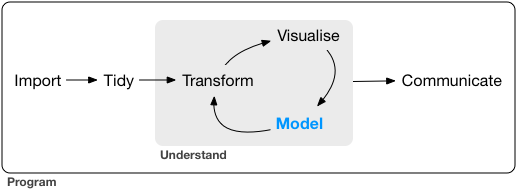
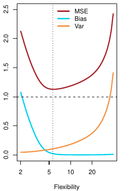
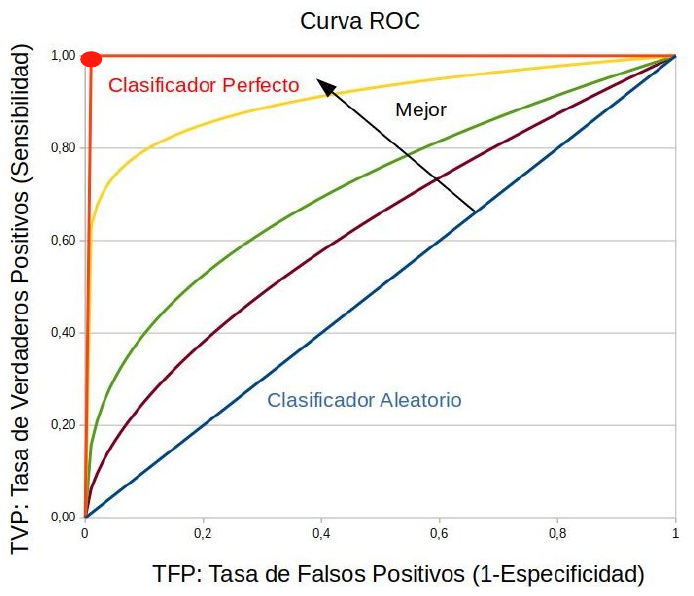
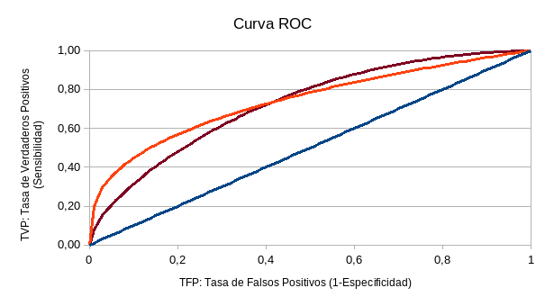

```{r}
#| label: setup
#| include: false
#| eval: true

# Elimino todo del Entorno
rm(list = ls())

# Cargo bibliotecas necesarias
library(tidyverse)
library(kableExtra)
```

```{r}
#| label: generar-datos
#| echo: false
#| eval: true

source("Tema05datos.R")
tienda <- tienda |>
  mutate(zona = factor(zona, levels = c("pueblo", "ciudad", "capital")))
modelo_z <- lm(ventas ~ renta + descuento + zona, data = tienda)
```

<!-- INTERNO (19-oct-2026). Deck rehecho con el plan `quality_reports/plans/2026-10-19_tema05-plan.md`.
27-oct-2026: el estudio previo (muestra sin bootstrap; regresion) esta en Tema05previo.qmd; aqui solo la clase.
1-nov-2026 (Pedro): este curso no se da por sabido: datos presentados aqui, Parte I desde la formula.
Eje: repaso de MCO e interpretacion -> formas de no linealidad una a una -> elegir para predecir ->
clasificar -> predecir frente a explicar. Las cuatro PRACTICAS son los apartados de `Tema05ej1.qmd`.
Datos: `data/tienda.csv`, generados por `Tema05datos.R` (set.seed(2027)); la forma funcional
verdadera esta en ese fichero y NO se dice en clase que los datos son generados.
Cifras verificadas con Rscript el 2-nov-2026 (renv saltado con R_LIBS a renv/library).
TIEMPO: 3 sesiones de 2 h. -->

# De la descriptiva al modelo

## Para qué sirve un modelo

:::: {.columns}
::: {.column width=52%}

- En los temas anteriores hemos descrito los datos. Ahora vamos a **modelizar**

- Modelizar es aproximar con métodos estadísticos la relación sistemática entre variables
  - por ejemplo, entre el gasto y las características de los clientes

:::
::: {.column width=48%}

{width=100% fig-align="center"}

:::
::::

- Modelizar sirve para:
  - **encontrar patrones** e interpretarlos: cómo cambia el gasto con cada característica
  - **predecir** el gasto de clientes que no están en los datos
  - **decidir**: a quién dar un descuento y qué pasaría si se diera a otros

- Todo esto se calcula con una muestra, y con otra muestra saldría distinto. Por eso empezamos por ver cuánto podemos fiarnos de un resultado obtenido con una muestra

## Los datos: los clientes de una cadena de tiendas

::: {style="font-size: 92%;"}

- Una cadena ha encuestado a **404 clientes** elegidos al azar. Cada fila de `tienda.csv` es un cliente:
  - gasto anual en euros (`ventas`) y renta mensual (`renta`)
  - `edad`, `mujer` (1 si es mujer) y años de estudios (`educ`)
  - `zona` (pueblo, ciudad o capital) y `descuento` (1 si lo recibió)

- El año pasado la cadena dio un descuento a algunos clientes, elegidos a mano

- Dirección plantea cuatro preguntas: (1) de qué depende el gasto, (2) con qué precisión lo sabemos, (3) cuánto gastará un cliente nuevo y (4) a quién dar el descuento

- Como en el Tema 04, los datos se preparan antes de analizarlos: `zona` es cualitativa, así que se guarda como factor con sus categorías ordenadas

```{r}
#| eval: true
tienda <- read_csv("data/tienda.csv") |>
  mutate(zona = factor(zona, levels = c("pueblo", "ciudad", "capital")))
```

:::

::: {.callout-important}
El **ejercicio del tema** se hace **durante estas clases**: [Tema 05 - Ejercicios del tema](Tema05ej1.html). Sus tres entregas corresponden a las cuatro PRÁCTICAS.
:::

::::{.notes}
- Numeración (1)-(4) de las preguntas: «la pregunta 3» y «la pregunta 4» del deck remiten aquí.
- Este curso no se da por sabido el estudio previo: los datos se presentan aquí. La población de 100.000 clientes (`cadena.csv`) no entra en clase; sacar muestras de ella con un bucle está en `Tema05previo.qmd`, para el curso que viene.
::::

# Parte I. Bootstrap: la muestra como si fuera la población

## La precisión de una media: la fórmula

- La precisión de la media la mide su **distribución muestral**: cómo varía $\bar Y$ de una muestra a otra

- Con una sola muestra no se observa, y se deriva de supuestos:
  - si los datos son normales en la población, $\bar Y$ es normal de forma exacta, para cualquier $n$
  - si no sabemos cómo se distribuyen pero $n$ es grande, $\bar Y$ es aproximadamente normal por el teorema central del límite

- En los dos casos:
  - error estándar: $s/\sqrt{n}$
  - intervalo al 95%: $\bar Y \pm 1{,}96$ errores estándar

- Las dos vías dependen de un supuesto: normalidad o muestra grande

- El **bootstrap** aproxima la distribución muestral sin ellos. Sirve cuando se duda del supuesto o cuando no hay una expresión analítica

::::{.notes}
- La cuenta con los datos del tema se hace en la PRÁCTICA (1).
- En algunos estadísticos no es fácil calcular analíticamente la varianza, porque el propio estadístico es difícil o porque, aunque se conozca, su varianza lo es. Es otro motivo para el bootstrap.
- Si preguntan por la mediana: su error estándar depende de la densidad en la mediana, que habría que estimar.
::::

## Bootstrap: la idea

::: {style="font-size: 92%;"}

- Si pudiéramos repetir la encuesta infinitas veces, veríamos directamente cómo varía la media. No podemos, pero tenemos lo más parecido a la población: la propia muestra

- El **bootstrap** usa la muestra como si fuera la población y saca de ella muchas **remuestras**:
  - del mismo tamaño que la muestra
  - **con reemplazamiento**: cada cliente puede salir varias veces o ninguna

- Con una muestra de cinco clientes:

```{r}
#| eval: true
gasto <- c(1000, 2000, 3000, 4000, 7000)
set.seed(2)
sample(gasto, size = 5, replace = TRUE)
```

| Remuestra | Gasto de los cinco clientes       | Media |
|:----------|:----------------------------------|------:|
| 1         | 7000, 1000, 7000, 1000, 4000      | 4.000 |
| 2         | 7000, 1000, 2000, 3000, 1000      | 2.800 |
| 3         | 3000, 2000, 3000, 1000, 1000      | 2.000 |

- Cada remuestra da una media distinta. Esas medias dan una **aproximación** a la distribución muestral del estimador, sin suponer ninguna distribución
  - no es la distribución muestral, porque solo tenemos una muestra

:::

::::{.notes}
- La tabla son las tres primeras remuestras con `set.seed(2)`; la media de la muestra es 3.400. Verificado el 1-nov-2026.
- Quitar `replace = TRUE` es un punto de la PRÁCTICA (1): no enseñarlo aquí.
- `size` igual al tamaño de la muestra: el error estándar depende de $n$, y se imita el muestreo que hubo.
- Las remuestras se centran en la media de la muestra, no en la de la población. La distribución bootstrap no es la distribución muestral: aproxima su dispersión.
::::

## Repetir mil veces: el bucle `for`

::: {style="font-size: 88%;"}

:::: {.columns}
::: {.column width=52%}

- Tres remuestras se hacen a mano; mil, con un **bucle**:

```{r}
#| eval: true
set.seed(2)
medias <- numeric(1000)
for (b in 1:1000) {
  remuestra <- sample(gasto, size = 5,
                      replace = TRUE)
  medias[b] <- mean(remuestra)
}
ggplot(tibble(medias), aes(medias)) +
  geom_histogram(bins = 15)
```

- Las tres piezas:
  - `numeric(1000)`: mil huecos donde guardar, creados antes del bucle
  - `for (b in 1:1000) { ... }`: repite lo de las llaves con `b` = 1, 2, ..., 1000
  - `medias[b] <- ...`: guarda la media `b` en el hueco `b`

:::
::: {.column width=48%}

```{r}
#| eval: true
#| output: true
#| echo: false
#| fig-width: 4.8
#| fig-height: 2.8
ggplot(tibble(medias), aes(medias)) +
  geom_histogram(bins = 15)
```

- Vuelta a vuelta: con `b` = 1, una remuestra y su media, 4.000, va a `medias[1]`; con `b` = 2, otra, y 2.800 va a `medias[2]`; y así hasta mil

- De las mil medias sale lo que buscábamos:
  - error estándar: `sd(medias)`, 948 euros
  - intervalo al 95%: `quantile(medias, c(0.025, 0.975))`, de 1.800 a 5.400 euros

:::
::::

:::

::::{.notes}
- Regla para escribir un bucle: hacerlo una vez a mano; cuando funciona, meterlo entre las llaves y cambiar lo que deba cambiar en cada vuelta.
- Lo más caro del tema. Dejar que se equivoquen con los corchetes y con el `numeric(1000)` olvidado.
- Con `set.seed(2)`: sd 947,6; percentiles 1.800 y 5.400. La fórmula da 2.302/√5 = 1.030, pero con cinco datos no es de fiar. Verificado el 1-nov-2026.
- Ejemplo de reserva con una población de forma conocida (el del curso 2025-26, en `legacy2025-26/Tema05.qmd`): ventas diarias Uniforme(0, 20), media 10.
  - `set.seed(101); ybar <- numeric(1000); for (j in 1:1000) ybar[j] <- mean(runif(25, 0, 20))`
  - Las mil medias se centran en 10,0, con sd 1,14 (la teoría, $20/\sqrt{12}/\sqrt{25}$, da 1,15) y van de 6,5 a 14,0. Una sola muestra de 25 con `set.seed(9915)` da 12,1. Verificado el 29-oct-2026.
- `rsample::bootstraps()`, `boot`: anexo.
::::

## PRÁCTICA en clase (1): precisión y bootstrap

Con `tienda$ventas` y vuestro DNI como semilla:

1. Con la fórmula: el error estándar de la media y su intervalo al 95%. Dirección quiere un error estándar de 20 euros: ¿a cuántos clientes hay que encuestar?

2. Con el bootstrap: el error estándar y el intervalo de la media. Comparadlos con los del punto 1. ¿Por qué salen casi iguales?

3. La mediana no tiene una fórmula sencilla: su error estándar e intervalo al 95% por bootstrap. ¿Es más o menos precisa que la media?

4. ¿Gastan más las mujeres? La diferencia de gasto medio entre mujeres y hombres, con su error estándar e intervalo por bootstrap, remuestreando cada grupo por separado. ¿Puede ser cero?

5. Repetid el bootstrap de la mediana quitando `replace = TRUE`. ¿Qué sale y por qué?

* En una frase: ¿de dónde sale la incertidumbre que medís, si los datos son siempre los mismos 404 clientes?

<!-- INTERNO (solución y guion del profesor). Cifras con DNI 12345678, en este orden y con una sola
semilla al principio, verificadas el 2-nov-2026:
1) Media 3.969, s 1.211,5, ee 60,3, intervalo 3.851 a 4.087. n = (1.212/20)^2 = 3.669 clientes, nueve
   veces la encuesta actual: dividir el error por 3 cuesta multiplicar la encuesta por 9.
2) ee 58,2, intervalo 3.851 a 4.080. Casi iguales: con 404 datos el teorema central del límite
   funciona bien, y el bootstrap llega a lo mismo sin suponerlo.
3) Mediana 3.826,5; ee 84,3, intervalo 3.684 a 4.004. Aquí la mediana es menos precisa que la media;
   con datos con valores extremos sería al revés.
4) Mujeres 4.739 (210), hombres 3.136 (194): diferencia 1.603. Bootstrap: ee 89,4, intervalo 1.430 a
   1.777. La fórmula sqrt(var1/n1 + var2/n2) da 89,2. El cero queda muy lejos.
   Código: xm <- tienda$ventas[tienda$mujer == 1]; en el bucle,
   d[b] <- mean(sample(xm, replace = TRUE)) - mean(sample(xh, replace = TRUE)).
5) Sin replace, sample() devuelve una permutación de los mismos 404: las mil medianas valen 3.826,5,
   sd 0 exacto. El reemplazamiento es lo que genera la variación.
Cierre: la incertidumbre sale de que esos 404 son UNA muestra entre muchas posibles; el bootstrap
imita ese muestreo usando la muestra como si fuera la población. -->

::: {.callout-note}
**Ahora el ejercicio: entrega 1, apartados a) y b).** Son estos puntos.
:::

# Parte II. Aprendizaje estadístico

## Aprendizaje estadístico

::: {style="font-size: 92%;"}

- El aprendizaje estadístico reúne técnicas para **extraer información de los datos**. Con unas mismas variables, podemos querer aprender dos cosas:
  - **Aprendizaje supervisado**: elegimos una variable como respuesta, $Y$, y aprendemos cómo depende de las demás, $X$
    - **regresión** si $Y$ es cuantitativa (el gasto)
    - **clasificación** si es cualitativa (tener o no el descuento)
  - **Aprendizaje no supervisado**: ninguna variable hace de respuesta, y aprendemos cómo se agrupan las observaciones, como clientes parecidos entre sí

- En el aprendizaje supervisado, $Y = f(X) + u$:
  - $f(X)$ es la parte sistemática de $Y$, la que se explica con las $X$ observadas; por ejemplo, la media condicional $E[Y \mid X]$
  - $u$ es lo no observado: los gustos de cada cliente, una tienda de la competencia cerca de su casa

- Estimamos $f$ para dos cosas:
  - predecir $Y$ en casos nuevos a partir de sus $X$
  - interpretar cómo cambia la media de $Y$ cuando cambia una $X$: una asociación, que puede ser o no un efecto causal

:::

::::{.notes}
- Y: variable dependiente, objetivo, respuesta. X: regresores, predictores, características (*features*).
- Bisagra del curso: T06 a T08 son maneras cada vez más automáticas de estimar $f$; el no supervisado (agrupamiento, k-means) llega en el Tema 10.
::::

## Estimar $f$: paramétrico o no paramétrico

::: {style="font-size: 90%;"}

:::: {.columns}
::: {.column width=50%}

- **Paramétrico**: se supone una forma para $f$; por ejemplo, una recta, $f(\text{edad}) = \beta_0 + \beta_1\,\text{edad}$
  - estimar $f$ se reduce a estimar sus parámetros, $\beta_0$ y $\beta_1$: valores de la población que no se conocen, como la media
  - si la forma supuesta no es la buena, se equivoca aunque haya muchos datos

- **No paramétrico**: no se supone ninguna forma, y la estimación de $f$ sigue a los datos
  - es más flexible
  - pide más datos y es más difícil de interpretar

- Los dos aproximan con una muestra la $f$ de la población (y sus parámetros, si los tiene)
  - con otra muestra saldría otra estimación, con su error estándar

:::
::: {.column width=50%}

```{r}
#| eval: true
#| output: true
#| fig-width: 4.8
#| fig-height: 2.5
ggplot(tienda, aes(edad, ventas)) +
  geom_point(colour = "grey") +
  geom_smooth(method = "lm", se = FALSE,
              colour = "red") +
  geom_smooth(se = FALSE,
              colour = "blue")
```

- Cada punto es un cliente
- La recta sale casi plana; la curva sube hasta los 45 años y luego baja

:::
::::

:::

::::{.notes}
- `geom_smooth()` sin método usa *loess*: medias ponderadas de los vecinos. Es la media condicional del Tema 04.
- La regresión lineal es el caso paramétrico que sigue; árboles y vecinos (T08) son no paramétricos.
::::

## PRÁCTICA en clase (2): coeficiente y varianza del error

::: {style="font-size: 92%;"}

Con `tienda` y vuestro DNI como semilla:

1. Estimad `modelo_z <- lm(ventas ~ renta + descuento + zona, data = tienda)`. Con `summary()`, leed en euros los coeficientes de `renta` y `descuento`, y el $R^2$

2. Predecid el gasto de un cliente de pueblo con renta 1.500 y sin descuento, y el de uno de capital con renta 3.000 y con descuento
   - `predict(modelo_z, newdata = nuevos)` predice para `nuevos`, una tabla con las mismas columnas que usa el modelo

3. Adaptad el bucle del bootstrap al coeficiente de `renta`:
   - remuestread **filas enteras**: `filas <- sample(nrow(tienda), replace = TRUE)`
   - estimad el modelo en `tienda[filas, ]` y guardad `coef(m_b)["renta"]`
   - comparad el error estándar y el intervalo con los de la fórmula, `summary()` y `confint(modelo_z)`

4. En el mismo bucle, guardad la varianza del error, `var(residuals(m_b))`. ¿Cuál es su error estándar y su intervalo al 95%? ¿Cuánto se desvía un cliente típico de lo que predice el modelo?

:::

<!-- INTERNO (solución y guion del profesor). Cifras verificadas el 2-nov-2026, con DNI 12345678 y un
solo bucle para los puntos 3 y 4:
1) renta 0,493 (ee 0,057): 100 euros de renta mensual son 49 de gasto anual; descuento 332 (ee 162).
   R2 = 0,174: más de cuatro quintos de la varianza del gasto están en u. Constante 2.716, zonaciudad
   26, zonacapital 350. Error típico: olvidar factor(zona) y obtener capital como referencia.
2) 3.455 y 4.877 euros (zona como factor con los mismos niveles).
3) sd(coefs) = 0,060 frente a Std. Error 0,057. Intervalo bootstrap 0,362 a 0,601; confint 0,380 a 0,606.
   Remuestrear filas conserva juntos el gasto y las características de cada cliente.
4) var(residuals(modelo_z)) = 1.212.856; bootstrap: ee 64.752, intervalo 1.078.442 a 1.326.311.
   Raíz: 1.101 euros, lo que se desvía un cliente típico. summary() no da error estándar de esta
   varianza, y el bucle sirve sin cambios: basta guardar otra cosa. -->

::: {.callout-note}
**Ahora el ejercicio: entrega 1, apartados c) a e).** Son estos puntos.
:::

# Parte III. Cuando el efecto no es constante

## Tres cosas que la recta no ve

```{r}
#| eval: true
#| output: true
#| echo: false
#| fig-width: 12
#| fig-height: 3.6
#| out-width: 100%
library(patchwork)
p1 <- ggplot(tienda, aes(edad, ventas)) + geom_point(colour = "grey") +
  geom_smooth(method = "lm", se = FALSE, colour = "grey40") +
  geom_smooth(se = FALSE, colour = "red") +
  labs(title = "edad: una curva") + theme_minimal()
p2 <- tienda |> group_by(educ) |> summarize(ventas = mean(ventas)) |>
  ggplot(aes(x = educ, y = ventas)) + geom_point(size = 3) + geom_step(colour = "red") +
  geom_smooth(data = tienda, method = "lm", se = FALSE, colour = "grey40") +
  scale_x_continuous(breaks = seq(8, 20, 2)) +
  labs(title = "educ: escalones (gasto medio por nivel)") + theme_minimal()
p3 <- ggplot(tienda, aes(x = renta, y = ventas, colour = factor(mujer))) +
  geom_point(shape = 1, size = 1, alpha = 0.7) +
  geom_smooth(method = "lm", se = FALSE, linewidth = 1.2) +
  scale_colour_manual(values = c("red", "blue")) +
  labs(title = "renta: dos pendientes (azul, mujeres)") +
  theme_minimal() + theme(legend.position = "none", plot.margin = margin(5.5, 18, 5.5, 5.5))
p1 + p2 + p3
```

<details>
<summary>Código de los gráficos</summary>

```{r}
ggplot(tienda, aes(edad, ventas)) + geom_point() +
  geom_smooth(method = "lm", se = FALSE) + geom_smooth(se = FALSE)

tienda |> group_by(educ) |> summarize(ventas = mean(ventas)) |>
  ggplot(aes(educ, ventas)) + geom_point() + geom_step()

ggplot(tienda, aes(renta, ventas, colour = factor(mujer))) +
  geom_point(shape = 1) + geom_smooth(method = "lm", se = FALSE)
```

</details>

- El modelo lineal supone que el efecto de cada $X$ es **el mismo número** siempre: $\partial\, \text{ventas} / \partial X_j = \beta_j$. Los datos dicen otra cosa:

  - El gasto **sube y luego baja** con la edad: la recta gris dice que no cambia

  - Con los estudios, el gasto va a **saltos** que suben y bajan

  - La pendiente de la renta es **distinta** para mujeres y hombres

- En economía esto es la norma: rendimientos decrecientes, umbrales, efectos distintos por grupo

- El modelo lineal lo captura **transformando las variables**

::::{.notes}
- Curva roja de edad: `geom_smooth()` sin método, la media condicional del Tema 04. Recta gris: `method = "lm"`.
- Medias por nivel de estudios: 8: 3.972; 10: 3.461; 12: 3.920; 14: 4.404; 16: 3.772; 18: 4.032; 20: 4.145. Los saltos están en 12, 14, 16 (hacia abajo) y 18. Pendientes de la renta: 0,08 hombres, 0,67 mujeres (`lm(ventas ~ renta * mujer)`). Verificado el 2-nov-2026.
- La figura es el guion de la parte: una forma funcional por panel, más los logaritmos para la renta.
::::

## Logaritmos

- Un euro más de renta importa menos cuanto más renta se tiene: **rendimientos decrecientes**

- En logaritmos, lo constante es el efecto de un **1%** más de renta

```{r}
lm(ventas ~ log(renta) + descuento + zona, data = tienda)
lm(log(ventas) ~ log(renta) + descuento + zona,
   data = tienda)
```

- Tres lecturas, según dónde esté el logaritmo:

  - $y \sim \log(x)$: $\beta/100$ es el cambio de $y$ por un 1% más de $x$. Aquí $\hat\beta$ = 1.150: **11,5 euros** más de gasto por un 1% más de renta

  - $\log(y) \sim \log(x)$: $\beta$ es la **elasticidad**: un 1% más de renta, un $\beta$% más de gasto. Aquí 0,28

  - $\log(y) \sim x$: $100\beta$ es el cambio porcentual de $y$ por una unidad más de $x$

- Frente a la recta, donde 100 euros de renta son siempre 49 de gasto, en logaritmos:
  - 100 euros son un 12,5% para quien tiene 800: 144 euros de gasto
  - y un 2% para quien tiene 5.000: 23 euros

- `log()` va dentro de la fórmula. Solo con valores **positivos**: `log(0)` es `-Inf` y esas filas desaparecen del modelo

::::{.notes}
- Coeficiente de log(renta): 1.149,7 (ee 135). Elasticidad log-log: 0,275. $R^2$ 0,172 frente a 0,174 con renta lineal: sin separar por sexo, el logaritmo no mejora el ajuste. Verificado el 2-nov-2026.
- Mini-test T05.3: comparar por error un modelo en niveles con otro en logaritmos cuando $y$ tiene ceros no vale: son muestras distintas.
- Funciones de producción, demanda, ecuación de Mincer: los logaritmos están en toda la economía aplicada.
::::

## La misma curva, dos aproximaciones: polinomio

::: {style="font-size: 88%;"}

:::: {.columns}
::: {.column width=52%}

- El gasto sube con la edad hasta los 45 y luego baja. Una **parábola** lo recoge:

$$
\small \text{ventas} = \beta_0 + \beta_1\,\text{edad} + \beta_2\,\text{edad}^2 + u
$$

```{r}
lm(ventas ~ edad + I(edad^2),
   data = tienda)
lm(ventas ~ poly(edad, 2),
   data = tienda)
```

- `I()` avisa a la fórmula de que `edad^2` es una operación aritmética

- `poly(edad, g)` añade de una vez los grados 1 a `g`: predice lo mismo, con los coeficientes en otra escala

- El efecto de un año más ya **depende de la edad**: $\partial\, \text{ventas} / \partial\, \text{edad} = \beta_1 + 2\beta_2\, \text{edad}$

- Con $\hat\beta_1$ = 313 y $\hat\beta_2$ = -3,40:
  - a los 30, **+109** euros por año; a los 50, **-28**; a los 60, **-96**
  - el máximo está en 312,6 / (2 · 3,402) = **45,9 años**

:::
::: {.column width=48%}

```{r}
#| eval: true
#| output: true
#| echo: false
#| fig-width: 5
#| fig-height: 4
ggplot(tienda, aes(edad, ventas)) + geom_point(colour = "grey") +
  geom_smooth(method = "lm", formula = y ~ poly(x, 2), se = FALSE, colour = "red", linewidth = 1.2) +
  theme_minimal()
```


```{r}
ggplot(tienda, aes(edad, ventas)) +
  geom_point(colour = "grey") +
  geom_smooth(method = "lm",
    formula = y ~ poly(x, 2))
```

:::
::::

:::

::::{.notes}
- Coeficientes: constante -2.573, edad 312,6 (ee 26,5), edad² -3,402 (ee 0,287). Efecto marginal: 108,5 a los 30; -27,6 a los 50; -95,6 a los 60. Vértice 45,9. $R^2$ 0,260 (lineal en edad: 0,000). Verificado el 2-nov-2026.
- Predicciones de la parábola: 2.319 a los 20, 4.489 a los 40, 4.606 a los 45, 4.553 a los 50, 2.641 a los 70.
- Un signo negativo en el cuadrado es una U invertida (ciclo de vida, curva de Laffer, experiencia y salario); positivo, una U.
- `poly()` reaparece en T07 como `step_poly()`.
::::

## La misma curva, dos aproximaciones: tramos

::: {style="font-size: 88%;"}

:::: {.columns}
::: {.column width=52%}

- Otra manera de seguir la curva: **tramos** de edad, cada uno con su media. `cut()` crea el factor y el modelo lo trata como a `zona`

```{r}
tramos <- c(20, 30, 40, 50, 60, 70)
lm(ventas ~ cut(edad, tramos,
        include.lowest = TRUE),
   data = tienda)
```

::: {style="font-size: 85%;"}

| (Intercept) | (30,40] | (40,50] | (50,60] | (60,70] |
|:-----------:|:-------:|:-------:|:-------:|:-------:|
| 3057        | 1276    | 1515    | 1199    | 249     |

:::

- `(40,50]` son los clientes de más de 40 y hasta 50 años. Cada coeficiente compara su tramo con el de 20 a 30, la referencia:
  - la constante es el gasto medio de la referencia: 3.057 euros
  - quienes tienen de 40 a 50 gastan **1.515 euros más**: 4.573 de media

- Dentro de un tramo, todos tienen la misma predicción, así que la función son **escalones**

:::
::: {.column width=48%}

```{r}
#| eval: true
#| output: true
#| echo: false
#| fig-width: 5
#| fig-height: 2.7
ggplot(tienda, aes(edad, ventas)) + geom_point(colour = "grey") +
  geom_smooth(method = "lm", formula = y ~ poly(x, 2), se = FALSE, colour = "red", linewidth = 1.2) +
  geom_smooth(method = "lm", formula = y ~ cut(x, c(20, 30, 40, 50, 60, 70), include.lowest = TRUE),
              se = FALSE, colour = "blue", linewidth = 1.2) +
  labs(title = "parábola (rojo) y tramos (azul)") + theme_minimal()
```

- Las dos siguen la misma curva:
  - parábola: 2 coeficientes y una forma impuesta
  - tramos: 4 coeficientes, sin forma impuesta, pero hay que elegir dónde cortar

<details>
<summary>Código del gráfico</summary>

```{r}
ggplot(tienda, aes(edad, ventas)) +
  geom_point(colour = "grey") +
  geom_smooth(method = "lm",
    formula = y ~ poly(x, 2)) +
  geom_smooth(method = "lm",
    formula = y ~ cut(x, tramos,
                      include.lowest = TRUE))
```

</details>

:::
::::

:::

::::{.notes}
- Un árbol de regresión (Tema 08) elige los cortes solo, mirando los datos.
- Medias por tramo: 3.057, 4.334, 4.573, 4.257, 3.307. Coeficientes 1.276, 1.515, 1.199, 249 (ee 171-178). $R^2$ 0,238 frente a 0,260 de la parábola: con cuatro coeficientes ajusta peor, porque los tramos de diez años son gruesos para una curva tan marcada. Verificado el 2-nov-2026.
- `include.lowest = TRUE` mete el 20 en el primer tramo; sin él, los clientes de 20 años exactos serían `NA`.
- Es el puente a T08: "Estratificación para asociaciones no lineales" y la PRÁCTICA 1 de árboles son esto mismo con los cortes elegidos por el algoritmo.
- Para `educ` los escalones son naturales (12, 14, 16 y 18 años): `cut(educ, c(0, 10, 12, 14, 16, 20), include.lowest = TRUE)` da +217, +701, +69 y +372 respecto a 10 años o menos.
::::

## Interacciones

- Añadir `mujer` desplaza la recta: distinta altura para mujeres y hombres, con la misma pendiente

- Una **interacción**, el producto de las dos variables, da a cada grupo **su pendiente**:

::: {style="text-align: center;"}
$\small \text{ventas} = \beta_0 + \beta_1\,\text{renta} + \beta_2\,\text{mujer} + \beta_3\,\text{renta} \cdot \text{mujer} + u$
:::

:::: {.columns}
::: {.column width=52%}

```{r}
lm(ventas ~ renta * mujer,
   data = tienda)
```

```
(Intercept)   renta   mujer   renta:mujer
       2961   0.079     285         0.594
```

- Lectura, por cada 100 euros más de renta:
  - hombres ($\text{mujer} = 0$): pendiente $\beta_1$, **8** euros más de gasto
  - mujeres ($\text{mujer} = 1$): pendiente $\beta_1 + \beta_3$, 7,9 + 59,4 = **67** euros más
  - $\beta_3$ es la diferencia entre las dos pendientes

:::
::: {.column width=48%}

```{r}
#| eval: true
#| output: true
#| echo: false
#| fig-width: 5
#| fig-height: 3
ggplot(tienda, aes(x = renta, y = ventas, colour = factor(mujer, labels = c("hombre", "mujer")))) +
  geom_point(shape = 1, size = 1, alpha = 0.7) +
  geom_smooth(method = "lm", se = FALSE, linewidth = 1.2) +
  scale_colour_manual(values = c("red", "blue")) +
  labs(colour = NULL, title = "ventas ~ renta * mujer") + theme_minimal() +
  theme(legend.position = "bottom", plot.margin = margin(5.5, 18, 5.5, 5.5))
```

<details>
<summary>Código del gráfico</summary>

```{r}
ggplot(tienda, aes(renta, ventas,
    colour = factor(mujer))) +
  geom_point(shape = 1) +
  geom_smooth(method = "lm", se = FALSE)
```

</details>

- Vale para dos cualitativas (`zona * descuento`) y dos continuas (`edad * renta`)

:::
::::

::::{.notes}
- `renta * mujer` incluye los dos efectos principales y el producto; solo `renta:mujer` obligaría a las dos rectas a salir del mismo punto.
- Coeficientes: 2.961; renta 0,079 (ee 0,060, p = 0,19); mujer 285 (ee 180, p = 0,11); renta:mujer 0,594 (ee 0,075, p < 0,0001). La pendiente de los hombres no es significativa: su gasto apenas depende de la renta. Verificado el 2-nov-2026.
- El efecto de `mujer` sin interacción es 1.603: con la interacción se reparte entre la constante y la pendiente. Explicarlo si preguntan.
- Interacciones de todo con todo es lo que hace un árbol (T08); en T07 se escriben con `step_interact()`.
::::

## PRÁCTICA en clase (3): muchos modelos posibles

Partiendo de `ventas ~ renta + descuento + zona`, anotad el $R^2$ de cada modelo con seis decimales, `summary(m)$r.squared`:

1. Polinomios: añadid `edad`, y después, de uno en uno, `I(edad^2)`, `I(edad^3)` e `I(edad^4)`

2. Tramos de edad, en lugar del polinomio: de 20 en 20 años (`cut(edad, c(20, 40, 60, 70), include.lowest = TRUE)`), de 10 en 10 (`seq(20, 70, by = 10)`) y de 5 en 5

3. Interacciones: partiendo de la parábola, añadid `educ`, y después, de una en una, `renta * mujer`, `educ * mujer` y `edad * mujer`

* ¿Cuántos grados, cuántos tramos y cuántas interacciones pondríais? Apuntad por qué cuesta decidirlo

<!-- INTERNO (solución y guion del profesor): 30 min. Lo importante es comparar muchas
especificaciones y ver que no se sabe cómo elegir: prepara «¿Y cuál elegimos?» y los árboles (T08).
R2, verificados el 2-nov-2026. De partida 0,17366.
1) edad 0,17471; + edad² 0,401205; + edad³ 0,401207; + edad⁴ 0,40191.
2) De 20 en 20: 0,30544; de 10 en 10: 0,37535; de 5 en 5: 0,40472.
3) Con edad y edad²: + educ 0,41321; + renta*mujer 0,88991; + educ*mujer 0,88995; + edad*mujer 0,89018.
Lecturas que antes eran práctica, para comentar si da tiempo: log(renta) 1.149,7, es decir, 11,5 euros
por 1%; log-log, elasticidad 0,275; R2 0,172. Máximo de la parábola a los 45,9 años. -->

::: {.callout-note}
**Ahora el ejercicio: entrega 2, apartados a) a c).** Son estos tres puntos.
:::

## ¿Y cuál elegimos? El $R^2$ sube siempre

- Con las cuatro formas y seis variables hay **decenas de especificaciones** plausibles. Elegir la de mayor $R^2$ no sirve, porque **nunca baja** al añadir una variable:

::: {style="font-size: 76%;"}

| Variables | `renta` | `+ descuento` | `+ zona` | `+ mujer` | `+ edad` | `+ educ` | `+ z1 + z2 + z3` |
|:----------|--------:|--------------:|---------:|----------:|---------:|---------:|-----------------:|
| $R^2$     | 0,14995 | 0,15803 | 0,17366 | 0,61601 | 0,61715 | 0,62855 | 0,62921 |

:::

- **Inclusión de variables irrelevantes**: `z1`, `z2` y `z3` son números aleatorios y también suben el $R^2$
  - en la muestra, cualquier variable "explica" algo por casualidad
  - pero aumenta la varianza: el error estándar de `descuento` pasa de 110,1 a 110,6, y el de `renta` de 0,0389 a 0,0391

<details>
<summary>Código</summary>

```{r}
set.seed(1)
tienda <- tienda |>
  mutate(z1 = rnorm(404), z2 = rnorm(404), z3 = rnorm(404))
m1 <- lm(ventas ~ renta, data = tienda)
m6 <- lm(ventas ~ renta + descuento + zona + mujer + edad + educ,
         data = tienda)
m9 <- lm(ventas ~ renta + descuento + zona + mujer + edad + educ +
           z1 + z2 + z3, data = tienda)
summary(m1)$r.squared
summary(m6)$r.squared
summary(m9)$r.squared
summary(m6)$coefficients[, "Std. Error"]
summary(m9)$coefficients[, "Std. Error"]
```

</details>

- Hace falta otro criterio: el error con datos que el modelo **no ha visto**

::::{.notes}
- Tabla verificada el 2-nov-2026 con el código de la transparencia.
- Mini-test T05.2: "añades tres variables y el $R^2$ sube, ¿es mejor el modelo?".
- $R^2$ ajustado, AIC y BIC penalizan el número de coeficientes y van en la misma dirección: anexo. En este curso se elige con datos de prueba.
::::

## Omisión de variables relevantes

::: {style="font-size: 92%;"}

- Dejar fuera una variable relevante **cambia los coeficientes** de las que quedan

- El descuento, con y sin la renta en el modelo:

::: {style="font-size: 88%;"}

| Modelo                                   | Coef. de `descuento` | Error estándar |
|------------------------------------------|---------------------:|---------------:|
| `ventas ~ descuento`                     |                  -97 |            170 |
| `ventas ~ descuento + log(renta)`        |                 +409 |            167 |
| modelo completo                          |                 +500 |             48 |

:::

- A solas, el descuento parece **no servir**
  - la tienda lo dio sobre todo a clientes de **renta baja** (1.497 frente a 2.336 euros), que gastan menos
  - el coeficiente mezcla las dos cosas

- El **sesgo por omisión** sigue la regla del signo: (efecto de la omitida sobre $Y$) × (su correlación con la $X$ que queda). Aquí, positivo × negativo: hacia abajo

- Elegir modelo tiene dos riesgos: incluir demasiado, que ajusta el ruido, y omitir lo relevante, que mezcla efectos

<details>
<summary>Código</summary>

```{r}
lm(ventas ~ descuento, data = tienda)
lm(ventas ~ descuento + log(renta), data = tienda)
tramos <- c(0, 10, 12, 14, 16, 20)
lm(ventas ~ log(renta) * mujer + edad + I(edad^2) +
     cut(educ, tramos, include.lowest = TRUE) +
     descuento + zona, data = tienda)
tienda |> group_by(descuento) |> summarize(renta = mean(renta))
```

</details>

:::

::::{.notes}
- Verificado el 2-nov-2026: descuento solo -97 (ee 170, p = 0,57); con log(renta) +409 (ee 167); con renta lineal +320; completo +500 (ee 48). Correlación renta-descuento -0,30.
- Esto enlaza con el cierre (Parte VI): aun con la renta dentro, el +500 es una asociación entre clientes parecidos; lo que pasaría si la tienda diera el descuento a otro cliente es otra pregunta.
- Es el recuerdo de Econometría: sesgo por omisión de relevantes, varianza por inclusión de irrelevantes.
::::

# Parte IV. Elegir para predecir

## Medir el error de predicción

::: {style="font-size: 92%;"}

- La pregunta 3 de la tienda es cuánto gastará un cliente **nuevo**, así que el modelo se juzga por cómo predice esos casos

- Una **función de pérdida** $L(y, \hat{y})$ asigna un coste a cada error de predicción, y el modelo se evalúa por la pérdida media:

  1. **MSE** (error cuadrático medio): $(1/n)\sum (y_i - \hat{y}_i)^2$. Penaliza más los errores grandes

  2. **RMSE**: $\sqrt{\text{MSE}}$, en las unidades de $y$

  3. **MAE** (error absoluto medio): $(1/n)\sum |y_i - \hat{y}_i|$. Cada euro de error pesa lo mismo

- Son pérdidas **simétricas**: pasarse y quedarse corto cuestan lo mismo

- En una pérdida **asimétrica**, un lado cuesta más: quedarse sin existencias frente a tener de sobra

- $R^2 = 1 - \text{SCR}/\text{SCT}$ es el MSE relativo a la varianza de $y$: compara modelos de la misma $y$ en los mismos datos


:::

::::{.notes}
- RMSE del modelo con zona: 1.099,9; `sigma` de `summary()`: 1.106,8 (la raíz de SCR/(n-k), casi el RMSE). Verificado el 2-nov-2026.
- Cuál elegir depende del negocio: si un error de 2.000 euros es diez veces peor que uno de 200, MSE; si es diez veces igual de malo, MAE.
::::

## Sobreajuste: la curva que persigue el ruido

::: {style="font-size: 90%;"}

- Estos datos los hemos simulado, y por eso conocemos la relación verdadera: la **curva negra discontinua** es $f(\text{edad})$

- Cada punto es $f(\text{edad})$ más un error $u$ propio de cada muestra. Su media es cero: unas veces cae por encima de la curva y otras por debajo

- Ajustamos tres modelos a dos muestras:
  - la **recta** (verde) no llega a la curva: **ajuste insuficiente** (*underfitting*)
  - la **parábola** (azul) sigue la curva en las dos muestras
  - el **grado 12** (naranja) persigue el error de cada muestra: **sobreajuste** (*overfitting*)

- El cliente marcado queda por encima de la curva en A y por debajo en B, y el grado 12 se va tras él

```{r}
#| eval: true
#| include: false
f <- function(edad) 3900 - 2.5 * (edad - 45)^2
edad <- seq(20, 70, length.out = 30)
set.seed(57)
A <- tibble(edad, ventas = f(edad) + rnorm(30, sd = 350))
B <- tibble(edad, ventas = f(edad) + rnorm(30, sd = 350))
A$ventas[13] <- f(edad[13]) + 900
B$ventas[13] <- f(edad[13]) - 900
```

```{r}
#| eval: true
#| output: true
#| echo: false
#| fig-width: 12
#| fig-height: 2.6
#| out-width: 100%
dibuja <- function(d, titulo) {
  ggplot(d, aes(edad, ventas)) + geom_point(colour = "grey55", size = 2) +
    geom_smooth(method = "lm", se = FALSE, colour = "forestgreen") +
    geom_smooth(method = "lm", formula = y ~ poly(x, 2), se = FALSE, colour = "blue") +
    geom_smooth(method = "lm", formula = y ~ poly(x, 12), se = FALSE, colour = "darkorange", linewidth = 1.3) +
    geom_function(fun = f, linewidth = 1, linetype = "dashed") +
    geom_point(data = d[13, ], colour = "red", size = 5, shape = 1) +
    coord_cartesian(ylim = c(1500, 5000)) + labs(title = titulo) + theme_minimal()
}
dibuja(A, "Muestra A") + dibuja(B, "Muestra B")
```

<details>
<summary>Cómo se han simulado estos datos</summary>

```{r}
f <- function(edad) 3900 - 2.5 * (edad - 45)^2
edad <- seq(20, 70, length.out = 30)
set.seed(57)
A <- tibble(edad, ventas = f(edad) + rnorm(30, sd = 350))
B <- tibble(edad, ventas = f(edad) + rnorm(30, sd = 350))
A$ventas[13] <- f(edad[13]) + 900
B$ventas[13] <- f(edad[13]) - 900
ggplot(A, aes(edad, ventas)) + geom_point(colour = "grey55", size = 2) +
  geom_function(fun = f) +
  geom_smooth(method = "lm", se = FALSE) +
  geom_smooth(method = "lm", formula = y ~ poly(x, 2), se = FALSE) +
  geom_smooth(method = "lm", formula = y ~ poly(x, 12), se = FALSE)
```

`rnorm(30, sd = 350)` es el error: 30 números aleatorios de media cero.

</details>

:::

::::{.notes}
- Ese cliente (fila 13, edad 40,7) se ha fijado a propósito para que se vea: +900 sobre la curva en A y -900 en B. Son 30 clientes, semilla 57, elegida para que el grado 12 vaya tras él en las dos muestras. Verificado el 2-nov-2026.
- Este ejemplo se presenta como simulado (Pedro, 1-nov-2026). De `tienda` no se dice.
- Con la tienda, el MSE en los 404 baja de forma monótona de 1.463.918 (g = 1) a 1.049.965 (g = 12). Verificado el 2-nov-2026.
- La misma idea en ISLR, figuras 2.9 a 2.11 (`figure/overfitting01c.png`, `overfitting2n.png`, `overfitting3n.png`).
::::

## El error que importa es el de los clientes nuevos

```{r}
#| eval: true
#| include: false
mse <- function(y, y_pred) mean((y - y_pred)^2)
simula <- function(n) {
  edad <- runif(n, 20, 70)
  tibble(edad, ventas = f(edad) + rnorm(n, sd = 350))
}
set.seed(8)
err <- tibble()
for (r in 1:200) {
  entrena <- simula(30)
  prueba <- simula(200) |> filter(between(edad, min(entrena$edad), max(entrena$edad)))
  for (g in 1:9) {
    m <- lm(ventas ~ poly(edad, g), entrena)
    err <- bind_rows(err, tibble(g,
      `muestra usada para estimar` = mse(entrena$ventas, fitted(m)),
      `muestra nueva` = mse(prueba$ventas, predict(m, prueba))))
  }
}
```

::: {style="font-size: 90%;"}

- La curva de grado 12 estimada en A es la que más se acerca al cliente marcado

- En una muestra nueva, la B, ese cliente cae lejos: el error es mayor que el de la recta y la parábola

- Con todos los clientes pasa lo mismo: el grado 12 tiene el menor MSE en A, y en B es peor que la parábola

::: {style="font-size: 85%;"}

| Curva estimada con A | Error, cliente marcado en A | Error, cliente marcado en B | MSE en A (miles) | MSE en B (miles) |
|:---------------------|----------------------------:|----------------------------:|-----------------:|-----------------:|
| recta                | 1.342                       | 458                         | 435              | 333              |
| parábola             | 886                         | 914                         | 237              | 157              |
| grado 12             | 347                         | 1.453                       | 81               | 391              |

:::

:::: {.columns}
::: {.column width=48%}

- Repetido con muchas muestras, el MSE medio según el grado:
  - en la muestra usada para estimar baja siempre, y quien elija con él se queda con el modelo más flexible
  - en una muestra nueva forma una **U**: la recta falla por ajuste insuficiente y los grados altos por sobreajuste

:::
::: {.column width=52%}

```{r}
#| eval: true
#| output: true
#| echo: false
#| fig-width: 5.2
#| fig-height: 2.5
err |> group_by(g) |>
  summarize(across(everything(), mean)) |>
  pivot_longer(-g) |>
  ggplot(aes(g, value / 1000, colour = name)) +
  geom_line(linewidth = 1) + geom_point(size = 2) +
  scale_x_continuous(breaks = 1:9) + coord_cartesian(ylim = c(0, 400)) +
  labs(x = "grado del polinomio", y = "MSE (miles)", colour = NULL) +
  theme_minimal() + theme(legend.position = "bottom")
```

:::
::::

<details>
<summary>Cómo se calcula</summary>

```{r}
m <- lm(ventas ~ poly(edad, 12), data = A)
mean((A$ventas - predict(m))^2)
mean((B$ventas - predict(m, newdata = B))^2)
```

</details>

:::

::::{.notes}
- Tabla verificada el 2-nov-2026, con las muestras A y B de la transparencia anterior y la fila 13. La recta acierta por azar con ese cliente en B, y su MSE muestra que es peor en conjunto: 435 y 333 frente a 237 y 157 de la parábola.
- Código del gráfico:

```{r}
mse <- function(y, y_pred) mean((y - y_pred)^2)
simula <- function(n) {
  edad <- runif(n, 20, 70)
  tibble(edad, ventas = f(edad) + rnorm(n, sd = 350))
}
set.seed(8)
err <- tibble()
for (r in 1:200) {
  entrena <- simula(30)
  prueba <- simula(200) |> filter(between(edad, min(entrena$edad), max(entrena$edad)))
  for (g in 1:9) {
    m <- lm(ventas ~ poly(edad, g), entrena)
    err <- bind_rows(err, tibble(g,
      `muestra usada para estimar` = mse(entrena$ventas, fitted(m)),
      `muestra nueva` = mse(prueba$ventas, predict(m, prueba))))
  }
}
```

- Gráfico: 200 repeticiones con edades al azar; la muestra nueva se limita al rango de edades de la usada para estimar. El eje se corta en 400 porque el grado 9 se sale de la escala.
- Con los 404 clientes de la tienda la U es casi plana: por eso se enseña con datos simulados.
- Aquí son dos muestras distintas. La tienda solo tiene una, y dividirla es lo que viene en «Entrenamiento y prueba».
::::

## Entrenamiento y prueba

- La tienda solo tiene una muestra, así que los clientes nuevos hay que conseguirlos de ella: se divide al azar en dos partes y una se aparta

  - **entrenamiento** (70-80%): donde se estima el modelo
  - **prueba** (20-30%): donde se mide el error, con clientes que el modelo no ha visto

- Con `tienda`, el error de entrenamiento baja siempre al subir el grado, y el de prueba cae hasta el grado 2 y luego apenas cambia. Elegiríamos un grado bajo

- El error de prueba estima cómo predecirá el modelo clientes nuevos, a costa de estimar con menos datos

::::{.notes}
- Código de la partición (no se les pide hacerla a mano; T07 trae `initial_split()`):

```{r}
set.seed(12345678)
n <- nrow(tienda)
filas <- sample(n, size = round(0.7 * n))
entrena <- tienda[filas, ]
prueba  <- tienda[-filas, ]
m <- lm(ventas ~ poly(edad, 3), data = entrena)
pred <- predict(m, newdata = prueba)
mse(prueba$ventas, pred)
```

- `sample(n, size)` sortea filas **sin** reemplazamiento; `-filas`, las que no salieron: 283 y 121.

```{r}
#| eval: true
#| output: true
#| echo: false
#| fig-width: 5
#| fig-height: 3.4
mse <- function(y, y_pred) mean((y - y_pred)^2)
set.seed(12345678)
filas <- sample(nrow(tienda), size = round(0.7 * nrow(tienda)))
entrena <- tienda[filas, ]; prueba <- tienda[-filas, ]
curva <- map_dfr(1:12, function(g) {
  m <- lm(ventas ~ poly(edad, g), data = entrena)
  tibble(g = g, entrenamiento = mse(entrena$ventas, predict(m)),
         prueba = mse(prueba$ventas, predict(m, newdata = prueba)))
}) |> pivot_longer(-g, names_to = "muestra", values_to = "MSE")
ggplot(curva, aes(x = g, y = MSE / 1000, colour = muestra)) + geom_line(linewidth = 1.2) + geom_point() +
  scale_x_continuous(breaks = 1:12) + labs(x = "grado del polinomio", y = "MSE (miles)", colour = NULL) +
  theme_minimal() + theme(legend.position = "bottom")
```

- Si preguntan por qué renunciar a 121 clientes para estimar: evaluar bien el modelo lo vale, y la validación cruzada (más adelante) los recupera.
- Semilla 12345678: 283 y 121 filas. MSE (euros²): g=1 1.344.086 / 1.758.387; g=2 977.636 / 1.338.951; g=3 977.442 / 1.344.666; g=5 968.965 / 1.364.097; g=8 941.741 / 1.370.572; g=12 930.566 / 1.386.779. Mínimo de prueba en g = 2. Verificado el 2-nov-2026.
- La U aquí es clara del 1 al 2 y muy suave después: de g = 2 a g = 12 el error de prueba sube un 3,6%. Avisar: con pocos datos la subida es modesta; la lección es que el de entrenamiento no sirve para elegir.
- Entre los grados 1, 2, 3, 5, 8 y 12, el ganador cambia mucho con la semilla, porque la U es muy plana: 404 -> 8; 11111111 -> 2; 87654321 -> 2; 1 -> 8; 2 -> 12; 3 -> 3. Lo estable es que 1 pierde siempre.
- Mini-test T05.4: `predict(newdata = prueba)` da "factor has new levels" si una categoría solo está en prueba.
- La antigua práctica de partir a mano (grados 1, 2, 3, 5, 8 y 12, curvas de entrenamiento y prueba, comparar semillas) se retiró el 2-nov-2026; su enunciado sigue oculto en `Tema05ej1.qmd`.
::::

## Sesgo y varianza

::: {style="font-size: 90%;"}

- El error con datos nuevos se descompone: $\text{Error total} = \text{Sesgo}^2 + \text{Varianza} + \text{Error irreducible}$

:::: {.columns}
::: {.column width=40%}

{width=75% fig-align="center"}

:::
::: {.column width=60%}

- **Sesgo**: diferencia entre la predicción media y el valor real por especificar mal $f$
  - lo tienen los modelos simples, por omitir variables relevantes o por una forma funcional incorrecta
  - estos modelos cambian poco de una muestra a otra: las rectas de A y B son casi iguales

- **Varianza**: cuánto cambian las predicciones con datos distintos
  - la tienen los modelos complejos: incluir variables irrelevantes la aumenta
  - el grado 12 cambia de A a B porque sigue al cliente marcado

- Al aumentar la complejidad baja el sesgo y sube la varianza
  - no pueden minimizarse a la vez: quien memoriza el entrenamiento no generaliza
  - se busca una flexibilidad intermedia

- Más en el [anexo](Tema05anexo.html#/sobreajuste-sesgo-y-varianza)

:::
::::

:::

::::{.notes}
- Recuerdo de Econometría: sesgo por omisión de variables relevantes, aumento de varianza por inclusión de variables irrelevantes.
- Descomposición: $E[(y - \hat f)^2] = [E(\hat f) - f]^2 + E[(\hat f - E\hat f)^2] + Var(u)$. El primer término es el sesgo al cuadrado (*underfit*) y el segundo la varianza, la sensibilidad a la muestra de entrenamiento (*overfit*). Está en el anexo.
- Ilustración con simulación, si hace falta: 50 muestras de la relación conocida y un ajuste de cada grado. Las 50 rectas caen casi en el mismo sitio y lejos de la curva; las 50 parábolas la abrazan; las de grado 12 cambian de una muestra a otra.

```{r}
#| eval: true
#| output: true
#| echo: false
#| fig-width: 6
#| fig-height: 2.2
edad <- seq(20, 70, length.out = 50)
set.seed(7)
ajustes <- tibble()
for (r in 1:50) {
  s <- tibble(edad, ventas = f(edad) + rnorm(50, sd = 350))
  for (g in c(1, 2, 12)) {
    pred <- fitted(lm(ventas ~ poly(edad, g), s))
    ajustes <- bind_rows(ajustes, tibble(r, g, edad, pred))
  }
}
ggplot(ajustes, aes(edad, pred, group = r)) +
  geom_line(colour = "darkorange", alpha = 0.3) +
  geom_function(fun = f, linewidth = 1, inherit.aes = FALSE) +
  facet_wrap(~g, labeller = label_both) + labs(y = "ventas") + theme_minimal()
```

- Predicción a los 65 años (curva: 2.900), verificado el 28-oct-2026: grado 1 media 3.357 y sd 84 (sesgo 457); grado 2 media 2.892 y sd 96; grado 12 media 2.908 y sd 199.
- Con la tienda, bootstrap de 200 remuestras, predicción a los 65 años (semilla 404, verificado el 2-nov-2026): grado 1 media 3.993 y sd 110; grado 2, 3.380 y 107; grado 5, 3.424 y 136; grado 12, 3.105 y 164.
- T06 retoma esto como "sesgo-varianza, de nuevo" para justificar penalizar coeficientes.
::::

# Parte V. Clasificar

## Una variable 0/1: predecir una probabilidad

- Pregunta 4 de la tienda: ¿a quién dar el descuento? `descuento` es una variable 0/1, así que es un problema de **clasificación**

- Con una variable 0/1, la media condicional es una **probabilidad**:

$$
\small E[\text{descuento} \mid \text{renta}] = \Pr(\text{descuento} = 1 \mid \text{renta})
$$

:::: {.columns}
::: {.column width=50%}

- Se puede ajustar una recta: `lm(descuento ~ renta)`

- Pendiente -0,00010: cada 1.000 euros de renta, 10 puntos menos de probabilidad

- Problema: la recta sale de $[0, 1]$. Para 35 clientes predice una probabilidad **negativa**

:::
::: {.column width=50%}

```{r}
#| eval: true
#| output: true
#| echo: false
#| fig-width: 4.8
#| fig-height: 2.9
ggplot(tienda, aes(x = renta, y = descuento)) + geom_point(alpha = 0.2) +
  geom_smooth(method = "lm", se = FALSE, colour = "grey40") +
  geom_hline(yintercept = c(0, 1), linetype = "dashed") +
  scale_x_continuous(breaks = c(2000, 4000, 6000)) +
  labs(y = "descuento (0/1)") + theme_minimal() + theme(plot.margin = margin(5.5, 18, 5.5, 5.5))
```

:::
::::

::::{.notes}
- Es lo que hacía `lm(parado ~ pareja_parada)` en el Tema 04.
- `lm(descuento ~ renta)`: 0,378 y -0,000104; 35 predicciones por debajo de 0; a renta 4.000, -0,038. Verificado el 2-nov-2026. El 15% de los clientes (60) tiene descuento.
- El modelo lineal de probabilidad se usa mucho en economía aplicada precisamente por la lectura directa de los coeficientes. Aquí se pasa al logit porque T06 a T08 lo necesitan y porque las probabilidades fuera de rango estorban al clasificar.
::::

## Regresión logística

::: {style="font-size: 88%;"}

:::: {.columns}
::: {.column width=56%}

- La **función logística** lleva cualquier índice $z = \beta_0 + \beta_1 x_1 + \ldots$ al intervalo $[0, 1]$: $\Lambda(z) = e^z/(1 + e^z)$

- El modelo: $\Pr(\text{descuento} = 1 \mid X) = \Lambda(\beta_0 + \beta_1\,\text{renta} + \ldots)$

:::
::: {.column width=44%}

```{r}
#| eval: true
#| output: true
#| echo: false
#| fig-width: 4.4
#| fig-height: 1.75
ggplot(tibble(z = seq(-5, 5, 0.05)), aes(x = z, y = plogis(z))) + geom_line(linewidth = 1.2, colour = "red") +
  labs(y = expression(Lambda(z))) + theme_minimal()
```

:::
::::

:::: {.columns}
::: {.column width=56%}

- Se estima con `glm()`, como `lm()` más el argumento `family`:

```{r}
logit <- glm(
  descuento ~ renta + edad + zona,
  data = tienda, family = "binomial")
summary(logit)
prob <- predict(logit, type = "response")
```

- `type = "response"` da probabilidades. Con `newdata`, las de clientes nuevos

:::
::: {.column width=44%}

```{r}
#| eval: true
#| output: true
#| echo: false
#| fig-width: 4.4
#| fig-height: 2.2
logit_r <- glm(descuento ~ renta, data = tienda, family = "binomial")
marcas <- tibble(renta = c(1000, 2000, 3000))
marcas$p <- predict(logit_r, newdata = marcas, type = "response")
ggplot(tienda, aes(x = renta, y = descuento)) + geom_point() +
  geom_smooth(method = "glm", method.args = list(family = "binomial"), se = FALSE, colour = "red") +
  geom_point(data = marcas, aes(y = p), colour = "red", size = 3) +
  geom_text(data = marcas, aes(y = p, label = format(round(p, 2), decimal.mark = ",")), vjust = -1, size = 3.5) +
  scale_x_continuous(breaks = c(2000, 4000, 6000)) +
  labs(y = "probabilidad de descuento") + theme_minimal() + theme(plot.margin = margin(5.5, 18, 5.5, 5.5))
```

:::
::::

- Los coeficientes **ya no** son cambios en la probabilidad: el efecto de un euro de renta depende de dónde esté la curva

- Sí se interpretan el **signo** y la significatividad: `renta` -0,0015 (z = -5,8); `edad`, nada

:::

::::{.notes}
- `glm()` admite en la fórmula lo mismo que `lm()`: logaritmos, polinomios, factores e interacciones.
- `glm(descuento ~ renta + edad + zona)`: constante 1,50 (ee 0,67), renta -0,00154 (ee 0,00027, z = -5,79), edad -0,012 (p = 0,27), zonaciudad 0,26 (p = 0,49), zonacapital -0,03 (p = 0,95). Probabilidades predichas entre 0,00005 y 0,60. Verificado el 2-nov-2026.
- Solo renta: 1,10 y -0,00155; probabilidades 0,389 (1.000), 0,226 (1.500), 0,119 (2.000), 0,028 (3.000).
- No se minimiza la SCR: se maximiza la verosimilitud de observar los unos y ceros. Fórmula y log-odds en el anexo.
- `edad` y `zona` salen no significativas: ocasión de enseñar un no rechazo limpio. El descuento se asignó solo por renta.
::::

## Regresión logística con más de dos clases

- La regresión logística se generaliza a una variable con $C$ categorías, como el producto elegido o el tipo de contrato: es el logit **multinomial**

- Hay un índice lineal por clase, y cada probabilidad es:

$$
\Pr(Y = c \mid X) = \genfrac{}{}{1.2pt}{0}{e^{z_c}}{\sum_{l = 1}^{C} e^{z_l}}, \qquad z_c = \beta_{0c} + \beta_{1c} x_1 + \ldots
$$

- Se predice la clase con mayor probabilidad

```{r}
library(nnet)
m_zona <- multinom(zona ~ renta + edad, data = tienda)
predict(m_zona, type = "probs")   # probabilidad de cada clase
predict(m_zona, type = "class")   # la clase predicha
```

::::{.notes}
- `glmnet` lo hace con matrices; es lo que usa el Tema 06 para regularizar: anexo.
::::

## Del umbral a la matriz de confusión

- Un modelo de clasificación predice la **probabilidad** de que una observación pertenezca a cada categoría

- La clase predicha es la de mayor probabilidad. Con dos clases, eso es superar un **umbral** de 0,5, y se pueden probar otros valores:

```{r}
umbral <- 0.5
pred <- as.integer(prob > umbral)
table(predicho = pred, observado = tienda$descuento)
```

- Las clases son categorías: no tiene sentido restarlas, así que no se puede calcular el MSE ni medidas similares

- Se comparan con la **matriz de confusión**, que tabula las clases observadas frente a las predichas:

::: {style="font-size: 88%;"}

|                 | Observado 1                  | Observado 0                  |
|:----------------|:-----------------------------|:-----------------------------|
| **Predicho 1**  | verdadero positivo (**VP**)  | falso positivo (**FP**)      |
| **Predicho 0**  | falso negativo (**FN**)      | verdadero negativo (**VN**)  |

:::

::::{.notes}
- Verificado el 2-nov-2026 con `glm(descuento ~ renta + edad + zona)`: umbral 0,5 → VP 7, FP 1, FN 53, VN 343. Las cifras se obtienen en la PRÁCTICA (4).
- FP es el error de tipo I y FN el de tipo II.
- Existen pseudo-$R^2$, pero en el curso se usan las medidas de la matriz.
::::

## De la exactitud a la sensibilidad y la especificidad

::: {style="font-size: 90%;"}

- La medida natural es la **exactitud**, la tasa de observaciones bien clasificadas, $\color{blue}{(VP + VN)/(VP + FP + VN + FN)}$

- Pero no informa con clases infrecuentes (datos **desequilibrados**): con un 1% de fraude, predecir que nunca hay fraude da una exactitud del 99% y no detecta ninguno

- Por eso se mira cada clase por separado, como en una prueba diagnóstica:

| Medida                                       | En una prueba diagnóstica                     | Fórmula                                     |
|:---------------------------------------------|:----------------------------------------------|:-------------------------------------------:|
| **Sensibilidad**                             | de los enfermos, cuántos detecta              | $\color{blue}{VP/(VP + FN)}$ |
| **Especificidad**                            | de los sanos, cuántos descarta                | $\color{blue}{VN/(VN + FP)}$ |
| **Tasa de falsos positivos**                 | de los sanos, a cuántos da por enfermos       | $\color{blue}{1 - \text{especificidad}}$    |

- Las dos tiran en sentido contrario: bajar el umbral detecta más positivos, y también da por positivos a más negativos

- Más métricas en el [anexo](Tema05anexo.html#/más-métricas-de-clasificación)

:::

::::{.notes}
- El modelo «nunca hay fraude» tiene sensibilidad 0 y especificidad 1.
- Con los datos: exactitud 0,866; sensibilidad 0,117; especificidad 0,997. Todos a cero: exactitud 0,851, porque solo el 15% tiene descuento. Verificado el 2-nov-2026; es lo que sale en la PRÁCTICA (4).
- Más métricas de la matriz (precisión, F, kappa...): anexo. T07 las calcula con `yardstick`.
::::

## PRÁCTICA en clase (4): elegir el umbral, no aceptarlo

La tienda quiere una regla para dar el descuento a clientes nuevos. Con `descuento` como variable a explicar y `renta`, `edad` y `zona` como regresores:

1. Estimad el logit y obtened la probabilidad predicha de cada cliente. ¿Entre qué valores está? ¿Cuántos pasan de 0,5?

2. Con umbral 0,5, construid la matriz de confusión. Calculad exactitud, sensibilidad y especificidad

3. Repetid con umbral 0,25 y con 0,10. Una tabla de tres filas: umbral, exactitud, sensibilidad, especificidad, clientes contactados

4. La tienda dice que **no** dar el descuento a quien lo habría recibido cuesta diez veces más que dárselo a quien no lo necesitaba. Calculad el coste de cada umbral: $10 \cdot FN + FP$. ¿Cuál elegís?

* En una frase: ¿por qué 0,5 es una decisión que estáis tomando y no "lo que viene por defecto"?

<!-- INTERNO (solución y guion del profesor): 30 min. Es el ejemplo trabajado con números que
sostiene todo el bloque de clasificación.
Cifras verificadas (2-nov-2026; n = 404; 60 con descuento, 344 sin):
1) Probabilidades entre 0,00005 y 0,60. Solo 8 clientes pasan de 0,5.
2) y 3) Tabla:
   umbral | VP  FP  FN  VN  | exactitud | sensibilidad | especificidad | contactados
    0,10  | 51 163   9 181 |   0,574   |    0,850     |     0,526     |    214
    0,25  | 32  52  28 292 |   0,802   |    0,533     |     0,849     |     84
    0,50  |  7   1  53 343 |   0,866   |    0,117     |     0,997     |      8
   Todos "sin descuento": exactitud 0,851, sensibilidad 0.
4) Costes: 0,10 -> 10*9 + 163 = 253; 0,25 -> 10*28 + 52 = 332; 0,50 -> 10*53 + 1 = 531.
   Gana 0,10, que es el umbral con PEOR exactitud. La métrica estadística y la decisión económica
   apuntan a sitios distintos: es la semilla del paso 5 del ejercicio largo 2.
   (AUC del modelo, para la transparencia siguiente: 0,78.)
Cierre: 0,5 solo es óptimo si los dos errores cuestan lo mismo y las clases están equilibradas.
Aquí no se cumple ninguna de las dos cosas. -->

::: {.callout-note}
**Ahora el ejercicio: entrega 3, apartados a) a d).** Son estos cuatro puntos.
:::

## Curva ROC ("Receiver Operating Characteristic")

:::: {.columns}
::: {.column width=52%}

- Cada umbral da un punto: la tasa de falsos positivos en horizontal y la sensibilidad en vertical. La **curva ROC** une los puntos de todos los umbrales

- Sus extremos:
  - con umbral 1 nadie es positivo: punto (0, 0)
  - con umbral 0 todos son positivos: punto (1, 1)

- Bajar el umbral nos mueve hacia arriba y a la derecha: más verdaderos positivos y más falsos positivos

- Un clasificador perfecto llega a la esquina (0, 1), y uno al azar sigue la diagonal: cuanto más cerca de la esquina, mejor

:::
::: {.column width=48%}

```{r}
#| eval: true
#| output: true
#| echo: false
#| fig-width: 4.8
#| fig-height: 3.5
logit <- glm(descuento ~ renta + edad + zona, data = tienda, family = "binomial")
prob <- predict(logit, type = "response")
roc <- map_dfr(seq(0, 1, by = 0.005), function(u) {
  pred <- as.integer(prob > u)
  tibble(umbral = u, TVP = sum(pred == 1 & tienda$descuento == 1) / sum(tienda$descuento == 1),
         TFP = sum(pred == 1 & tienda$descuento == 0) / sum(tienda$descuento == 0))
})
puntos <- roc |> filter(umbral %in% c(0.1, 0.25, 0.5))
ggplot(roc, aes(x = TFP, y = TVP)) + geom_abline(linetype = "dashed", colour = "grey50") +
  geom_path(colour = "red", linewidth = 1.2) +
  geom_point(data = puntos, size = 3) +
  geom_text(data = puntos, aes(label = umbral), nudge_x = 0.07, nudge_y = -0.04) +
  coord_equal() + labs(x = "tasa de falsos positivos (1 - especificidad)", y = "sensibilidad",
                       title = "ROC del logit, con tres umbrales") + theme_minimal()
```

:::
::::

::::{.notes}
- Puntos marcados: umbral 0,10 (0,474; 0,850), 0,25 (0,151; 0,533), 0,50 (0,003; 0,117). Verificado el 2-nov-2026.
- T07 la dibuja con `roc_curve()` de `yardstick`. Código de esta curva:

```{r}
logit <- glm(descuento ~ renta + edad + zona, data = tienda, family = "binomial")
prob <- predict(logit, type = "response")
roc <- map_dfr(seq(0, 1, by = 0.005), function(u) {
  pred <- as.integer(prob > u)
  tibble(umbral = u,
         TVP = sum(pred == 1 & tienda$descuento == 1) / sum(tienda$descuento == 1),
         TFP = sum(pred == 1 & tienda$descuento == 0) / sum(tienda$descuento == 0))
})
ggplot(roc, aes(TFP, TVP)) + geom_abline() + geom_path()
```

- Con clases muy desequilibradas se usa también la curva precisión-sensibilidad (PR): anexo.
::::

## AUC ("area under the curve")

- El **AUC** es el área bajo la curva ROC: resume todos los umbrales en un número. En la tienda, **0,78**

- Va de 0,5 (clasificador aleatorio) a 1 (clasificador perfecto):

:::: {.columns}
::: {.column width=50%}

{width=62% fig-align="center"}

:::
::: {.column width=50%}

{width=80% fig-align="center"}

:::
::::

- Si dos curvas se cruzan, ninguna gana con todos los umbrales, y el área las compara con un solo número

- El AUC compara **modelos** sin fijar umbral; el umbral lo fija el **coste** de cada error, como en la práctica. Más en el [anexo](Tema05anexo.html#/más-métricas-de-clasificación)

::::{.notes}
- AUC 0,780, verificado el 2-nov-2026 con el estadístico de rangos.
- Es la probabilidad de que un positivo elegido al azar tenga más probabilidad predicha que un negativo elegido al azar.
- T08ej2 compara AUC entre modelos.
::::

## Validación cruzada

:::: {.columns}
::: {.column width=54%}

- Con una sola partición, el error de prueba depende de qué observaciones cayeron en prueba

- La **validación cruzada de K bloques** usa todas las observaciones para estimar y para evaluar, aunque nunca a la vez:
  1. se asigna al azar cada observación a uno de K bloques del mismo tamaño (5 o 10)
  2. se aparta un bloque, se estima con los otros K-1 y se mide el error en el apartado
  3. se repite K veces, apartando cada vez un bloque distinto
  4. se promedian los K errores

- Se aplica a regresión (con el MSE) y a clasificación (con la exactitud o el AUC)

:::
::: {.column width=46%}

```{r}
#| eval: true
#| output: true
#| echo: false
#| fig-width: 4.6
#| fig-height: 3
esquema <- expand_grid(iteracion = 1:5, bloque = 1:5) |>
  mutate(papel = if_else(iteracion == bloque, "prueba", "entrenamiento"))
ggplot(esquema, aes(x = bloque, y = iteracion, fill = papel)) + geom_tile(colour = "white", linewidth = 2) +
  scale_y_reverse(breaks = 1:5) + scale_x_continuous(breaks = 1:5) +
  scale_fill_manual(values = c(entrenamiento = "grey80", prueba = "darkorange")) +
  labs(x = "bloque", y = "iteración", fill = NULL) + theme_minimal() + theme(legend.position = "bottom")
```

- Con K = 5: cada fila es una iteración, y el bloque naranja es el apartado

- Variantes en el [anexo](Tema05anexo.html#/variantes-de-la-validación-cruzada)

:::
::::

::::{.notes}
- Código de cinco bloques (no se les pide hacerlo a mano; la práctica y su entrega se retiraron el 2-nov-2026 y siguen ocultas en `Tema05ej1.qmd`, por si se recuperan como ejercicio adicional):

```{r}
set.seed(12345678)
bloque <- sample(rep(1:5, length.out = nrow(tienda)))
errores <- numeric(5)
for (k in 1:5) {
  entr <- tienda[bloque != k, ]
  prue <- tienda[bloque == k, ]
  m <- lm(ventas ~ poly(edad, 3), entr)
  pred <- predict(m, newdata = prue)
  errores[k] <- mse(prue$ventas, pred)
}
mean(errores)
```

- Semilla 12345678, 5 bloques (81, 81, 81, 81, 80): MSE medio g=1 1.476.831; g=2 1.098.652; g=3 1.097.888; g=5 1.118.945; g=8 1.112.771; g=12 1.117.755. Mínimo en 3, casi empatado con 2. Con otras semillas (404, 11111111, 87654321, 1, 2, 3) el mínimo sale en 2, 2, 2, 3, 3 y 3, y 1 pierde siempre. Verificado el 2-nov-2026.
- La validación cruzada elige el modelo; el error final se da en una muestra de prueba apartada al principio. En T07 las dos cosas se hacen con `initial_split()` y `vfold_cv()`.
::::

# Parte VI. Predecir y explicar

## El coeficiente del descuento, dos preguntas distintas

::: {style="font-size: 92%;"}

- Dirección hace dos preguntas que suenan igual y no lo son:

  1. "¿Cuánto gastará un cliente **con** descuento?" → **predecir**. Vale cualquier modelo que acierte en prueba; el coeficiente del descuento solo tiene que ayudar a acertar

  2. "¿Cuánto **más** gastaría un cliente si **le diéramos** el descuento?" → un **efecto**. Hay que comparar al mismo cliente con y sin descuento, y eso no está en los datos

- A solas, el descuento resta 97 euros; con la renta, suma 320; con el modelo completo, 500
  - el descuento fue a clientes de renta baja, que gastan menos por **otros** motivos
  - un modelo sin renta puede predecir razonablemente y responder mal a la pregunta 2

- Con la renta dentro, el +320 compara clientes con **la misma renta observada**
  - si la tienda eligió además por algo que no está en la tabla (fidelidad, quejas), el coeficiente sigue mezclando
  - solo un **experimento** (dar el descuento al azar, una prueba **A/B**) separa el efecto de la selección

- Regla del curso: "esta variable es importante" significa "el modelo la usa para predecir", y nada más
  - un modelo puede predecir muy bien y ser inútil para decidir qué cambiar

- Selección, contrafactual y experimentos en el [anexo](Tema05anexo.html#/predicción-y-causalidad)

:::

::::{.notes}
- Contrafactual, selección y experimento, con la tienda: anexo.
- Cifras: -97 (ee 170), +320 con renta (ee 163), +409 con log(renta), +500 en el modelo completo (ee 48). Renta media de los que tienen descuento 1.497 frente a 2.336. Verificado el 2-nov-2026.
- Ejemplo de la prosa: los paraguas vendidos predicen la lluvia; prohibirlos no trae sequía.
- Ensayos aleatorios, pruebas A/B y la regla del signo del sesgo con más detalle: anexo. El ejercicio largo 2 lo pregunta (paso 6) y la prueba de bloque también.
- T06 vuelve con "predicción ≠ causalidad" al hablar de LASSO: coeficientes encogidos que predicen bien y no se interpretan.
::::
