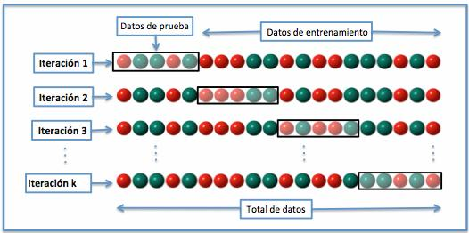
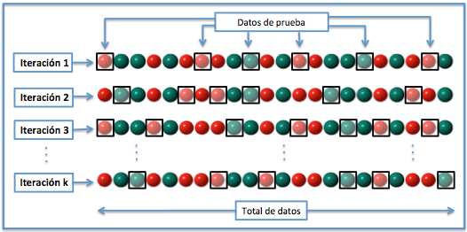
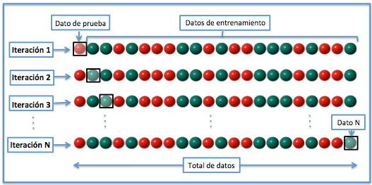
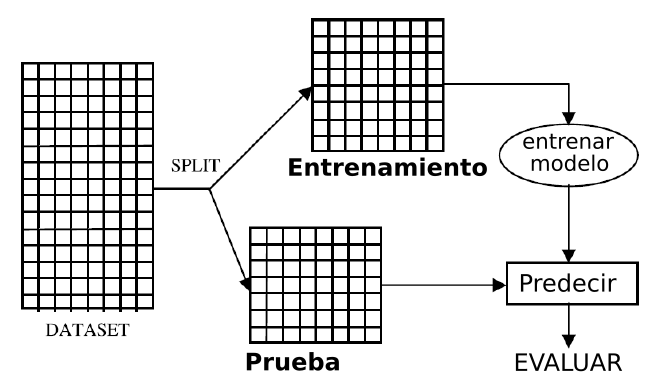
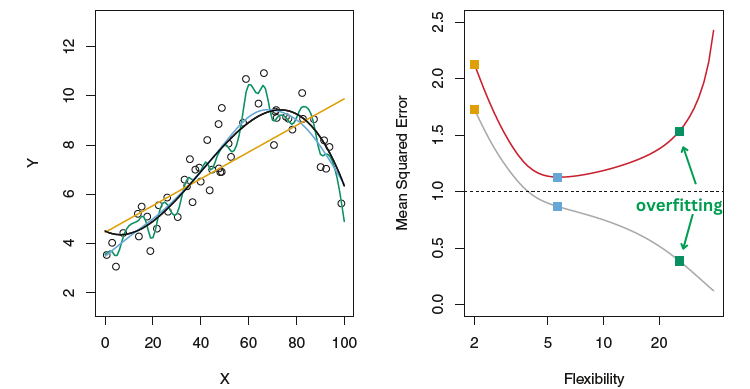
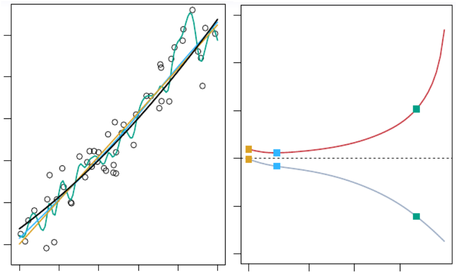
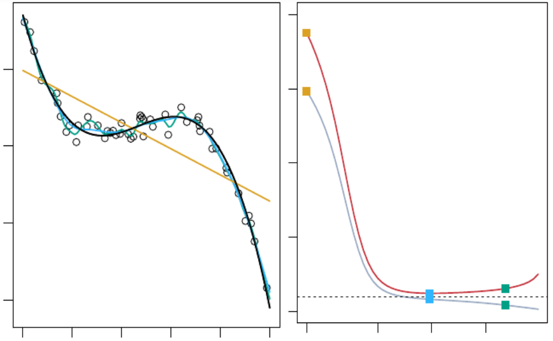
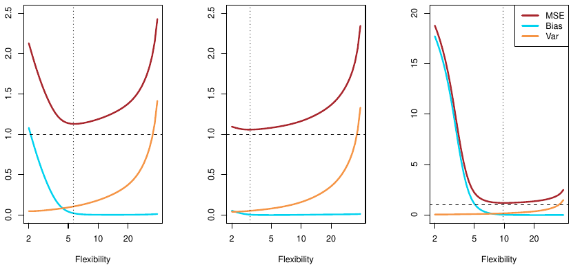
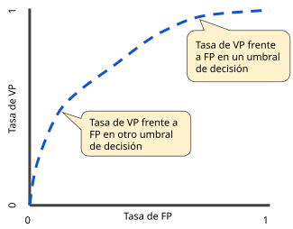

```{r}
#| label: setup
#| include: false
#| eval: true
library(tidyverse)
```

<!-- INTERNO (19-oct-2026). PRIMERA VERSION del reparto deck/anexo, hecha por Claude; se decide
con Pedro (plan `quality_reports/plans/2026-10-19_tema05-plan.md`, decision 6). Criterio usado:
en el deck queda lo que T06-T08 usan sin volver a explicar (partición, validación cruzada,
MSE/RMSE/MAE, logit, matriz, exactitud, sensibilidad, especificidad, ROC, AUC, sesgo-varianza,
variables omitidas); aqui va lo que solo se consulta (formulas de intervalos, funciones que
automatizan el bootstrap y la VC, tablas, criterios AIC/BIC, el resto de metricas, multiclase,
y la parte larga de causalidad). Comprobado con grep en T06-T10 y Proyect*: nada de lo de aqui
se usa despues sin reexplicarse. -->

## Esto es material de consulta

- Lo que hay aquí amplía el [Tema 05](Tema05.html): intervalos por fórmula, funciones que hacen el bootstrap y la validación cruzada sin bucle, tablas de resultados, criterios para comparar modelos sin partir la muestra, más métricas de clasificación, el logit con más de dos clases, y la discusión larga de predicción frente a causalidad

- Se consulta cuando hace falta en un trabajo; en clase no se ve

# Intervalos por fórmula

## Intervalos de confianza con `confint()`

- Bajo normalidad de $u$ (o con $n$ grande), $\hat\beta \sim N(\beta, Var(\hat\beta))$, y el intervalo al 95% es $\hat\beta \pm 1{,}96 \cdot se(\hat\beta)$. R lo da hecho:

```{r}
modelo <- lm(ventas ~ renta + descuento + zona, data = tienda)
confint(modelo)                      # todos los coeficientes
confint(modelo, "renta", level = 0.95)
```

- A mano, con el valor crítico de la normal (`qnorm`) o de la t de Student (`qt`, que es lo que usa `confint()`):

```{r}
b  <- coef(modelo)["renta"]
se <- summary(modelo)$coefficients["renta", "Std. Error"]
b + qnorm(c(0.025, 0.975)) * se
```

- Para la varianza del error, $(n - k)\, s^2 / \sigma^2 \sim \chi^2_{n-k}$, con $s^2$ = `summary(modelo)$sigma^2`, $n$ = `nobs(modelo)` y $k$ el número de coeficientes:

```{r}
n <- nobs(modelo); k <- length(coef(modelo)); s2 <- summary(modelo)$sigma^2
(n - k) * s2 / qchisq(c(0.975, 0.025), df = n - k)
```

- Con los datos del tema: `renta` 0,380 a 0,606 por fórmula, 0,370 a 0,604 por bootstrap. Las dos cosas miden lo mismo; el bootstrap no necesita el supuesto

## Intervalos de confianza y de predicción

- `predict()` puede dar, además del valor esperado, dos intervalos distintos:

```{r}
nuevos <- tibble(renta = 2000, descuento = 1,
                 zona = factor("ciudad",
                               levels = levels(tienda$zona)))
predict(modelo, newdata = nuevos, interval = "confidence")
predict(modelo, newdata = nuevos, interval = "prediction")
```

- **Confianza** (`"confidence"`): dónde está el gasto medio de todos los clientes con esas características; solo recoge la incertidumbre de los coeficientes

- **Predicción** (`"prediction"`): dónde caerá el gasto de un cliente concreto; añade la varianza de $u$, y por eso es mucho más ancho. Es el que responde a "cuánto gastará este cliente"

# Bootstrap y validación cruzada sin bucle

## `rsample::bootstraps()` y `boot::boot()`

- El bucle del tema es la forma de entenderlo. Para usarlo a diario hay funciones que lo hacen

::: {style="font-size: 88%;"}

:::: {.columns}
::: {.column width=50%}

```{r}
library(rsample)
remuestras <- bootstraps(tienda,
                         times = 1000)
coefs <- map_dbl(remuestras$splits,
  function(s) {
    m <- lm(ventas ~ renta + descuento +
              zona, data = as_tibble(s))
    coef(m)["renta"]
  })
sd(coefs)
quantile(coefs, c(0.025, 0.975))
```

- `map_dbl()` (`purrr`, dentro de `tidyverse`) aplica la misma función a cada elemento de una lista y devuelve un vector: el bucle `for` en una línea

:::
::: {.column width=50%}

- `boot` hace lo mismo con una función que recibe los datos y los índices de la remuestra:

```{r}
library(boot)
coef_renta <- function(datos, filas) {
  m <- lm(ventas ~ renta + descuento +
            zona, data = datos[filas, ])
  coef(m)["renta"]
}
boot(data = tienda,
     statistic = coef_renta, R = 1000)
```

:::
::::

:::

- En el Tema 07, `rsample` también parte la muestra (`initial_split()`) y crea los bloques de la validación cruzada (`vfold_cv()`)

## Variantes de la validación cruzada

- **K bloques** (la del tema): K = 5 o 10. Cada observación hace de prueba una vez

- **Dejar uno fuera** (*leave-one-out*, LOOCV): K = $n$. Se estima $n$ veces con $n - 1$ observaciones y se evalúa en la que falta. Sin azar, pero caro, y con mucha varianza entre iteraciones

- **Particiones aleatorias repetidas**: se repite muchas veces la partición entrenamiento/prueba con reemplazamiento del sorteo; una observación puede caer varias veces en prueba

- **Validación cruzada repetida**: K bloques, varias veces con distintas semillas, y se promedia todo. Es lo más estable

- Con `rsample`:

```{r}
vfold_cv(tienda, v = 5)                    # 5 bloques
vfold_cv(tienda, v = 5, repeats = 10)      # 5 bloques, diez veces
loo_cv(tienda)                             # dejar uno fuera
```

- Regla: la validación cruzada **elige** el modelo o el hiperparámetro; el error que se publica se mide en una muestra de prueba apartada **antes** de todo

## Validación cruzada de K bloques, paso a paso

:::: {.columns}
::: {.column width=52%}

{width=100% fig-align="center"}

- Se divide la muestra al azar en K bloques. Uno hace de prueba y los K-1 restantes de entrenamiento, en K iteraciones

- Evita depender de una partición concreta y usa todas las observaciones para estimar y para evaluar, aunque nunca a la vez

:::
::: {.column width=48%}

```{r}
set.seed(12345678)
bloque <- sample(rep(1:5,
  length.out = nrow(tienda)))
errores <- numeric(5)
for (k in 1:5) {
  entr <- tienda[bloque != k, ]
  prue <- tienda[bloque == k, ]
  m <- lm(ventas ~ poly(edad, 3),
          data = entr)
  pred <- predict(m, prue)
  e <- prue$ventas - pred
  errores[k] <- mean(e^2)
}
mean(errores)
```

:::
::::

## Validación cruzada aleatoria y dejar uno fuera

:::: {.columns}
::: {.column width=55%}

{width=80% fig-align="center"}

:::
::: {.column width=45%}

- **Aleatoria**: en cada iteración se reparte al azar entre entrenamiento y prueba, y una observación puede repetir como prueba

:::
::::

:::: {.columns}
::: {.column width=55%}

{width=80% fig-align="center"}

:::
::: {.column width=45%}

- **Dejar uno fuera**: una sola observación hace de prueba en cada iteración. Son $n$ iteraciones, y se promedian $n$ resultados

:::
::::

# Sobreajuste, sesgo y varianza

## Muestras de entrenamiento y de prueba

:::: {.columns}
::: {.column width=50%}

{width=60% fig-align="center"}

- ¿Por qué renunciar a parte de los datos? Evaluar bien el modelo importa más que un tamaño muestral algo mayor

- La estimación del error en prueba puede ser volátil, según las observaciones que caigan en cada grupo

:::
::: {.column width=50%}

{width=60% fig-align="center"}

- Al aumentar la flexibilidad, el MSE baja siempre en entrenamiento y forma una U en prueba

- El MSE en entrenamiento suele ser menor que en prueba

:::
::::

```{r}
set.seed(12345678)
n <- nrow(tienda)
filas <- sample(n, size = round(0.7 * n))
entrena <- tienda[filas, ]
prueba  <- tienda[-filas, ]
```

## Ajuste insuficiente, correcto y sobreajuste

:::: {.columns}
::: {.column width=50%}

{width=100% fig-align="center"}

:::
::: {.column width=50%}

{width=100% fig-align="center"}

:::
::::

- Figuras del libro ISL (*An Introduction to Statistical Learning*, figuras 2.9 a 2.11). Los **grados de libertad**, el número de valores del modelo que pueden variar, resumen la flexibilidad de una curva

## Trade-off varianza-sesgo

- El MSE esperado en la muestra de prueba se descompone en:

$$
\small E\left[\left(y-\hat{f}(x)\right)^2\right] = \underbrace{\left[E\left(\hat{f}(x)\right)-f(x)\right]^2}_{\text{sesgo}^2} + \underbrace{E\left(\left[\hat{f}(x)-E\left(\hat{f}(x)\right)\right]^2\right)}_{\text{varianza}} + \text{Var}(u)
$$

:::: {.columns}
::: {.column width=45%}

{width=100% fig-align="center"}

:::
::: {.column width=55%}

- **Sesgo**: error por supuestos erróneos sobre $f$. Se pierden relaciones relevantes entre $X$ e $Y$ (*underfit*)

- **Varianza**: sensibilidad a las fluctuaciones de la muestra de entrenamiento. Si el modelo aprende puro ruido, ajusta bien allí y predice mal casos nuevos (*overfit*)

- Es fácil construir un modelo con poco sesgo y mucha varianza, y al revés. El desafío es encontrar una flexibilidad con los dos bajos

:::
::::

## Sesgo y varianza con simulaciones

- 50 muestras de la relación conocida del tema y un ajuste de cada grado en cada una:

```{r}
#| eval: true
#| output: true
#| echo: false
#| fig-width: 10
#| fig-height: 2.8
#| out-width: 100%
f <- function(edad) 3900 - 2.5 * (edad - 45)^2
edad <- seq(20, 70, length.out = 50)
set.seed(7)
ajustes <- tibble()
for (r in 1:50) {
  s <- tibble(edad, ventas = f(edad) + rnorm(50, sd = 350))
  for (g in c(1, 2, 12)) {
    pred <- fitted(lm(ventas ~ poly(edad, g), s))
    ajustes <- bind_rows(ajustes, tibble(r, g, edad, pred))
  }
}
ggplot(ajustes, aes(edad, pred, group = r)) +
  geom_line(colour = "darkorange", alpha = 0.3) +
  geom_function(fun = f, linewidth = 1, inherit.aes = FALSE) +
  facet_wrap(~g, labeller = label_both) + labs(y = "ventas") + theme_minimal()
```

- **Grado 1**: las 50 rectas caen casi en el mismo sitio y todas lejos de la curva: sesgo. **Grado 2**: abrazan la curva. **Grado 12**: cada muestra da una curva distinta: varianza

- Con la tienda, 200 remuestras bootstrap y la predicción para un cliente de 65 años:

::: {style="font-size: 85%;"}

| Grado | Predicción media | Desviación típica entre remuestras |
|------:|-----------------:|-----------------------------------:|
| 1     | 3.993            | 110                                |
| 2     | 3.380            | 107                                |
| 5     | 3.424            | 136                                |
| 12    | 3.105            | 164                                |

:::

# Tablas y criterios de comparación

## Tablas de resultados en Quarto

- `tidy()` (paquete `broom`) convierte la salida de `lm()` en una tabla, que se puede manipular y presentar con `kable()`. La celda necesita `#| results: markup`

```{r}
library(broom); library(kableExtra)
modelo |> tidy() |>
  select(term, estimate, std.error) |>
  kbl(digits = 3) |> kable_classic()
```

- `modelsummary()` pone varios modelos en columnas, con estrellas de significatividad y las medidas de ajuste que se pidan:

```{r}
library(modelsummary)
modelos <- list(
  "Lineal"      = lm(ventas ~ renta + descuento + zona, data = tienda),
  "Logaritmo"   = lm(ventas ~ log(renta) + descuento + zona, data = tienda),
  "Parábola"    = lm(ventas ~ renta + descuento + zona +
                       edad + I(edad^2), data = tienda),
  "Interacción" = lm(ventas ~ renta * mujer + descuento + zona, data = tienda)
)
modelsummary(modelos, stars = TRUE,
             gof_map = c("nobs", "r.squared", "adj.r.squared", "rmse"))
```

- Es la forma habitual de presentar la tabla de la entrega 2 y las comparaciones del trabajo final

## Comparar modelos sin partir la muestra

- El $R^2$ sube siempre al añadir variables. Tres criterios lo **penalizan** por el número de coeficientes $k$:

  1. **$R^2$ ajustado**: $\bar{R}^2 = 1 - \dfrac{(1 - R^2)(n - 1)}{n - k - 1}$. Baja si la variable añadida aporta menos que un coeficiente al azar

  2. **AIC** y **BIC**: $-2 \log L + 2k$ y $-2 \log L + k \log n$. Menor es mejor; BIC penaliza más y elige modelos más pequeños

```{r}
summary(modelo)$adj.r.squared
AIC(modelo); BIC(modelo)
```

- Sirven para comparar modelos de la **misma** $y$ en los **mismos** datos. Son aproximaciones a lo que mide la validación cruzada; en el curso se elige con datos de prueba, que es lo que vale para cualquier modelo (también los de T07 y T08)

- **Significatividad individual** con varios términos de la misma variable (polinomio, tramos) engaña: los términos están correlacionados. Se contrasta el grupo entero (test F, `anova(modelo_chico, modelo_grande)`)

## Errores estándar robustos y las "pruebas de supuestos"

- La fórmula del error estándar de `summary()` supone varianza constante de $u$. Si varía con las $X$ (heterocedasticidad, lo habitual con gasto o renta), los coeficientes siguen bien y los errores estándar no. Se corrigen con errores estándar **robustos**:

```{r}
library(sandwich); library(lmtest)
coeftest(modelo, vcov = vcovHC(modelo, type = "HC1"))
modelsummary(modelo, vcov = "HC1")         # lo mismo dentro de la tabla
```

- El bootstrap de filas del tema también es robusto a esto

- A menudo se proponen "pruebas" de los supuestos del modelo lineal (normalidad, linealidad, colinealidad, heterocedasticidad). En este curso se tratan así:

  - **No linealidad**: se modeliza (Parte III del tema), no se contrasta

  - **No normalidad**: innecesaria con $n$ grande o con bootstrap

  - **Colinealidad**: dos variables que miden casi lo mismo; se quita una o se acepta el error estándar grande

  - **Heterocedasticidad**: errores estándar robustos

# Más métricas de clasificación

## Métricas de la matriz de confusión

::: {style="font-size: 80%;"}

| Métrica | Fórmula | Qué responde |
|---|---|---|
| Exactitud | $(VP + VN) / n$ | aciertos totales; engaña con clases desequilibradas |
| Sensibilidad (*recall*) | $VP / (VP + FN)$ | de los positivos reales, cuántos detecto |
| Especificidad | $VN / (VN + FP)$ | de los negativos reales, cuántos descarto |
| Precisión | $VP / (VP + FP)$ | de los marcados como positivos, cuántos lo son |
| Exactitud equilibrada | (sens. + espec.) / 2 | exactitud sin premiar a la clase mayoritaria |
| $F_\beta$ | $(1 + \beta^2)\, \text{prec} \cdot \text{sens} / (\beta^2\, \text{prec} + \text{sens})$ | $\beta = 1$: media armónica; $\beta > 1$ pesa más la sensibilidad |
| Kappa | exactitud corregida por el acierto esperado al azar | parecido a la exactitud equilibrada |

:::

- Logit del tema, umbral 0,5: precisión 7/8 = 0,875 (de 8 contactados, 7 tenían descuento) y sensibilidad 0,117. Las dos miran los positivos predichos desde lados distintos. En `yardstick` (Tema 07): `precision()`, `f_meas()`, `kap()`, `bal_accuracy()`

## Curva precisión-sensibilidad y otras pérdidas

- Con clases muy desequilibradas (fraude al 1%), la curva ROC puede parecer buena porque la tasa de falsos positivos se calcula sobre muchísimos negativos. La curva **precisión-sensibilidad** (PR) y su área (**PR-AUC**) miran solo lo que pasa con los positivos, y son más exigentes

```{r}
library(yardstick)
logit <- glm(descuento ~ renta + edad + zona,
             data = tienda, family = "binomial")
datos <- tienda |>
  mutate(prob = predict(logit, type = "response"),
         descuento = factor(descuento, levels = c(1, 0)))
pr_curve(datos, truth = descuento, prob)
pr_auc(datos, truth = descuento, prob)
roc_curve(datos, truth = descuento, prob)
roc_auc(datos, truth = descuento, prob)
```

- Otras funciones de pérdida que no fijan umbral: la **log-loss** (menos la log-verosimilitud media), que penaliza dar probabilidad alta a la clase equivocada, y la **curva de ganancia**, que ordena por probabilidad y dice qué fracción de positivos se captura contactando al x% con mayor probabilidad

- Con **más de dos clases** se calcula una ROC por clase (esa clase frente a todas las demás) y se promedian, con o sin ponderar por el tamaño de cada clase (`roc_aunu()`, `roc_aunp()`)

## Curva ROC: cada punto es un umbral

:::: {.columns}
::: {.column width=50%}

{width=100% fig-align="center"}

:::
::: {.column width=50%}

- Reducir el umbral clasifica más observaciones como positivas, verdaderas y falsas: nos movemos hacia arriba y a la derecha

- Por debajo de la diagonal, el clasificador predice más positivos entre los negativos que entre los positivos

:::
::::

# Logit: detalles y más de dos clases

## Verosimilitud y log-odds

- El logit no minimiza la SCR: elige los $\beta$ que hacen **más probable** observar los unos y ceros de la muestra (**máxima verosimilitud**):

$$
\small L(\beta) = \prod_{i:\, y_i = 1} p(x_i) \prod_{i:\, y_i = 0} \left(1 - p(x_i)\right), \qquad p(x) = \Lambda(\beta_0 + \beta_1 x_1 + \ldots)
$$

- La probabilidad relativa (**odds**) es $\dfrac{p}{1 - p} = e^{\beta_0 + \beta_1 x_1 + \ldots}$, así que el **log-odds** es lineal: $\beta_j$ es el cambio en el logaritmo de la probabilidad relativa por una unidad de $x_j$, y $e^{\beta_j}$ el factor por el que se multiplica la odds

- El efecto sobre la **probabilidad** depende del punto: $\partial p / \partial x_j = \beta_j\, p\, (1 - p)$. Máximo en $p = 0{,}5$ y casi nulo en los extremos. Un resumen habitual es el efecto **medio** sobre los clientes de la muestra:

```{r}
p <- predict(logit, type = "response")
mean(coef(logit)["renta"] * p * (1 - p))
```

## Más de dos clases

- Con una variable de $C$ categorías (producto elegido, tipo de contrato), el logit **multinomial** tiene un índice lineal por clase:

$$
\small \Pr(Y = c \mid X) = \frac{e^{\beta_{0c} + \beta_{1c} x_1 + \ldots}}{\sum_{l = 1}^{C} e^{\beta_{0l} + \beta_{1l} x_1 + \ldots}}
$$

- Dos implementaciones. `nnet::multinom()` con fórmula; `glmnet` con matrices (es lo que usa el Tema 06 para regularizar):

```{r}
library(nnet)
multinom(zona ~ renta + edad, data = tienda)

library(glmnet)
x <- model.matrix(zona ~ renta + edad, data = tienda)[, -1]
mod <- glmnet(x, tienda$zona, family = "multinomial", lambda = 0)
predict(mod, newx = x, type = "response")   # una probabilidad por clase
predict(mod, newx = x, type = "class")      # la clase más probable
```

- La clase predicha es la de mayor probabilidad; las métricas se calculan clase a clase o promediadas

## Regresión lineal: comentarios finales

- Estos modelos informan de la relación entre los regresores y la variable dependiente. **Correlación no implica causalidad**, salvo en ensayos aleatorios controlados o pruebas A/B

- La selección de variables es importante, porque evita sesgos y afecta a la variabilidad:

```{r}
lm(ventas ~ descuento, data = tienda) |> summary()
lm(ventas ~ descuento + renta, data = tienda) |> summary()
lm(ventas ~ renta, data = tienda) |> summary()
lm(ventas ~ renta + educ, data = tienda) |> summary()
```

- Los valores atípicos pueden tratarse sin afectar a la validez del modelo

# Predicción y causalidad

```{r}
#| eval: true
#| include: false
tienda <- read_csv("data/tienda.csv", show_col_types = FALSE)
```

## Dos preguntas que suenan igual

- Dirección pregunta dos cosas sobre el descuento:
  1. «¿Cuánto gastará un cliente **con** descuento?»: **predecir**. Vale cualquier modelo que acierte en prueba
  2. «¿Cuánto **más** gastaría un cliente si **le diéramos** el descuento?»: un **efecto**
- El efecto del descuento sobre un cliente es la diferencia entre dos gastos: el que tiene con descuento y el que tendría sin él. Solo se observa **uno** de los dos:

| cliente | descuento | gasto con descuento | gasto sin descuento | efecto |
|:-------:|:---------:|:-------------------:|:-------------------:|:------:|
|    1    |     1     |        4.284        |          ?          |   ?    |
|    2    |     0     |          ?          |        3.773        |   ?    |

- Lo que sí se puede estimar es el efecto **medio**: comparar el gasto medio de los que tienen descuento con el de los que no, **si los dos grupos son iguales en todo lo demás**

::::{.notes}
- Filas 1 y 2 de `tienda.csv`. Verificado el 2-nov-2026.
- El gasto que tendría sin descuento es el **contrafactual**.
::::

## Lo que hizo la tienda: elegir a mano

:::: {.columns}
::: {.column width=50%}

- La tienda eligió a quién dar el descuento, y eligió clientes de **renta baja**: renta media **1.497** con descuento frente a **2.336** sin él
- Los dos grupos ya eran distintos **antes** del descuento. Comparar sus gastos medios mezcla dos cosas, el descuento y la renta:
  - gasto medio con descuento 3.886, sin él 3.983: el descuento parece restar **97** euros
  - es el coeficiente de `lm(ventas ~ descuento)`, y responde mal a la pregunta 2
- **Selección**: quién recibe el descuento depende de algo (la renta) que también mueve el gasto. Es la variable omitida, vista desde la pregunta que importa

:::
::: {.column width=50%}

::: {style="font-size: 80%;"}

```{r}
#| eval: true
#| output: true
#| echo: true
#| fig-width: 5
#| fig-height: 3.4
ggplot(tienda, aes(renta, ventas,
  colour = factor(descuento))) +
  geom_point(alpha = 0.5) +
  scale_colour_manual(
    values = c("grey55", "red"),
    labels = c("sin descuento",
               "con descuento")) +
  labs(colour = NULL) + theme_minimal()
```

:::

:::
::::

::::{.notes}
- 60 clientes con descuento y 344 sin él. Verificado el 2-nov-2026.
::::

## Lo que arregla la regresión, y lo que no

- Con la renta en el modelo, el coeficiente compara clientes de **la misma renta**: `lm(ventas ~ descuento + renta)` da **+320** euros
- La regresión iguala los grupos en lo que **está en la tabla**. La tienda eligió a mano, y pudo mirar cosas que la tabla no tiene: fidelidad, quejas, lo que sabía el vendedor
  - si alguna de esas cosas también mueve el gasto, el coeficiente sigue mezclando
  - con datos observacionales nunca se sabe que no queda nada fuera
- Por eso un coeficiente predictivo, por preciso que sea, responde a la pregunta 1 y solo a veces a la 2

::::{.notes}
- `lm(ventas ~ descuento + renta)`: +320; con renta y zona, +332; con todas las columnas en lineal, +497. Verificado el 2-nov-2026.
- La regla del signo del sesgo y su fórmula: anexo.
::::

## Repartir al azar: el experimento

:::: {.columns}
::: {.column width=50%}

- La única forma de que los grupos sean iguales en **todo**, observado y no observado, es repartir el descuento **al azar**: una **prueba A/B**
- Con 1.000 repartos al azar de los 60 descuentos entre los 404 clientes, la diferencia de renta media entre los dos grupos queda entre **-273 y +291** euros. La tienda hizo **-839**
- El azar reparte igual la edad, los estudios y todo lo que la tabla no tiene
- Con reparto al azar, la diferencia de gasto medio **es** el efecto medio del descuento, y `lm(ventas ~ descuento)` lo estima bien

:::
::: {.column width=50%}

::: {style="font-size: 80%;"}

```{r}
#| eval: true
#| output: true
#| echo: true
#| fig-width: 5
#| fig-height: 2.6
set.seed(2027)
dif <- numeric(1000)
for (b in 1:1000) {
  azar <- sample(tienda$descuento)
  dif[b] <- mean(tienda$renta[azar == 1]) -
            mean(tienda$renta[azar == 0])
}
ggplot(tibble(dif), aes(dif)) +
  geom_histogram(bins = 30) +
  geom_vline(xintercept = -839,
             colour = "red") +
  theme_minimal()
```

:::

:::
::::

::::{.notes}
- `sample(tienda$descuento)` baraja los 60 unos y 344 ceros: es un reparto al azar con el mismo número de descuentos.
- Verificado el 2-nov-2026 (semilla 2027): media 0, sd 147, percentiles 2,5 y 97,5 en -273 y 291, máximo en valor absoluto 527. La diferencia observada, -839, queda sola a la izquierda.
- Sin experimento, la regla del curso: «esta variable importa» quiere decir «el modelo la usa para predecir». Qué pasaría si la cambiamos es otra pregunta, con otros métodos (Econometría). Lo que puede fallar en un experimento y los métodos sin experimento: anexo.
::::

## El sesgo por variable omitida

- Modelo verdadero $y = \beta_0 + \beta_1 x + \beta_2 z + u$, y se estima **sin** $z$. El coeficiente de $x$ que sale estima:

$$
\small \beta_1 + \beta_2 \cdot \delta, \qquad \text{donde } \delta \text{ es la pendiente de } z \text{ sobre } x
$$

- El signo del sesgo es el producto de los signos: efecto de $z$ sobre $y$ ($\beta_2$) por relación entre $z$ y $x$ ($\delta$)

- El caso del tema: $x$ = descuento, $z$ = renta. La renta sube el gasto ($\beta_2 > 0$) y el descuento fue a rentas bajas ($\delta < 0$): sesgo **negativo**, y el +500 se queda en -97 al omitir la renta

- Lo mismo con el modelo completo: si la tienda eligió además por algo que no está en la tabla y que se relaciona con el gasto, el coeficiente sigue sesgado. Con datos observacionales nunca se sabe que no queda nada fuera

## Ensayos aleatorios y pruebas A/B

- La única forma de que $\delta = 0$ para **todas** las variables, observadas o no, es que $x$ se asigne **al azar**: ensayo aleatorio controlado. En empresa, **prueba A/B**: la mitad de los clientes (al azar) recibe el descuento, la otra mitad no, y se compara el gasto

- Con asignación al azar, `lm(ventas ~ descuento)` **sí** estima el efecto: los dos grupos son iguales en todo lo demás, en promedio

- Lo que puede fallar incluso así: que los clientes no usen el descuento (incumplimiento), que se vayan antes de medir (desgaste), que el descuento de unos afecte a otros (interferencia)

- Sin experimento hay métodos para aproximarse (diferencias en diferencias, variables instrumentales, discontinuidades) que son materia de Econometría. En este curso la regla es la del tema: **un coeficiente predictivo no dice qué pasaría si cambiamos la variable**

## Un ejemplo con otros datos: descuentos y ventas

- `discount.csv` (página Datos): ventas y porcentaje medio de descuento de 404 clientes, con su renta

```{r}
datos <- read_csv("data/discount.csv")
lm(sales ~ discount, data = datos) |> coef()
lm(sales ~ discount + income, data = datos) |> coef()
datos |> mutate(renta_baja = income < 7500) |>
  ggplot(aes(x = discount, y = sales)) + geom_point() +
  geom_smooth(method = "lm") + facet_wrap(~ renta_baja)
```

- La misma estructura que en la tienda: los descuentos mayores fueron a rentas bajas. Separando por renta, la pendiente cambia de signo

- Es un ejercicio de cinco minutos para comprobar que se ha entendido la regla del signo
