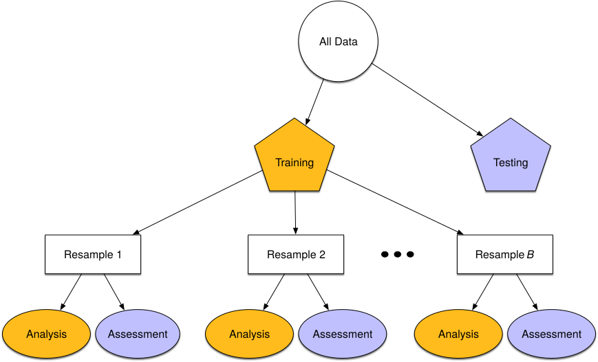

```{r}
#| label: setup
#| include: false
#| eval: true

# Elimino todo del Entorno
rm(list = ls())

# Cargo bibliotecas necesarias
library(tidyverse)
library(tidymodels)
options(width = 78, pillar.sigfig = 4)
```

<!-- INTERNO (11-nov-2026). Deck rehecho por la revisión de Pedro del 11-nov
(`quality_reports/plans/2026-11-11_T07-tidymodels-sin-comparaciones.md`): los cinco pasos, cada uno con su ejemplo
(qué entra y qué sale), el preprocesado (fórmula y receta) ANTES del flujo y del afinado, partición 80/20 y
comparaciones con el T06 y scikit-learn en el anexo. Siguen vigentes las seis rondas del plan
`quality_reports/plans/2026-11-06_tema07.md` y `notes/Tema07/cambios-tidymodels.md`.
Datos: `tienda` (regresión) y `churn_clientes` (clasificación), ya presentados en el T05 y el T06.
Cifras con semilla 12345678, `initial_split(prop = 0.8)`, `vfold_cv(v = 10)` y UNA rejilla para todo el tema:
`grid_regular(penalty(range = c(-4, 3)), levels = 71)`. Verificadas el 11-nov-2026 con tidymodels 1.5.0,
recipes 1.4.0, tune 2.1.0 y glmnet 5.0: niveles, λ 20,0, RMSE de validación cruzada 363,3 y de prueba 339,6 (bloques tras crear la receta, como en el deck; 26-nov);
logaritmos, 400 € de validación cruzada y 361 € en prueba; churn, λ 0,0032, AUC 0,737 y 0,749 en prueba.
El reparto en sesiones y el tiempo los decide Pedro: el deck no menciona sesiones. -->

# El proceso con `tidymodels`

## Los cinco pasos de `tidymodels`

::: {style="font-size: 82%;"}

- `tidymodels` es una colección de paquetes con las **herramientas para seguir en orden el proceso de estimar un modelo**: el explicado en el Tema 05, el mismo que hace `cv.glmnet()` en el Tema 06 y scikit-learn en Python ([anexo](Tema07anexo.html#/del-tema-06-a-tidymodels))
  - las mismas funciones sirven para cualquier modelo

```{r}
#| eval: true
library(tidymodels)
```

- Cada paso crea un **objeto**, que usan los pasos siguientes

| Paso | Qué entra | Qué sale | Funciones |
|---|---|---|---|
| 1. Partir | los datos | `part`: el reparto en entrenamiento y prueba | `initial_split()` |
| 2. Preprocesado, modelo y flujo | una fórmula o una receta, y un tipo de modelo | `flujo`: todo lo que hay que estimar, en un objeto | `recipe()`, `linear_reg()`, `workflow()` |
| 3. Bloques | el entrenamiento | `bloques`: los repartos de la validación cruzada | `vfold_cv()` |
| 4. Afinar | `flujo`, `bloques` y una rejilla de $\lambda$ | `ajuste`: el error de cada $\lambda$, y el elegido | `tune_grid()`, `select_best()` |
| 5. Finalizar y evaluar | `flujo`, el $\lambda$ elegido y `part` | `final`: el modelo y su error de prueba | `finalize_workflow()`, `last_fit()` |

- Con un ejemplo, predecir el gasto de los clientes de la tienda con LASSO, vemos qué entra y qué sale en cada paso

:::

::::{.notes}
- Paquetes y su papel: `rsample` (partir), `parsnip` (modelos), `workflows` (flujos), `recipes` (preprocesado), `tune` (afinar), `yardstick` (métricas), `dials` (rejillas). `library(tidymodels)` los carga todos y además `dplyr`, `ggplot2`, `purrr` y `tibble`; `readr` hay que cargarlo con `tidyverse`.
- Por qué el paso 1: si el error se mide en los mismos bloques que eligieron $\lambda$, sale optimista (sesgo de optimización); detalle en el anexo.
- La misma gramática servirá para los modelos del Tema 08.
::::


# Paso 1: partir los datos

## Los datos: la tienda

::: {style="font-size: 92%;"}

```{r}
#| eval: true
tienda <- read_csv("data/tienda.csv") |>
  mutate(zona = factor(zona, levels = c("pueblo", "ciudad", "capital")),
         educ = factor(educ))
```

- Son los **404 clientes** de los Temas 05 y 06: el gasto anual (`ventas`) y seis variables con las que predecirlo

- La tienda quiere predecir el gasto de los clientes nuevos con el modelo flexible del Tema 06, con polinomios e interacciones, estimado por LASSO

- Las cualitativas (`zona`, `educ`) se convierten en factor **antes** de partir los datos ([errores frecuentes](Tema07anexo.html#/errores-frecuentes))
  - así sus niveles quedan fijados en todas las partes, aunque en alguna falten observaciones de un nivel

:::

::::{.notes}
- `educ` tiene siete niveles (8 a 20 años), así que son 6 columnas 0/1 con 8 años como referencia; `zona`, 2.
- Verificado el 11-nov-2026: con `factor(educ)` dentro de la fórmula, como en el Tema 06, `tune_grid()` avisa «Can't subset columns that don't exist: `factor(educ)10`...» en 1 de los 10 bloques, y las medias se calculan con 9. Con el factor creado antes, los niveles están fijos y la matriz tiene siempre las mismas columnas.
::::

## Partición inicial: `initial_split()`

::: {style="font-size: 92%;"}

```{r}
#| eval: true
#| output: true
set.seed(12345678)
part <- initial_split(tienda, prop = 0.8)
part
```

- `initial_split()` sortea qué clientes van a entrenamiento: el 80 % (`prop`)

- `part` es un **objeto de R**: una lista que guarda dentro varios objetos (como el resultado de `lm()`)
  - guarda el **reparto**: otras funciones lo leen y extraen de él lo que necesitan, p.e. las tablas de entrenamiento y de prueba

```{r}
#| eval: true
training(part)     # la tabla con los 323 clientes de entrenamiento
testing(part)      # la tabla con los 81 de prueba
```

- La prueba queda apartada hasta el paso 5: ni se mira ni entra en ninguna decisión

:::

::::{.notes}
- Basta un `set.seed()` antes para reproducir la partición. Con `prop = 0.8` y 404 filas, `initial_split()` redondea hacia abajo: 323 y 81. El Tema 05 dijo entrenamiento 70-80 % y usó `sample()` con 0,7.
- Dentro, `names(part)` da `data` (los 404 clientes), `in_id` (las filas sorteadas para entrenamiento), `out_id` e `id`. `part$out_id` vale `NA`: las filas de prueba son las que faltan en `in_id`. `part$id` es una etiqueta.
- En clasificación, `strata = y` reparte la respuesta en la misma proporción en las dos partes: se usa con `churn` al final del tema.
- `initial_validation_split()` parte en tres (entrenamiento, validación, prueba): es la alternativa a la validación cruzada de la figura `train_validate.png` del deck viejo. No se usa en el curso.
::::

# Paso 2: preprocesado, modelo y flujo

## El preprocesado: fórmula o receta

::: {style="font-size: 88%;"}

- La limpieza general de los datos va antes (Tema 04). **Preprocesar** para modelizar es construir las columnas que recibe cada estimación (logaritmos, polinomios, una columna 0/1 por categoría, interacciones)
  - algunos modelos necesitan una transformación concreta (p.e. estandarizar)
  - probar distintas especificaciones: variables, con o sin interacciones, [quitando ausentes o imputándolos](Tema07anexo.html#/otros-pasos-de-receta)

- Dos formas de escribirlo:
  - la **fórmula**, p.e. la del modelo flexible del [Tema 06](Tema06.html#/los-datos-la-tienda-con-un-modelo-flexible)

    ```{r}
    #| eval: true
    formula <- ventas ~ (poly(edad, 4) + poly(log(renta), 4) +
                           educ + mujer + descuento + zona)^2
    ```

  - la **receta**: una lista de pasos, que admite algunos que la fórmula no tiene (p.e. estandarizar)

    ```{r}
    #| eval: true
    receta <- recipe(ventas ~ edad + renta + mujer + educ + descuento + zona,
                     data = training(part)) |>
      step_log(renta) |>
      step_poly(edad, renta, degree = 4) |>
      step_dummy(educ, zona) |>
      step_normalize(all_numeric_predictors())   # glmnet ya lo hace
    ```

- `recipe()` fija la respuesta y los predictores; cada `step_*()` añade una transformación, en ese orden
  - cada paso se aplica a las variables que se nombran o a grupos: `all_predictors()`, `all_numeric_predictors()`, `all_nominal_predictors()`, `all_outcomes()`, `contains("edad")`...

:::

::::{.notes}
- `recipe()` no admite funciones en la fórmula: `recipe(ventas ~ log(renta) + edad, ...)` da error al preparar («Misspelled variable name or in-line functions detected... Use steps to do transformations instead»); por eso `step_log()`. `recipe(ventas ~ ., ...)` toma todas las demás columnas.
- Los selectores se combinan y se excluye con `-`: `step_scale(all_predictors(), -all_nominal())` es lo mismo que `step_scale(all_numeric(), -all_outcomes())` (verificado el 16-nov-2026).
- `poly()` y `log()` sí pueden ir en la fórmula: la base del polinomio se aprende en los datos de estimación y se aplica a los de predicción (`makepredictcall`), igual que en `lm()` y `predict()`.
- Con la fórmula, `model.matrix(formula, training(part)) |> dim()` da 323 filas y 144 columnas: 143 más la constante, 18 de las variables una a una y 125 de sus interacciones de dos en dos. Dentro del flujo la fórmula construye la matriz sola.
- Con la receta, el primer cliente (30 años, 12 años de estudios, ciudad) sale con `educ_X12 = 1`, `zona_ciudad = 1` y sus cuatro valores de `edad_poly`.
- En código ajeno aparece `juice(receta_preparada)`: devolvía el entrenamiento transformado, y desde recipes 0.1.14 es lo mismo que `bake(receta_preparada, new_data = NULL)`; sigue funcionando sin aviso.
- Con `step_normalize(renta, edad)`, `prep()` aprende las medias y desviaciones típicas del entrenamiento (2.192 € y 46,0 años); al hornear la prueba con ellas, la renta normalizada de la prueba tiene media 0,09 y no 0, porque su media es 2.286 €. Es lo que tiene que pasar. Verificado el 11-nov-2026.
- `step_select()` está obsoleta (recipes 1.3.0) y avisa: las columnas se eligen con `select()` antes de la receta, o se quitan con `step_rm()`. Los pasos de imputación (`step_impute_*`), `step_other()`, `one_hot = TRUE` existen y no hacen falta con estos datos: tabla del anexo.
- `step_dummy()` es necesario en `tidymodels` para los modelos que no entienden factores. `glmnet` por la fórmula los crea solo.
- Primer cliente del entrenamiento con la semilla 12345678: ventas 4.296, renta 1.726, edad 30, mujer, educ 12, ciudad, sin descuento; `edad_poly_1` = −0,064.
::::

## La receta es un plan

::: {style="font-size: 84%;"}

- Se usa en dos tiempos:
  - `prep()` **prepara** la receta: calcula con unos datos lo que necesita cada paso (p.e. la base de cada polinomio)
  - `bake()` **aplica** la receta preparada a unos datos: los mismos (`new_data = NULL`), los de prueba u otros

```{r}
#| eval: true
#| output: true
receta |> prep() |> bake(new_data = NULL) |> names()   # 18 columnas más ventas
```

- Los pasos cambian los nombres: `edad` pasa a ser `edad_poly_1` a `edad_poly_4`
- `step_interact()` va **después**, con los nombres nuevos; con `~ zona:edad` da error

```{r}
step_interact(~ starts_with("zona_"):starts_with("edad_poly"))   # 2 x 4 = 8 columnas
step_interact(~ all_predictors():all_predictors())               # todos los pares
```

:::

::::{.notes}
- En versiones anteriores de `recipes`, `~ zona:edad` creaba cero columnas sin aviso; desde la 1.4.0 avisa y falla. Verificado el 11-nov-2026.
- Con dos cualitativas: `~ starts_with("zona_"):starts_with("educ_")`.
- `step_interact()` multiplica columnas, y `( ... )^2` en la fórmula, variables: con todos los pares salen 153 productos frente a 125 (práctica 1).
- Ayuda de `recipes`: `prep()` «estimate the required parameters from a training set that can be later applied to other data sets»; `bake()` «apply the computations to new data».
::::

## Definir el modelo: `linear_reg()`

::: {style="font-size: 92%;"}

- Un modelo se define en dos partes:
  - el **tipo**: `linear_reg()` para regresión, `logistic_reg()` para un logit
  - el **motor** que lo estima: `set_engine()`

- Los argumentos se llaman igual con cualquier motor (`lm`, `glm`, `glmnet`...), aunque en cada función original tengan otro nombre:
  - `penalty` es $\lambda$, y `mixture`, la mezcla de penalizaciones: 1 es LASSO y 0, Ridge regression
  - `tune()` en lugar de un valor deja el argumento por fijar: se elegirá con los datos en el paso 4

```{r}
#| eval: true
lasso <- linear_reg(penalty = tune(), mixture = 1) |>
  set_engine("glmnet")
```

- El resultado es una **especificación**: el modelo todavía no ha visto ningún dato

:::

::::{.notes}
- En `glmnet()`, `penalty` se llama `lambda` y `mixture`, `alpha`.
- La lista de tipos de modelo y motores: <https://www.tidymodels.org/find/parsnip/>. `logistic_reg()` con `set_engine("glm")` es `glm(family = binomial)`.
- `set_mode("regression")` o `("classification")` hace falta en los modelos que sirven para las dos cosas (Tema 08); `linear_reg()` y `logistic_reg()` ya lo saben.
- El motor `glmnet` estandariza las variables por defecto (`standardize = TRUE`), como en el Tema 06, y devuelve los coeficientes en las unidades originales.
- `linear_reg()` con los valores por defecto es MCO con `lm()`. El deck viejo escribía MCO como `linear_reg(engine = "glmnet", penalty = 0)`: funciona, pero `linear_reg()` a secas es más claro.
- En las notas de la receta: con los nombres originales (`~ zona:edad`) `prep()` avisa «Interaction specification failed» y da error.
::::

## El flujo de trabajo: `workflow()`

::: {style="font-size: 86%;"}

- Un flujo junta el **preprocesado** (fórmula o receta) y el **modelo** en un solo objeto $\Rightarrow$ para los pasos 4 y 5

```{r}
#| eval: true
flujo <- workflow(formula, lasso)       # con una receta: workflow(receta, lasso)
```

- El flujo se aplica a unos datos para hacer dos cosas:
  - construir con esos datos las columnas que necesita el modelo
  - con el entrenamiento, estimar el modelo; con la prueba u otros datos, predecir con lo estimado

- Si un flujo lleva un `tune()`, no se puede estimar hasta elegir los hiperparámetros (paso 4)

- Ejemplo sin nada que afinar, el modelo flexible por MCO, que se estima con `fit()`:

```{r}
#| eval: true
mco <- workflow(formula, linear_reg()) |> fit(training(part))
```

- Con el flujo estimado:

```{r}
tidy(mco)                                 # tabla de coeficientes: 143 y constante
predict(mco, new_data = training(part))   # tabla con .pred, para cualquier dato
augment(mco, new_data = training(part)) |>  # los datos más .pred
  rmse(ventas, .pred)                       # error: 256; también mae()...
```

- En clasificación, `predict()` da la clase (`type = "class"`, por defecto) o las probabilidades (`type = "prob"`)

:::

::::{.notes}
ACLARATORIO para clase: el mismo MCO de la manera que ya conocen, con `lm()`, y con el flujo.

```{r}
#| label: aclara-lm-flujo
#| eval: false
mco_trad <- lm(data = training(part), formula)                  # como lo hacíais hasta ahora
mco <- workflow(formula, linear_reg()) |> fit(training(part))   # lo mismo, con un flujo
summary(mco_trad)   # coeficientes, errores estándar, R²: una lista que se imprime ordenada
summary(mco)        # sobre un flujo no da los coeficientes
tidy(mco)           # los mismos coeficientes, en una tabla
```

- En qué se parecen: es el mismo modelo con los mismos datos, y los coeficientes son idénticos (R² 0,953 con los dos).
- En qué se diferencian:
  - `lm()` estima y ya; el flujo junta la fórmula (o la receta) y el modelo en un objeto, que después se estima con `fit()`.
  - `summary()` da una lista: para usar un número hay que sacarlo con `$` (`summary(mco_trad)$r.squared`); `tidy()` da una tabla, que se filtra, se ordena y se dibuja como cualquier otra.
- Ventajas del flujo:
  - cambiar de modelo es cambiar una pieza (`linear_reg()` por el lasso, un árbol o los vecinos) sin tocar lo demás;
  - `tidy()`, `predict()` y `augment()` funcionan igual con todos los modelos;
  - el preprocesado viaja con el modelo y se aplica igual a los datos nuevos.
- Inconvenientes: para un MCO suelto es más código, y `summary()` ya no sirve.
- Por qué lo usamos: en este tema hay que afinar $\lambda$ con validación cruzada y comparar modelos, y eso lo hacen `tune_grid()` y `last_fit()`, que reciben un flujo.

- `workflow(formula, lasso)` es un atajo de `workflow() |> add_formula(formula) |> add_model(lasso)`, que es como lo escriben los tutoriales; con una receta, `add_recipe()`.
- El flujo estimado guarda la receta preparada (si la lleva) y los resultados de la estimación, para usarlos de varias formas:
  - `extract_recipe(flujo_est) |> bake(testing(part))` aplica la receta preparada a otros datos (con una fórmula da error: «The workflow must have a recipe preprocessor»);
  - `extract_fit_parsnip(flujo_est) |> tidy()` da los resultados de la estimación, y `glance()` otros detalles (R², AIC, BIC...);
  - `predict()` recibe el flujo estimado y unos datos: transforma los datos con la receta guardada y aplica los parámetros estimados. Devuelve una tabla: en regresión, `type = "numeric"` por defecto y `type = "conf_int"` (solo con `lm`); en clasificación, `type = "class"` por defecto y `type = "prob"`.
  - En clasificación es igual: `workflow(receta, logistic_reg()) |> fit(...)`, y después `tidy()`, `glance()`, `predict()`. Verificado el 16-nov-2026.
- Del flujo estimado, `extract_fit_parsnip()` da los resultados (`tidy()`, `glance()`) y, si lleva una receta, `extract_recipe()` la aplica a otros datos con `bake()`; con una fórmula da error («The workflow must have a recipe preprocessor»). Verificado el 16-nov-2026.
- `augment()` devuelve los datos con `.pred` y `.resid`: es la forma cómoda de predecir con un flujo estimado. `predict(mco, new_data = ...)` da solo la columna `.pred`.
- MCO da 256 en entrenamiento y 814 en validación cruzada (con el $\lambda$ más pequeño de la rejilla): el de entrenamiento engaña más cuanto menos se penaliza.
- Verificado el 11-nov-2026: `tidy(mco)` tiene 144 filas; el RMSE de entrenamiento de MCO es 256,0. En validación cruzada, el $\lambda$ más pequeño de la rejilla (casi sin penalización) da 814, y MCO exacto, con `fit_resamples(workflow(formula, linear_reg()), bloques)`, 969 (± 173) (26-nov): el sobreajuste del Tema 06. Se retoma en el anexo, «Tres errores del mismo modelo».
- Las métricas son de `yardstick`: primero la columna observada y después la predicha.
::::

# Paso 3: los bloques de validación cruzada

## Validación cruzada: `vfold_cv()`

::: {style="font-size: 84%;"}

- El modelo tiene un hiperparámetro, $\lambda$: se elige mediante validación cruzada **dentro del entrenamiento**
  - cada valor candidato de $\lambda$ se estima y se mide en todos los repartos, y se elige el de menor error medio (paso 4)

```{r}
#| eval: true
bloques <- vfold_cv(training(part), v = 10)   # 10 bloques de clientes al azar
```

- `bloques` tiene una fila por reparto (p.e. `[290/33]`: 290 clientes y 33): miradlo en el entorno

:::: {.columns}
::: {.column width=42%}

- En cada reparto (cada fila de la figura), el entrenamiento se divide en:
  - **análisis**: nueve bloques, con los que se estima el modelo
  - **evaluación**: el bloque restante, en el que se mide el error de cada $\lambda$

- La **prueba** queda fuera de todos los repartos: mide el error con el $\lambda$ elegido (paso 5)

:::
::: {.column width=58%}

{width=100% fig-align="center"}

:::
::::

:::

::::{.notes}
- `bloques` es otro objeto: una tabla con una fila por reparto, y cada reparto (columna `splits`) es un objeto como `part`. `analysis(bloques$splits[[1]])` da los 290 clientes del resto y `assessment()`, los 33 apartados.
- Nombres de `tidymodels`: la partición inicial se llama `training`/`testing`; dentro de cada bloque, `analysis()` es el resto y `assessment()` el apartado, para que no se confundan los dos niveles (tmwr §10.2). En clase: análisis, evaluación y prueba.
- Cada cliente del entrenamiento cae en un bloque y solo en uno: se aparta una vez y está en el resto las otras nueve.
- Material del curso pasado, como alternativa a `initial_split()`: bloques sobre todos los datos y `fit_resamples()`, que estima el mismo flujo en cada reparto sin nada que afinar. `bloques_todos <- vfold_cv(tienda, v = 10)`; `workflow(ventas ~ edad + log(renta) + mujer + educ + descuento + zona, linear_reg()) |> fit_resamples(resamples = bloques_todos, metrics = metric_set(rmse, mae)) |> collect_metrics()` da RMSE 720 (± 12,1) y MAE 580 (± 14,4), promedios de los 10 bloques (semilla 12345678, verificado el 16-nov-2026). `splits` da acceso a cada bloque.
- El otro uso de los bloques, que es el del Tema 05: comparar modelos ya fijados (los grados del polinomio) con bloques sobre todos los datos, sin prueba aparte. En cuanto se elige algo con los bloques y se quiere informar del error del elegido, hace falta la prueba que los bloques no han tocado: por eso van sobre `training(part)`.
- Si tampoco se quiere que el error final dependa de una única partición de prueba, se repite todo el proceso, elección de $\lambda$ incluida, en cada bloque externo: **validación cruzada anidada**, `nested_cv()`, en el [anexo](Tema07anexo.html).
::::

# Paso 4: afinar $\lambda$

## La rejilla y `tune_grid()`

::: {style="font-size: 80%;"}

- La **rejilla** es una tabla con los valores de $\lambda$ que se van a probar: [`grid_regular()` u otras](https://dials.tidymodels.org/reference/index.html#grid-creation)

  ```{r}
  #| eval: true
  rejilla <- grid_regular(penalty(range = c(-4, 3)), levels = 71)   # 71 valores
  ```

  - `penalty()` trabaja en escala $\log_{10}$: `range = c(-4, 3)` va de $10^{-4}$ a $10^{3}$
    - cada valor es el anterior multiplicado por $10^{(\text{fin} - \text{inicio})/(\text{valores} - 1)}$

```{r}
#| eval: true
ajuste <- tune_grid(flujo, resamples = bloques, grid = rejilla,
                    metrics = metric_set(rmse, mae),
                    control = control_grid(save_pred = TRUE))
```

- `tune_grid()` recibe el flujo, los bloques, la rejilla y las [métricas](Tema07anexo.html#/métricas-metric_set) (`metric_set()`)
  - para cada valor de $\lambda$, en cada uno de los 10 repartos:
    1. prepara el preprocesado con el **análisis** (`prep()`) y lo aplica a la **evaluación** (`bake()`)
    2. estima el modelo con el análisis
    3. predice en la evaluación y calcula el RMSE y el MAE
  - promedia los 10 errores de cada $\lambda$ (media y error estándar)

- Si `prep()` usara todo el entrenamiento (p. ej., las medias y desviaciones de `step_normalize()`), los datos de evaluación entrarían en el preprocesado
  - es una **fuga de información** (el error sale optimista)

:::

::::{.notes}
ACLARATORIO para clase: cómo construye `grid_regular()` la rejilla, primero con 8 valores.

```{r}
#| label: aclara-rejilla
#| eval: false
grid_regular(penalty(range = c(-4, 3), trans = NULL), levels = 8)   # -4, -3, -2, ..., 3
grid_regular(penalty(range = c(-4, 3)), levels = 8)                 # 0,0001; 0,001; ...; 1000
rejilla                                                             # la del tema: 71 valores
```

- Sin transformar, la distancia entre valores es (fin − inicio) / (valores − 1); en $\log_{10}$, es la distancia entre los exponentes. De −4 a 3, fin − inicio = 3 − (−4) = 7, aunque los enteros sean 8: 8 valores dejan 7 huecos entre ellos.
- Sin transformar: 8 valores de −4 a 3, cada uno el anterior **más 1** ($7/7 = 1$).
- En $\log_{10}$: los mismos números, como exponentes de 10; sumar 1 al exponente es multiplicar **por 10**.
- Con 71 valores, el paso es $7/70 = 0{,}1$: cada $\lambda$ es el anterior por $10^{0{,}1} = 1{,}26$.
- `grid_regular()` da valores igualmente espaciados, que es lo más visual con un solo hiperparámetro. Con varios a la vez (Tema 08) la rejilla regular crece como el producto, y se usa `grid_space_filling()`, que reparte un número fijo de puntos por todo el espacio; es lo que `tune_grid()` usa si no se le da rejilla. Sustituye a `grid_max_entropy()` y `grid_latin_hypercube()`, que avisan desde dials 1.3.0.
- El deck viejo usaba `grid_regular(penalty(range = c(0, 15), trans = NULL), levels = 51)`: una rejilla **lineal** entre 0 y 15 que obligaba a tantear el rango a mano.
- Verificado el 11-nov-2026: `tune_grid(flujo, bloques)` sin rejilla prueba 10 valores entre $10^{-10}$ y 1 (cambian con la semilla), todos con RMSE 814 salvo el mayor, 553 (26-nov).
- Es la rejilla logarítmica que ya vieron en el gráfico de `cv.glmnet()`: pasos iguales en $\log(\lambda)$.
- Son 10 repartos × 71 valores: 710 errores por métrica, en 2,5 s. Los 71 ajustes de cada reparto son uno solo para `glmnet`, que calcula el camino entero de $\lambda$.
- `save_pred = TRUE` guarda las predicciones de cada bloque apartado, para calcular después otras cosas con ellas (`collect_predictions()`); se usa en «Niveles o logaritmos».
- `collect_metrics(ajuste, summarize = FALSE)` da los 710 errores, bloque a bloque: de ahí salen los diez de $\lambda = 20$.
- Con la fórmula de este tema la fuga sería pequeña (la base de `poly()` depende poco de 33 clientes); con pasos que aprenden más de los datos (estandarizar, imputar, seleccionar variables) es grande.
- Los 10 RMSE de $\lambda = 20$: 376, 401, 414, 337, 341, 329, 285, 364, 418 y 368.
- `rejilla |> slice(1, 36, 54, 71)` muestra 0,0001, 0,316, 15,8 y 1000: con `levels = 71` hay un valor cada 0,1 en $\log_{10}$ (cada $\lambda$ es el anterior por 1,26). Con el rango por defecto ($10^{-10}$ a 1) la U de la tienda, que ronda 20, queda fuera.
::::

## Lo que devuelve `tune_grid()`

::: {style="font-size: 80%;"}

```{r}
#| eval: true
collect_metrics(ajuste)   # una fila por lambda y métrica: medias, bloques (n) y std_err
```

:::: {.columns}
::: {.column width=50%}

```{r}
#| eval: true
autoplot(ajuste)
```

```{r}
#| eval: true
#| output: true
#| echo: false
#| fig-width: 6
#| fig-height: 2.7
autoplot(ajuste, metric = "rmse") + labs(x = "lambda (escala log)", y = "RMSE de validación cruzada")
```

- `autoplot()` dibuja la media de cada $\lambda$ (en escala logarítmica); se prueba el rango hasta encontrar la U
  - ojo: es solución [«interior»](Tema07anexo.html#/si-el-mejor-valor-cae-en-el-borde-de-la-rejilla); a veces, [*zoom*](Tema07anexo.html#/zoom-una-rejilla-más-fina-alrededor-del-mejor)

:::
::: {.column width=50%}

```{r}
#| eval: true
#| output: true
#| R.options:
#|   width: 52
show_best(ajuste, metric = "rmse", n = 3)
```

- `show_best()` ordena de mejor a peor la media de una métrica (p. ej., RMSE)
  - notad: diferencias en la métrica menores que un error estándar

:::
::::

```{r}
#| eval: true
mejor  <- select_best(ajuste, metric = "rmse")   # lambda = 20,0 (RMSE 363,3: menor error medio)
simple <- select_by_one_std_err(ajuste, desc(penalty), metric = "rmse")   # lambda = 31,6 (RMSE 369,2)
```

- `select_by_one_std_err()` aplica la **regla de un error estándar**: el mayor $\lambda$ (`desc()`), es decir, el modelo más simple, cuyo error está a menos de un error estándar del mínimo

:::

::::{.notes}
- `select_best()` y `show_best()` sin `metric =` avisan y cogen la primera métrica; siempre con `metric =`.
- Si `n` sale menor que 10, algún bloque ha fallado (el caso de `factor(educ)` en la fórmula).
- Por MAE el orden cambia poco: 15,8 (293,2), 20,0 (294,0) y 12,6 (294,7).
- `select_best()` y `select_by_one_std_err()` devuelven una tabla de una fila con el valor de `penalty`: es lo que recibe `finalize_workflow()` en el paso 5.
- `autoplot(ajuste)` sin `metric` dibuja las dos métricas (RMSE y MAE) una debajo de la otra. En el gráfico de la transparencia el eje es $\lambda$ creciente; en `plot(cv)` del Tema 06 era $-\log(\lambda)$, así que la U está al revés.
- Lectura del gráfico: a la izquierda es plano, con $\lambda$ tan pequeño que el modelo casi no penaliza (RMSE 814; MCO exacto da 969); el mínimo está en 20; a la derecha todos los coeficientes son cero y el modelo predice la media (RMSE 1.176).
- `show_best(ajuste, metric = "rmse", n = 3)`: 20,0 (363,3), 15,8 (364,7) y 25,1 (365,0), todos dentro de un error estándar: la diferencia entre ellos es ruido de la validación cruzada, y de ahí la regla de un error estándar (principio de parsimonia).
- En logaritmos y en `churn` salen 0,004 y 0,003: la misma rejilla, otro tramo.
::::

## PRÁCTICA en clase (1): la receta del modelo flexible

::: {style="font-size: 84%;"}

La tienda quiere predecir el gasto de los clientes nuevos con el modelo flexible del Tema 06, pero escrito como receta, para poder añadirle después pasos que la fórmula no permite (estandarizar, imputar). Con vuestro DNI como semilla y la partición de la transparencia «Partición inicial»:

1. Escribid el modelo flexible como receta: logaritmo de la renta, polinomios de grado 4 en edad y renta, dummies de estudios y zona, y todas las interacciones de dos en dos, y estandarizad las columnas. Afinad $\lambda$ con `workflow(receta, lasso)`, los mismos bloques y la misma rejilla, y comparad $\lambda$ y el RMSE de validación cruzada con los de la fórmula.

2. En tres frases: qué aprende `prep()` en esta receta, qué hace `bake()` con la muestra de prueba, y por qué dentro de `tune_grid()` la receta se prepara en cada bloque y no una vez con todo el entrenamiento

:::

<!-- INTERNO (solución y guion del profesor): 30 min. Cifras con DNI 12345678 y prop = 0.8, verificadas el 11-nov-2026.
1) receta <- recipe(ventas ~ edad + renta + mujer + educ + descuento + zona, data = training(part)) |> step_log(renta) |> step_poly(edad, renta, degree = 4) |>
   step_dummy(educ, zona) |> step_interact(~ all_predictors():all_predictors()) |>
   step_normalize(all_numeric_predictors())
   (Si sale la pregunta: bake() da 171 columnas, 153 productos de 18 columnas frente a las 125 interacciones de la
   fórmula, porque la receta multiplica columnas y no variables; 16 productos de dummies de un mismo factor valen
   siempre 0: step_normalize() avisa de ellos (sin NaN; verificado 26-nov-2026) y step_zv(all_predictors()) los quita; anexo, «Otros pasos de receta».)
   Mismo lambda, 20,0, y casi el mismo RMSE de validación cruzada: 363,9 con la receta (con y sin step_zv, verificado el 26-nov-2026) frente a
   363,3 con la fórmula; prueba 340,4 y MAE 278,8 (fórmula: 339,6 y 278,5); 39 coeficientes distintos de cero de 155.
   La receta tarda 4,4 s frente a 2,5 s.
2) prep() aprende con el entrenamiento la base ortogonal de cada polinomio y los niveles de educ y zona (y en
   step_normalize, medias y desviaciones). bake() aplica esa misma base y esos niveles a la prueba, sin recalcular
   nada con ella. En tune_grid() se prepara con el resto de cada bloque porque el bloque apartado hace de prueba en
   ese reparto: si la base o las medias se calculasen con todo el entrenamiento, el apartado habría entrado en
   el preprocesado (fuga de información) y su error saldría optimista. -->

::: {.callout-note}
**Ahora el ejercicio: entrega 1, apartados a) y b).**
:::

# Paso 5: finalizar y evaluar

## Finalizar y evaluar

::: {style="font-size: 86%;"}

```{r}
#| eval: true
final <- finalize_workflow(flujo, mejor) |>   # a mano: tibble(penalty = 8.5)
  last_fit(part, metrics = metric_set(rmse, mae))
```

- `finalize_workflow()` cambia `tune()` por el valor elegido ($\lambda = 20$): sale un flujo completo

- `last_fit()` recibe ese flujo y `part`, y hace los dos últimos pasos del proceso, en este orden:
  1. estima el flujo en **todo** el entrenamiento (los 323 clientes, sin bloques)
  2. predice los 81 clientes de prueba y calcula las métricas, una sola vez

- En `final` queda guardado todo, y se puede extraer con funciones:
  - `extract_workflow()` saca el flujo estimado, que se usa con las mismas funciones que ya vimos para la estimación sin hiperparámetros de [`mco`](#/el-flujo-de-trabajo-workflow) (`tidy()`, `predict()`, `augment()`)

```{r}
#| eval: true
collect_metrics(final)              # el error de prueba: RMSE 339,6 y MAE 278,5
collect_predictions(final)          # ventas y .pred de los 81 clientes de prueba
extract_workflow(final) |> tidy()   # coeficientes: 39 de 143 no son cero
```

- Se informa del error de **prueba**: los de entrenamiento y validación cruzada también se han calculado, pero no sirven para eso
  - con el entrenamiento se estimó el modelo y se eligió $\lambda$, y su error sale optimista ([anexo](Tema07anexo.html#/tres-errores-del-mismo-modelo))

:::

::::{.notes}
- `augment(final)` devuelve los 81 clientes de prueba con todas sus columnas más `.pred` y `.resid`: lo más cómodo para calcular cosas en euros.
- Para fijar $\lambda$ a mano: `finalize_workflow(flujo, tibble(penalty = 8.5))`.
- Con el $\lambda$ de la regla de un error estándar (`simple`): RMSE de prueba 350,2 y MAE 287,5, con 26 coeficientes distintos de cero. Verificado el 11-nov-2026.
- El flujo completo también se puede estimar con `fit(training(part))` y usar con `augment()` sobre datos nuevos; `last_fit()` hace eso y además evalúa.
::::

# Niveles o logaritmos

## El gasto en logaritmos y el error en euros

::: {style="font-size: 76%;"}

```{r}
#| eval: true
tienda_l <- tienda |> mutate(lventas = log(ventas))
set.seed(12345678)
part_l    <- initial_split(tienda_l, prop = 0.8)       # paso 1: la misma partición
formula_l <- lventas ~ (poly(edad, 4) + poly(log(renta), 4) +    # paso 2
                          educ + mujer + descuento + zona)^2
flujo_l   <- workflow(formula_l, lasso)
bloques_l <- vfold_cv(training(part_l), v = 10)        # paso 3: los mismos bloques
ajuste_l  <- tune_grid(flujo_l, resamples = bloques_l, grid = rejilla,    # paso 4
                       metrics = metric_set(rmse, mae),
                       control = control_grid(save_pred = TRUE))
mejor_l   <- select_best(ajuste_l, metric = "rmse")
final_l   <- finalize_workflow(flujo_l, mejor_l) |> last_fit(part_l)     # paso 5
```

- Los mismos cinco pasos con otra respuesta, que cambia solo en la fórmula
  - cualquier transformación de la respuesta se hace **antes** de partir, con `mutate()` ([errores frecuentes](Tema07anexo.html#/errores-frecuentes))

- El RMSE de validación cruzada sale **en logaritmos**: 0,113 ($e^{0{,}113} = 1{,}12$, un error típico del 12 % del gasto)
  - para elegir entre el modelo en niveles y el de logaritmos, los errores tienen que estar **en las mismas unidades**
  - si uno de los modelos va en logaritmos y los datos son muy dispersos, mejor comparar por MAE
  - se deshace el logaritmo en las predicciones de evaluación, guardadas con `save_pred = TRUE`:

```{r}
#| eval: true
collect_predictions(ajuste_l, parameters = mejor_l) |>
  mutate(ventas = exp(lventas), pred = exp(.pred)) |> rmse(ventas, pred)   # 400 euros
```

- En euros, el modelo en logaritmos se equivoca más (400) que el de niveles (363): se predice en niveles

:::

::::{.notes}
- En euros, MAE 311 (logaritmos) frente a 293 (niveles): niveles gana también por MAE. Verificado el 26-nov-2026.
- Si $\log y = f(x) + u$, entonces $E(y|x) = e^{f(x)} E(e^u)$ y $E(e^u) > 1$ (desigualdad de Jensen). El factor de Duan (1983, *JASA*; «smearing») es la media de $e^{\hat u}$ en el entrenamiento: 1,004 aquí, porque la desviación típica de los residuos en logaritmos es 0,09. Con $\sigma_u = 0{,}5$ sería $e^{0{,}125} = 1{,}13$: un 13 % de menos en cada predicción. Verificado el 11-nov-2026.
- Para la prueba (paso 5): `collect_predictions(final_l)` tiene `lventas` y `.pred`, y se hace lo mismo.
- Verificado el 16-nov-2026 (recipes 1.4.0, workflows 1.3.0): con `step_log(ventas)` en la receta, `predict()` del flujo falla («required column is missing from `new_data`: ventas»), incluso con `testing(part)`; con `skip = TRUE`, `.pred` sale en logaritmos (media 8,26) y `ventas` en euros, y el RMSE de `tune_grid()` sale sin sentido (4.077).
- `select_best()` da $\lambda = 0{,}004$: la misma rejilla, otro tramo.
::::

## Predecir un cliente nuevo: niveles y logaritmos

::: {style="font-size: 86%;"}

```{r}
#| eval: true
#| output: true
nuevo <- tibble(renta = 2000, edad = 40, mujer = 1, descuento = 0,
                educ = factor(12, levels = levels(tienda$educ)),
                zona = factor("ciudad", levels = levels(tienda$zona)))
predict(extract_workflow(final), new_data = nuevo)       # en niveles: 5.028 €
predict(extract_workflow(final_l), new_data = nuevo) |>
  mutate(euros = exp(.pred))                            # en logaritmos: 5.088 €
```

- Las variables cualitativas del cliente nuevo llevan las mismas categorías que en los datos

:::

::::{.notes}
- Verificado el 16-nov-2026 con la semilla 12345678: niveles 5.027,7 €; logaritmos `.pred` = 8,535, `exp()` = 5.088 € y con el factor de Duan (1,004) 5.109 €.
- Por qué `exp(.pred)` da la mediana y no la media. El modelo es $\log y = f(x) + u$ con $E(u) = 0$, y `.pred` estima $f(x)$, la media del logaritmo. La media no pasa por `exp()`, que estira más los valores altos: dos clientes iguales con `log(ventas)` 7 y 9 (media 8) gastan 1.097 y 8.103 € (media 4.600), y $e^8$ = 2.981 €. La mediana sí pasa, porque `exp()` conserva el orden: con $u$ simétrico, la mitad de los clientes con ese $x$ gasta más que $e^{f(x)}$. La media es $e^{f(x)} E(e^u)$; el factor de corrección estima $E(e^u)$ con los residuos del entrenamiento, y con $u$ normal vale $e^{\sigma^2/2} = e^{0{,}004} = 1{,}004$ ($\sigma$ = 0,09).
- Qué métrica usar con el modelo en logaritmos: la mediana es la predicción que minimiza el error absoluto, y la media la que minimiza el cuadrático. Con `exp(.pred)` sin corregir, la comparación coherente es por MAE; por RMSE habría que corregir. Aquí no cambia nada (factor 1,004): niveles gana por las dos.
- Sesgo de retransformación, si sale la pregunta: `exp(.pred)` predice la mediana del gasto y la media queda algo por encima. El factor de Duan (1983) es la media de $e^{\hat u}$ con los residuos del entrenamiento: `augment(extract_workflow(final_l), new_data = training(part_l)) |> summarise(mean(exp(lventas - .pred)))` da 1,004 (5.109 € para este cliente): inapreciable aquí, porque los residuos en logaritmos tienen desviación típica 0,09. Si $\log y = f(x) + u$, $E(y|x) = e^{f(x)} E(e^u) > e^{f(x)}$.
- Transformar la respuesta con un paso de la receta: `step_log(ventas)` impide predecir y con `skip = TRUE` las predicciones quedan en logaritmos (verificado; anexo, errores frecuentes).
::::

## PRÁCTICA en clase (2): ¿niveles o logaritmos?

::: {style="font-size: 86%;"}

La tienda tiene que elegir un modelo para predecir el gasto de los clientes nuevos y quiere el error en euros, porque es lo que entiende quien decide. Con vuestro DNI como semilla:

1. Afinad el LASSO con el gasto en logaritmos: la misma fórmula con `lventas`, la misma rejilla y los mismos bloques. ¿Qué $\lambda$ sale? ¿Qué significa el RMSE de validación cruzada que da `show_best()`, y qué es `exp()` de ese número?

2. Calculad el error en euros del modelo en logaritmos, en validación cruzada y en prueba, y ponedlo al lado del modelo en niveles (RMSE y MAE). ¿Con cuál predecís?

3. Un cliente nuevo tiene 55 años, 3.000 € de renta, 16 años de estudios, vive en la capital, es hombre y tiene descuento. ¿Cuánto gastará según cada modelo? ¿Qué predicción le daríais a la tienda, y por qué?

:::

<!-- INTERNO (solución y guion del profesor): 25 min. Cifras con DNI 12345678 y prop = 0.8, verificadas el 11-nov-2026.
1) lambda 0,00398 (con la misma rejilla). RMSE de validación cruzada 0,113 en logaritmos (± 0,006); es la raíz del
   error cuadrático medio de log(ventas). exp(0,113) = 1,12 es un factor, un error típico del 12 % del gasto; la
   cifra 0,113 leída en euros carece de sentido.
2) En euros, con exp(.pred): validación cruzada (collect_predictions con parameters = mejor_l, requiere save_pred)
   RMSE 400,2 y MAE 311,2 sobre las 323 predicciones de los bloques apartados (396 si se promedia bloque a bloque);
   prueba RMSE 361,4 y MAE 286,5. Niveles: validación cruzada 363,3 y MAE 294,0; prueba 339,6 y MAE 278,5. Se
   predice en niveles: 22 euros menos de RMSE y 8 de MAE en la prueba, 37 y 17 en validación cruzada. Con la
   corrección de Duan (1,004) la prueba en logaritmos queda en 362,6: no cambia nada. En el T06 salía lo mismo con
   glmnet (352,5 frente a 382,8).
   Pregunta para el aula: ¿y si el gasto fuera muy asimétrico (unos pocos clientes que gastan diez veces más)? Ahí los
   logaritmos suelen ganar, y el sesgo de retransformación deja de ser despreciable.
3) Con DNI 12345678: niveles 3.891 €; logaritmos .pred = 8,232 y exp() = 3.758 € (verificado el 16-nov-2026).
   Se da la del modelo en niveles, que es el que menos se equivoca en euros (punto 2). Si alguien pregunta por qué
   difieren: son dos modelos distintos; además exp(.pred) predice la mediana (con el factor de Duan, 1,004, 3.773 €).
   Lo de tune_grid() por dentro (antes era el punto 3) se pregunta en la práctica 1, punto 2, y en el mini-test. -->

::: {.callout-note}
**Ahora el ejercicio: entrega 2, apartados a) a c).**
:::

# Clasificación: a quién vigilar

## El abandono con `logistic_reg()`

::: {style="font-size: 80%;"}

```{r}
#| eval: true
churn <- read_csv("data/churn_clientes.csv") |>
  select(-id_cliente, -plan_tipo) |>
  mutate(across(where(is.character), factor),
         churn = factor(churn, levels = c("Sí", "No")))
set.seed(12345678)
part_c    <- initial_split(churn, prop = 0.8, strata = churn)       # 1. partir
logit     <- logistic_reg(penalty = tune(), mixture = 1) |>         # 2. modelo
  set_engine("glmnet")
flujo_c   <- workflow(churn ~ ., logit)                             #    y flujo
bloques_c <- vfold_cv(training(part_c), v = 10, strata = churn)     # 3. bloques
ajuste_c  <- tune_grid(flujo_c, resamples = bloques_c,              # 4. afinar
                       grid = rejilla, metrics = metric_set(roc_auc))
```

- Los mismos cinco pasos con los 600 clientes del Tema 06 (60 % de abandono)

- Respecto a la regresión cambian tres cosas:
  - el tipo de modelo, `logistic_reg()`, que se estima por verosimilitud más la penalización (Tema 06), y la métrica con la que solo se elige $\lambda$, `roc_auc`
  - `strata = churn` mantiene el 60 % de abandono en entrenamiento (479 clientes), prueba (121) y bloques
  - `churn` lleva «Sí» como **primer nivel**, porque las métricas toman el primer nivel como el suceso: así `roc_auc()` y `sens()` miran el abandono ([errores frecuentes](Tema07anexo.html#/errores-frecuentes))

- Todas las cualitativas pasan a factor antes de partir, igual que `educ` en la tienda ([errores frecuentes](Tema07anexo.html#/errores-frecuentes))
  - no toda columna de texto es cualitativa (un identificador), ni toda cualitativa es texto (`educ`)

:::

::::{.notes}
- Con el orden alfabético («No», «Sí»), que es el del Tema 06, `roc_auc(churn, .pred_Sí)` da 0,25 en vez de 0,75: `yardstick` mide el AUC de «No» con la probabilidad de «Sí». La alternativa es `event_level = "second"` en cada métrica, que es lo que aparece en código ajeno. Verificado el 11-nov-2026.
- Consecuencia del orden: `glmnet` modela la probabilidad del **segundo** nivel («No»), así que los coeficientes salen con el signo cambiado respecto al Tema 06 (`satisfaccion` +0,69 aquí, negativo allí). Las probabilidades `.pred_Sí` son las mismas con los dos órdenes. Para leer los signos como en el Tema 06, multiplicar por −1.
- `tune_grid()` tarda 3 s. `select_best(metric = "roc_auc")`: $\lambda = 0{,}0032$, AUC 0,737; regla de un error estándar: 0,0251, AUC 0,719, 17 coeficientes distintos de cero (29 con el mejor).
- Umbral y postprocesado dentro del flujo: existe `tailor` (tune 2.0), con `adjust_probability_threshold()`. Comprobado el 6-nov-2026 que afinar $\lambda$ y el umbral a la vez da métricas idénticas para todos los umbrales salvo el primer $\lambda$ (fallo de tune 2.1.0): el umbral se elige a mano.
::::

## Evaluar en prueba y elegir el umbral a mano

::: {style="font-size: 84%;"}

```{r}
#| eval: true
#| output: true
mejor_c <- select_best(ajuste_c, metric = "roc_auc")
final_c <- finalize_workflow(flujo_c, mejor_c) |>                    # 5. finalizar y evaluar
  last_fit(part_c, metrics = metric_set(roc_auc, accuracy))
collect_metrics(final_c) |> select(.metric, .estimate)
```

- `augment(final_c)` devuelve los 121 clientes de prueba con tres columnas nuevas: las probabilidades `.pred_Sí` y `.pred_No`, y la clase predicha `.pred_class`, que usa el umbral 0,5

- El umbral puede ser una decisión de la empresa (para hacer distintas promociones): se elige a mano y se calculan las métricas habituales:

```{r}
#| eval: true
augment(final_c) |>
  mutate(oferta = .pred_Sí > 0.5,   # 6 meses gratis: umbral 6/12 (Tema 06)
         pred = factor(if_else(oferta, "Sí", "No"), levels = c("Sí", "No"))) |>
  sens(churn, pred)      # 0,81; también spec(), precision(), accuracy(), conf_mat()
```

:::

::::{.notes}
- La regla del Tema 06: la oferta de $k$ meses gratis compensa si $12\,p > k$, es decir, con umbral $k/12$. En la prueba se puede comprobar cuánto ahorra cada $k$, porque ahí sabemos quién se fue de verdad.
- `last_fit()` sin `metrics` añade `brier_class` (error cuadrático medio de la probabilidad): se pasa `metric_set()` para que salgan solo las conocidas.
- Con umbral 0,5 en la prueba: sensibilidad 0,808, especificidad 0,500, exactitud 0,686; matriz: 59 abandonos acertados, 14 no detectados, 24 falsas alarmas, 24 fieles acertados. Verificado el 11-nov-2026.
- `predict(extract_workflow(final_c), new_data = ..., type = "prob")` da solo las dos probabilidades; `augment()` lo da todo. En código ajeno, `type = "conf_int"` solo funciona con `lm`; con `glmnet` da error.
::::

## PRÁCTICA en clase (3): a quién vigilar, evaluado de verdad

::: {style="font-size: 84%;"}

La empresa del Tema 06 quiere un modelo de abandono evaluado con clientes que el modelo no haya visto, y decidir con él cuántos meses gratis ofrecer. Con vuestro DNI como semilla y los objetos de la transparencia «El abandono con `logistic_reg()`»:

1. Afinad $\lambda$ por AUC con `tune_grid()`. ¿Qué $\lambda$ elige `select_best()` y qué AUC de validación cruzada tiene? Con la regla de un error estándar, ¿cuántos coeficientes quedan distintos de cero y cuánto AUC se pierde?

2. Finalizad el flujo con el mejor $\lambda$ y evaluadlo con `last_fit()`. Comparad el AUC de prueba con el de validación cruzada. Explicad qué ha hecho `last_fit()` por dentro, en qué orden, y por qué los dos números pueden diferir

3. Con los clientes de prueba, calculad para $k$ = 3, 6 y 9 meses cuántos recibirían la oferta y el ahorro neto de cada $k$: un año de cuota (12 × `precio_mensual`) por cada cliente con oferta que de verdad se iba, menos $k$ meses de cuota por cada oferta. ¿Qué $k$ elegís, y qué supuesto hace falta para que esa cuenta valga?

:::

<!-- INTERNO (solución y guion del profesor): 35 min. Cifras con DNI 12345678 y prop = 0.8, verificadas el 11-nov-2026.
1) lambda 0,00316, AUC de validación cruzada 0,737 (± 0,022); 29 coeficientes distintos de cero de 34. Regla de un
   error estándar: lambda 0,0251, AUC 0,719, 17 coeficientes: se pierde 0,018 de AUC. En el T06, cv.glmnet sobre los
   600 daba AUC 0,745 (0,729 con lambda.1se).
2) AUC de prueba 0,749 y exactitud 0,686 (con el lambda simple, 0,775 y 0,669). last_fit(): (1) reajusta el flujo
   con lambda* en los 479 clientes de entrenamiento, sin bloques; (2) predice los 121 de prueba (probabilidades y
   clase con umbral 0,5); (3) calcula las métricas pedidas. Difieren por dos cosas: el AUC de validación cruzada es
   el máximo de 71 medias con ruido (tiende a optimista), y la prueba son 121 clientes concretos (variabilidad
   muestral; el error estándar de la validación cruzada ya era 0,02). Aquí gana la segunda: la prueba sale 0,012 por
   encima, menos de un error estándar. Lo que vale para informar es 0,749.
3) augment(final_c) |> mutate(oferta = .pred_Sí > k/12) |> filter(oferta) |>
   summarise(n = n(), ahorro = sum(12 * precio_mensual * (churn == "Sí")), coste = sum(k * precio_mensual))
   k = 3 (umbral 0,25): 113 ofertas, sensibilidad 0,973, especificidad 0,125, ahorro 23.871, coste 9.207, neto 14.665.
   k = 6 (umbral 0,50): 83 ofertas, sensibilidad 0,808, especificidad 0,500, ahorro 19.793, coste 12.355, neto 7.438.
   k = 9 (umbral 0,75): 52 ofertas, sensibilidad 0,575, especificidad 0,792, ahorro 13.315, coste 11.155, neto 2.160.
   Con esta regla gana k = 3: la oferta barata a casi todos (113 de 121) deja el mayor ahorro neto, porque el 60 %
   se va. Supuestos: que la oferta retiene seguro al cliente (en la realidad retiene a una fracción, y la cuenta
   cambia), que quien no se iba no cambia de comportamiento, y que la prueba se parece a los clientes futuros.
   Pregunta para el aula: la empresa quiere que el modelo distinga, y con k = 3 casi no hace falta modelo. ¿Cuándo
   compensa un modelo mejor? Cuando la oferta es cara (k alto) o la tasa de abandono es baja. -->

::: {.callout-note}
**Ahora el ejercicio: entrega 3, apartados a) a c).**
:::
