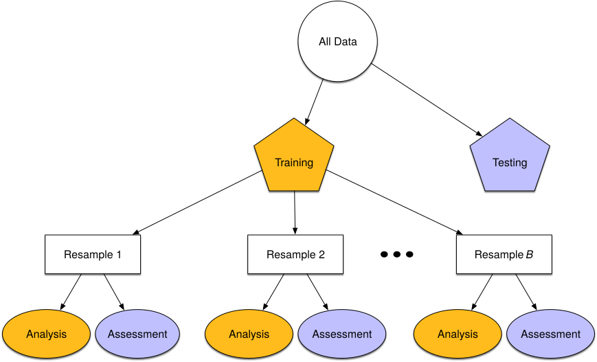

```{r}
#| label: setup
#| include: false
#| eval: true
library(tidyverse)
library(tidymodels)
```

<!-- INTERNO (6-nov-2026). Anexo nuevo del T07, según el plan (rondas 3 a 6): la validación cruzada anidada con
`figure/resampling.svg` (comentada en el deck viejo) y el código de `nested_cv()` con sus tiempos (verificados el
6-nov-2026 con el flujo del deck, semilla 12345678); la tabla tidymodels / scikit-learn; y las funciones viejas
de `notes/Tema07/cambios-tidymodels.md` §5 y §6. El 11-nov-2026 se recalcularon las cifras que dependen de la partición
del deck, que pasó a `prop = 0.8`: 364 y 340, 11,0 s, 20,0 y 31,6, 0,25 y 0,75, 1 de 10 bloques. -->

## Esto es material de consulta

- Lo que hay aquí amplía el [Tema 07](Tema07.html): las dos capas de elegir y evaluar, la comparación con `cv.glmnet()` del Tema 06, la correspondencia con scikit-learn en Python, los errores más frecuentes y otros pasos de receta

- Se consulta cuando hace falta en un trabajo; en clase no se ve

# Elegir y evaluar

## Dos capas

::: {style="font-size: 90%;"}

:::: {.columns}
::: {.column width=55%}

{width=100% fig-align="center"}

:::
::: {.column width=45%}

- Elegir $\lambda$ y evaluar el modelo elegido son **dos usos** de los datos, y piden dos capas

- En el tema, la capa de fuera es **una** partición (`initial_split()`): la prueba se usa una vez. Dentro del entrenamiento, los bloques (`vfold_cv()`) eligen $\lambda$

- Es el esquema de la figura: cada remuestra tiene una parte de **análisis**, con la que se estima, y otra de **evaluación**, en la que se mide

- La capa de fuera también puede ser una validación cruzada en lugar de `initial_split()`: es la validación cruzada **anidada**

:::
::::

:::

::::{.notes}
- Figura de tmwr §10.2. Nombres: `training`/`testing` para la partición inicial, `analysis()`/`assessment()` para cada remuestra; `nested_cv()` llama igual a los dos niveles y guarda los internos en la columna `inner_resamples`.
- Con la validación cruzada anidada, el promedio externo estima el error del **procedimiento completo**, elección de $\lambda$ incluida, sin sesgo de optimización. Fuentes: artículo «Nested resampling» de tidymodels.org; Cawley y Talbot (2010, *JMLR*); Varma y Simon (2006); ejemplo «Nested versus non-nested cross-validation» de scikit-learn.
- Cómo se haría con `nested_cv()`, con el código, las cifras de `tienda` y transparencias: `notes/Tema07/validacion-anidada.qmd`.
::::

# Del Tema 06 a `tidymodels`

## Los mismos pasos con `cv.glmnet()`

::: {style="font-size: 74%;"}

| Paso | Tema 06, con `glmnet` | Tema 07, con `tidymodels` |
|---|---|---|
| Partir | `sample()` (Tema 05) | `initial_split()` |
| Bloques | `nfolds` dentro de `cv.glmnet()` | `vfold_cv()` |
| Preprocesado, modelo y flujo | `model.matrix()` y `glmnet(x, y, alpha)` | fórmula o `recipe()`, `linear_reg()` y `workflow()` |
| Afinar | `cv.glmnet()`, `plot()`, `lambda.min`, `lambda.1se` | `tune_grid()`, `autoplot()`, `select_best()`, `select_by_one_std_err()` |
| Finalizar y evaluar | `coef(cv, s = )`, `predict()` | `finalize_workflow()`, `last_fit()`, `collect_metrics()` |
| Métricas | a mano | `rmse()`, `mae()`, `roc_auc()`, `sens()`... |

- En el Tema 06, `cv.glmnet()` hizo los bloques sobre los 404 clientes y midió el error del $\lambda$ elegido en esos mismos bloques: es optimista, porque $\lambda^*$ se eligió por dar el mínimo (**sesgo de optimización**), y no quedaba prueba para evaluar
- Lo que `cv.glmnet()` daba en `cvm` y `cvsd` es `mean` y `std_err` de `collect_metrics()`; `plot(cv)` es `autoplot()`, con el eje en $-\log(\lambda)$, así que la U sale al revés
- Con `cv.glmnet()` sobre los 404 clientes, $\lambda$ salía 21,3 y 37,2 (mínimo y un error estándar); en el Tema 07, con solo el entrenamiento, 20,0 y 31,6

:::

# `tidymodels` y scikit-learn

## La misma gramática en Python

::: {style="font-size: 70%;"}

- En Python, lo equivalente a `tidymodels` es scikit-learn. La lógica es idéntica y cambian los nombres:

| Paso | `tidymodels` (R) | scikit-learn (Python) |
|---|---|---|
| Partir | `initial_split(prop = 0.8)` | `train_test_split(test_size = 0.2)` |
| Bloques | `vfold_cv(v = 10)`, `strata =` | `KFold(10)`, `StratifiedKFold(10)` |
| Preprocesado que aprende | `recipe()`, `step_normalize()`, `prep()`, `bake()` | `StandardScaler()`, `.fit()`, `.transform()` |
| Modelo | `linear_reg(penalty, mixture = 1)` con `glmnet` | `Lasso(alpha)`; `LogisticRegression(penalty = "l1", C)` |
| Flujo | `workflow(receta, modelo)` | `Pipeline([("sc", StandardScaler()), ("m", Lasso())])` |
| Rejilla y afinado | `grid_regular()`, `tune_grid(grid, metrics)` | `GridSearchCV(param_grid, cv, scoring)` |
| Mejor y reajuste | `select_best()`, `finalize_workflow()`, `last_fit()` | `best_params_`, `refit = True`, `.score(X_test, y_test)` |
| Métricas | `rmse()`, `roc_auc()`, `sens()` | `mean_squared_error`, `roc_auc_score`, `recall_score` |
| Camino de $\lambda$ barato | `cv.glmnet()` (Tema 06) | `LassoCV`, `LogisticRegressionCV` |
:::

::::{.notes}
- Diferencias que importan: scikit-learn no trae la regla de un error estándar; `LogisticRegression` parametriza con $C = 1/\lambda$ y regulariza por defecto; los hiperparámetros de un paso del `Pipeline` se nombran `paso__parametro` (`m__alpha`); el `Pipeline` dentro de `GridSearchCV` evita la fuga de información igual que la receta dentro del flujo.
- Fuentes: guías oficiales de scikit-learn (`model_selection`, `grid_search`, `compose`). Comprobado el 6-nov-2026 que en CRAN no hay una réplica de la API de scikit-learn; `reticulate` permite llamarla desde R.
::::

# Errores frecuentes y otros pasos de receta

## Errores frecuentes

::: {style="font-size: 95%;"}

| Cuidado con | Qué pasa | Cómo evitarlo |
|---|---|---|
| El orden de los niveles de un factor, p.e. `churn` con «No» y «Sí» en orden alfabético | Las métricas toman el primer nivel como el suceso: el AUC sale 0,25 en vez de 0,75 | Fijar el orden antes de partir: `factor(churn, levels = c("Sí", "No"))` |
| Crear un factor dentro de la fórmula, p.e. `factor(educ)` | Falla en los bloques donde falta algún nivel | Crearlo antes de partir: `mutate(educ = factor(educ))` |
| Elegir sin decir la métrica, p.e. `select_best(ajuste)` | Avisa y elige con la primera métrica | `select_best(ajuste, metric = "rmse")` |
| Evaluar sin decir las métricas, p.e. `last_fit()` sin `metrics` | Calcula las de por defecto, que pueden no ser las usadas al afinar | `last_fit(..., metrics = metric_set(roc_auc, accuracy))` |

:::

## Otros pasos de receta

::: {style="font-size: 85%;"}

- **Valores ausentes** ([Tema 04](Tema04.html#/ausentes-y-qué-hacemos)): dos salidas, cada una con sus problemas
  - quitar las filas, con `drop_na()` antes de partir
  - imputar, con un paso de la receta: el valor de relleno se aprende en el entrenamiento
  - hay muchas formas de imputar: media (`step_impute_mean()`), mediana, moda, regresión (`step_impute_linear()`), observaciones parecidas (`step_impute_knn()`)...

- `step_dummy()` quita por defecto una categoría, la de referencia, como en la regresión
  - otros modelos usan una columna por categoría: `step_dummy(one_hot = TRUE)`

- `step_normalize()` deja cada variable con media 0 y desviación típica 1, las del entrenamiento
  - algunos motores, como `glmnet`, ya estandarizan por dentro

- `step_other()` junta en «other» las categorías con pocos casos

- `step_nzv()` y `step_corr()` quitan variables casi constantes o muy correlacionadas

:::

- Todos los pasos: <https://recipes.tidymodels.org/reference/>

::::{.notes}
- Todo verificado el 6-nov-2026, y las cifras de `tienda` y `churn` de nuevo el 11-nov-2026, con las versiones del curso: tidymodels 1.5.0, recipes 1.4.0, dials 1.4.4, tune 2.1.0, rsample 1.3.2, yardstick 1.4.0, glmnet 5.0.
- Las funciones antiguas y sus sustitutas, para el profesor: `notes/Tema07/cambios-tidymodels.md`.
::::
