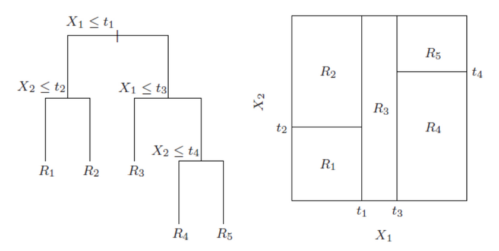

```{r}
#| label: setup
#| include: false
#| eval: true
library(tidyverse)
library(tidymodels)
```

<!-- INTERNO (7-nov-2026). Anexo nuevo del T08: lo que no cabe en dos sesiones y no usa ningún tema posterior
(comprobado con grep en Tema09-11, Taller-proyecto y evaluacion2627: usan decision_tree, rand_forest, boost_tree,
cost_complexity, mtry e importancia, que están en el deck). Cifras verificadas el 7-nov-2026 con los mismos objetos
del deck (semilla 12345678, 80/20, 10 bloques; rehechas el 16-nov-2026 con la partición del T07 nuevo). Naive Bayes, SVM, redes y el código viejo salieron el 22-nov-2026 (Pedro: el anexo solo amplía el tema; el código
ajeno va a las notas de cada transparencia del deck). Las otras familias pasaron al anexo del T09. -->

## Esto es material de consulta

- Lo que hay aquí amplía el [Tema 08](Tema08.html)

- Se consulta cuando hace falta en un trabajo; en clase no se ve

# Árboles

## Las partes de un árbol y cómo se construye

::: {style="font-size: 86%;"}

:::: {.columns}
::: {.column width=50%}

{width=100% fig-align="center"}

:::
::: {.column width=50%}

- Los árboles se dibujan al revés: la **raíz**, con todas las observaciones, arriba

- Los puntos donde se divide el espacio son los **nodos internos**, y se unen por **ramas**

- Las **hojas** o nodos terminales, abajo, son las regiones finales

:::
::::

- Se construye en dos pasos:
  1. se divide el espacio de los regresores $X_1, X_2, \dots, X_p$ en $J$ regiones distintas y sin solapamiento, $R_1, R_2, \dots, R_J$, cada vez más homogéneas o «puras»
  2. a cada observación que cae en la región $R_j$ se le predice lo mismo: la media de $y$ de las observaciones de entrenamiento en $R_j$, $\hat y_{i \in R_j} = \bar y_{R_j}$, o su clase mayoritaria

:::

::::{.notes}
- Del deck del curso pasado (`legacy2025-26/Tema08.qmd`, «Árboles de decisión» y «Árboles de regresión»). ISLR 2.ª ed. §8.1.1. La parte de «inviable» y «voraz» ya está en el deck.
::::

## Partición binaria recursiva: la formalización

::: {style="font-size: 88%;"}

1. Al principio, todas las observaciones pertenecen a una sola región

2. Se divide sucesivamente cada región en dos: $R_1(j,s) = \{X \mid X_j < s\}$ y $R_2(j,s) = \{X \mid X_j \geq s\}$
   - en cada nodo se consideran **todos** los regresores $X_j$ y **todos** los umbrales $s$
   - para cada par $(j, s)$ se calcula el error de predicción de esa partición:
   $$
   SCR_{j,s} = \sum_{i \in R_1(j,s)} (y_i - \bar y_{R_1})^2 + \sum_{i \in R_2(j,s)} (y_i - \bar y_{R_2})^2
   $$
   - se hace **una sola** partición en cada iteración: la del par $(j, s)$ con menor $SCR_{j,s}$

3. Se repite el proceso dentro de cada región de la iteración anterior

4. Se sigue hasta que se cumple un criterio de parada; por ejemplo, que ninguna región tenga más de cinco observaciones

:::

::::{.notes}
- Del deck del curso pasado (`legacy2025-26/Tema08.qmd`, «Partición binaria recursiva»). ISLR 2.ª ed. §8.1.1.
::::

## Entropía y tasa de error

::: {style="font-size: 88%;"}

- Tres medidas de la **pureza** de una región con proporciones $\hat p_{mk}$ de cada clase $k$:

| Medida | Fórmula | Para qué sirve |
|---|---|---|
| Tasa de error | $E_m = 1 - \max_k \hat p_{mk}$ | evaluar el árbol final |
| Índice de Gini | $G_m = \sum_k \hat p_{mk}(1 - \hat p_{mk})$ | crecer el árbol (`rpart`, por defecto) |
| Entropía | $D_m = -\sum_k \hat p_{mk} \log \hat p_{mk}$ | crecer el árbol (`C5.0`; `rpart` con `parms = list(split = "information")`) |

- Gini y entropía se parecen mucho y son más sensibles que la tasa de error: un corte que no cambia la clase mayoritaria de ninguna hija deja la tasa de error igual, pero sí baja Gini y entropía si las hijas son más puras

- Con la raíz de `churn` (60 % de abandonos): Gini 0,48 y entropía 0,67 (en *nats*, la unidad que da el logaritmo natural; con logaritmo en base 2 se mide en bits). Con el corte `satisfaccion < 3.5`, 0,45 y 0,64

:::

::::{.notes}
- ISLR §8.1.2. Verificado el 16-nov-2026 con los 479 clientes de entrenamiento: entropía de la raíz $-(0{,}603 \log 0{,}603 + 0{,}397 \log 0{,}397) = 0{,}672$; tras el corte, media ponderada 0,639 (Gini 0,448).
- Para pasar el criterio a `rpart` desde `parsnip`: `set_engine("rpart", parms = list(split = "information"))`.
::::

# Bagging

## El error *out-of-bag*

::: {style="font-size: 88%;"}

- Cada remuestra bootstrap se saca **con reemplazamiento**: unas observaciones salen repetidas y otras no salen
  - la probabilidad de que una observación no salga en $n$ extracciones es $(1 - 1/n)^n \approx e^{-1} \approx 0{,}37$: de media, un tercio queda fuera de cada remuestra (*out-of-bag*, OOB)

- Para cada observación se promedian solo los árboles que **no** la vieron, y se compara con su valor real

- Es una estimación del error sin apartar bloques: con $B$ grande equivale a un tipo de validación cruzada, la *leave-one-out*

- `ranger` lo guarda en `$prediction.error` (MSE en regresión, tasa de error en clasificación)

- En el curso se sigue usando la validación cruzada, porque es la misma para todos los modelos y permite afinar los hiperparámetros con `tune_grid()`

::: {style="font-size: 75%;"}
<details>
<summary>Código</summary>

```{r}
#| eval: true
tienda <- read_csv("data/tienda.csv") |>
  mutate(zona = factor(zona, levels = c("pueblo", "ciudad", "capital")),
         educ = factor(educ))
set.seed(12345678)
part <- initial_split(tienda, prop = 0.8)
set.seed(12345678)
bosque <- rand_forest(mtry = 6, trees = 500, min_n = 5) |>
  set_engine("ranger") |> set_mode("regression") |> fit(ventas ~ ., data = training(part))
sqrt(extract_fit_engine(bosque)$prediction.error)     # RMSE out-of-bag
```

</details>
:::

:::

::::{.notes}
- ISLR §8.2.1 (*out-of-bag error estimation*). Verificado el 16-nov-2026: `prediction.error` con mtry 6, 500 árboles y `set.seed(12345678)`: RMSE 446,2. Que se parezca al de prueba (434,8) es casualidad: el OOB, como la validación cruzada, sirve para elegir; la prueba, para evaluar.
- Las importancias por permutación de `ranger` también se calculan con las observaciones OOB de cada árbol.
::::

## Bagging: el número de árboles

::: {style="font-size: 88%;"}

- Con la tienda (`mtry = 6`, que es bagging), el RMSE de prueba según el número de árboles:

| Árboles ($B$) | 10 | 100 | 500 | 2.000 |
|---|---:|---:|---:|---:|
| RMSE de prueba | 445 | 434 | 435 | 437 |

- Añadir árboles no sobreajusta: solo estabiliza el promedio y cuesta tiempo

:::

::::{.notes}
- Verificado el 16-nov-2026 con `rand_forest(mtry = 6, trees = B, min_n = 5)`, motor `ranger` y `set.seed(12345678)` antes de cada ajuste: 445,0, 433,9, 434,8 y 437,2 euros en prueba. Venía del deck.
::::

# Boosting

## El boosting a mano: tres iteraciones

<!-- INTERNO (23-nov-2026). Venía del deck: Pedro, «tal como está explicado no hay Dios que lo entienda; el
código, ininteligible». Al anexo este curso; rehacerlo en la rama curso-2027-28. -->

::: {style="font-size: 82%;"}

:::: {.columns}
::: {.column width=60%}

```{r}
#| eval: true
f   <- rep(mean(training(part)$ventas),
           nrow(training(part)))
eta <- 0.1
for (b in 1:3) {
  datos_b <- training(part) |>
    mutate(r = ventas - f) |> select(-ventas)
  g <- decision_tree(tree_depth = 2,
                     cost_complexity = 0) |>
    set_engine("rpart") |> set_mode("regression") |>
    fit(r ~ ., data = datos_b)
  f <- f + eta * predict(g, datos_b)$.pred
}
```

- Seis líneas con lo que ya sabemos: el bucle `for` del Tema 05 y `decision_tree()`
  - cada vuelta ajusta un árbol de profundidad 2 a los **residuos** `r` y suma una décima de su predicción

- En la primera vuelta el árbol corta por `mujer`, que es donde más residuo queda; en la segunda y la tercera también, porque solo se ha corregido una décima parte de la diferencia por sexo

:::
::: {.column width=40%}

| Iteración | RMSE en entrenamiento |
|---:|---:|
| 0 (la media) | 1.179 |
| 1 | 1.105 |
| 2 | 1.042 |
| 3 | 987 |
| 50 | 392 |
| 200 | 263 |

- Con $\eta = 0{,}1$ hacen falta decenas de árboles para acercarse a los datos; a partir de ahí, cada árbol nuevo persigue residuos cada vez más parecidos al ruido

- `xgboost` hace esto mismo, mucho más rápido y con mejoras: por eso `boost_tree()`

:::
::::

:::

::::{.notes}
- Verificado el 16-nov-2026: desviación típica de las ventas de entrenamiento 1.179; RMSE tras 1, 2, 3, 10, 50, 100, 200 y 300 iteraciones: 1.105, 1.042, 987, 744, 392, 305, 263 y 237. Primer corte de los árboles: `mujer` en las tres primeras y en la 50, `edad` en la 10, la 100 y la 200, `renta` en la 300.
- `cost_complexity = 0` para que el árbol de los residuos no se niegue a cortar cuando la mejora relativa es pequeña.
- Lo que hace `xgboost` además: la pérdida se aproxima con segundas derivadas, cada hoja lleva su propia penalización (como la poda), y se puede submuestrear filas (`sample_size`) y columnas (`mtry`) en cada árbol.
::::

# Interpretación

## Interpretar un modelo que no se lee

- La importancia dice qué variables usa el modelo; otras dos herramientas dicen **cómo** las usa:
  - **gráfico de dependencia parcial** (*partial dependence plot*, PDP): la predicción media del modelo cuando a todos los clientes se les pone el mismo valor de $X_j$, dibujada contra $X_j$. Con la tienda, la curva de la edad que el bosque ha aprendido
  - **valores de Shapley**: reparten la predicción de **un** cliente entre sus variables, como un reparto de un juego cooperativo. Dicen por qué ese cliente concreto tiene esa predicción

- En R, `DALEX` y `iml` lo hacen con cualquier flujo de `tidymodels`; en Python, `shap`

- Ninguna de las dos convierte una predicción en un efecto causal: describen el modelo, y el modelo describe correlaciones en los datos de entrenamiento

::::{.notes}
- Friedman (2001) para los PDP; Lundberg y Lee (2017) para SHAP. tmwr, capítulo *Explaining models and predictions*. `vip` se retiró de CRAN en julio de 2026; `DALEX` e `iml` siguen.
- Un PDP con variables correlacionadas evalúa el modelo en combinaciones que no existen (clientes de 20 años con renta de jubilado); los *accumulated local effects* (ALE) lo corrigen.
::::

# `tidymodels` y scikit-learn

## Los mismos modelos en Python

::: {style="font-size: 76%;"}

| Modelo | `tidymodels` (R) | scikit-learn (Python) |
|---|---|---|
| Árbol | `decision_tree(cost_complexity, tree_depth, min_n)`, motor `rpart` | `DecisionTreeRegressor(ccp_alpha, max_depth, min_samples_split)` |
| Dibujarlo | `rpart.plot(extract_fit_engine(ajuste))` | `plot_tree(modelo)` |
| Bosque | `rand_forest(mtry, trees, min_n)`, motor `ranger` | `RandomForestRegressor(max_features, n_estimators, min_samples_leaf)` |
| Importancia | `set_engine("ranger", importance = "permutation")` | `permutation_importance(modelo, X, y)`; `feature_importances_` (impureza) |
| Error OOB | `$prediction.error` | `oob_score = True`, `oob_score_` |
| Boosting | `boost_tree(trees, tree_depth, learn_rate)`, motor `xgboost` | `GradientBoostingRegressor(n_estimators, max_depth, learning_rate)`; `xgboost.XGBRegressor` |
| Dummies para `xgboost` | `step_dummy(all_nominal_predictors())` | `OneHotEncoder` en un `ColumnTransformer`, o `enable_categorical = True` |
| Afinar | `tune_grid()` con `vfold_cv()` | `GridSearchCV(cv = 10)` |

- La lógica es la del Tema 07: partir, afinar con validación cruzada dentro del entrenamiento, reajustar y evaluar una vez
  - cambian los nombres de los hiperparámetros, y poco más

:::

::::{.notes}
- `max_features` de scikit-learn es `mtry` como fracción o como `"sqrt"`; `min_samples_leaf` limita el tamaño de la hoja y `min_samples_split` el del nodo que se parte (`min_n` de `rpart` es `minsplit`). `ccp_alpha` es el coste de complejidad en la escala absoluta de la SCR, y `rpart` lo mide como fracción de la SCR total.
- Fuentes: guías de scikit-learn (`tree`, `ensemble`, `inspection`). Comprobado el 7-nov-2026.
::::
